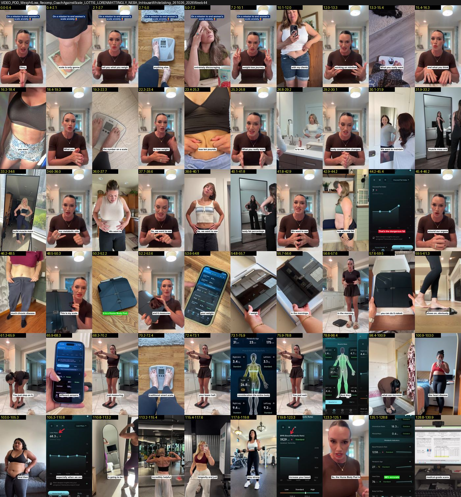

# VIDEO_POD_WeightLoss_Recomp_CoachAgainstScale_LOTTIE_LORENMATTINGLY_NEBA_InHouseWhitelisting_261026_2026Week44

Master: `VIDEO_POD_WeightLoss_Recomp_CoachAgainstScale_LOTTIE_LORENMATTINGLY_NEBA_InHouseWhitelisting_261026_2026Week44_Hook1_9x16.mp4` · 152.3s · 1080x1920

**Pacing:** 72 shots · avg 2.116s · median 1.817s · 4.66 cuts/10s · first cut 0.433s · 196.0 wpm · talk ratio 0.98 · cuts on word start 74.6% · cuts in speech gaps 49.3%
**Audio:** {'I_lufs': -19.0, 'LRA': 3.5, 'true_peak_db': -1.8} · BPM≈172.3 · music {'speech_rms_db': -24.6, 'pause_seconds': 0.9, 'pause_rms_db': -23.1, 'bed_minus_voice_db': 1.5, 'music_bed_likely': True} · cuts with SFX/transient 54.9%

**Captions:** 436 cards · 1.0 words/card (median) · y≈0.744 of frame height · text height≈0.0258 · colours {'white': 265, 'dark/other': 152, 'red': 1, 'blue': 12, 'green': 5, 'yellow': 1} · cards crossing a cut: 2
Highlighted: That'sthe dangerousfat, Body, It is a Hume Body Pod, Fat Mass, Body, Hume, BodyCompositlonFundamentals, Low, High, Body, Fat(%), Standard, Standal, andard, Charts
**Headlines:** On a mission to end women's (0.0–8.0s, white) | scaleanxiety (0.0–8.0s, white) | TANITA (21.0–22.0s, white) | HumePod (44.0–45.0s, white) | StepOnScale (44.0–45.0s, green) | VisceralFatIndex (44.0–45.0s, dark/other) | Updated:Today (44.0–45.0s, dark/other) | 4:28 (54.0–54.0s, blue)

**Hook (0–3s) spoken:** Okay, a traditional scale is only gonna tell you what you weigh. It doesn't
**Hook on-screen:** It doesn't tell you / Okay, / On a mission to end women's / atraditional / scaleanxiety / scaleisonlygonna / tell you what you weigh.
**CTA (last 5s):** use that for this purchase which is also fantastic. So I'll leave that link here. · on-screen: 1426 / 50%OFFWITHCODE:LAST50 / HumeHealth.com / So I'll leave / XHume / forthispurchase, / thatlinkhere. / whichisalsofantastic.

## Beat sheet

| # | in–out (s) | dur | transition | spoken | on-screen text |
|---|---|---|---|---|---|
| 1 | 0.00–0.43 | 0.43 |  | Okay, | On a mission to end women's (HEADLINE) / scaleanxiety (HEADLINE) / Okay, |
| 2 | 0.43–2.13 | 1.7 | cut +SFX hit | a traditional scale is only gonna tell you | On a mission to end women's (HEADLINE) / scaleanxiety (HEADLINE) / Okay, / atraditional / scaleisonlygonna / tell you what you weigh. |
| 3 | 2.13–2.73 | 0.6 | cut +SFX hit | what you weigh. | On a mission to end women's (HEADLINE) / scaleanxiety (HEADLINE) / tell you what you weigh. / It doesn't tell you |
| 4 | 2.73–4.97 | 2.23 | cut | It doesn't tell you anything else and that can be | On a mission to end women's (HEADLINE) / scaleanxiety (HEADLINE) / It doesn't tell you / TAROITA / anything else. / And that can be |
| 5 | 4.97–7.23 | 2.27 | cut +SFX hit | extremely discouraging, especially when | On a mission to end women's (HEADLINE) / scaleanxiety (HEADLINE) / And that can be / extremelydiscouraging, / especiallywhenyou |
| 6 | 7.23–10.07 | 2.83 | cut | you are on a weight loss journey. I spend a lot | On a mission to end women's (HEADLINE) / scaleanxiety (HEADLINE) / especiallywhenyou / weight-loss journey. / I spent / a lot of time |
| 7 | 10.07–12.00 | 1.93 | cut | of time with my clients, | a lot of time / with my clients |
| 8 | 12.00–13.30 | 1.3 | cut +SFX hit | working on mindset around | working on mindset |
| 9 | 13.30–15.43 | 2.13 | cut +SFX hit | the scale. What you really want and | working on mindset / SALTER / What you really want |
| 10 | 15.43–16.30 | 0.87 | cut +SFX hit | what you | SALTER / What you really want / and what you think |
| 11 | 16.30–18.40 | 2.1 | cut | think you want can be two different things. | and what you think / you want / two different things. |
| 12 | 18.40–19.33 | 0.93 | cut | What you think you | two different things. / think you want |
| 13 | 19.33–22.30 | 2.97 | cut +SFX hit | want is to see the number on a scale come down. | think you want / TANOTA / is to see / TANITA (HEADLINE) / the number on a scale / come down. |
| 14 | 22.30–23.43 | 1.13 | cut | You just wanna lose weight. | TANITA (HEADLINE) / come down. / to lose weight |
| 15 | 23.43–25.27 | 1.83 | cut +SFX hit | You wanna lose 10 pounds, 20 pounds, 30 pounds. | to lose weight / losetenpounds / thirty pounds. |
| 16 | 25.27–26.77 | 1.5 | cut | What you really want is | thirty pounds. / What you really want |
| 17 | 26.77–29.17 | 2.4 | cut | to see body composition changes. | is to see / body composition changes. |
| 18 | 29.17–30.10 | 0.93 | cut |  | body composition changes. / We want to maintain |
| 19 | 30.10–31.90 | 1.8 | cut +SFX hit | We want to maintain muscle | We want to maintain |
| 20 | 31.90–33.17 | 1.27 | cut +SFX hit | mass and build muscle | muscle mass and / build muscle mass |
| 21 | 33.17–34.57 | 1.4 | cut +SFX hit | mass to improve | build muscle mass / to improve |
| 22 | 34.57–36.00 | 1.43 | cut +SFX hit | our metabolic rate. We | ourmetabolicrate |
| 23 | 36.00–37.73 | 1.73 | cut | want to burn fat. | We want to / burn fat. |
| 24 | 37.73–38.57 | 0.83 | cut +SFX hit | So we want | So,we wantto see |
| 25 | 38.57–40.07 | 1.5 | cut +SFX hit | to see a lower body | So,we wantto see / body fat percentage. |
| 26 | 40.07–41.83 | 1.77 | cut +SFX hit | fat percentage. | body fat percentage. |
| 27 | 41.83–42.87 | 1.03 | cut | We want to see less | We want to see |
| 28 | 42.87–44.17 | 1.3 | cut | visceral fat. | lessvisceralfat / HumePod (HEADLINE) / StepOnScale [green] (HEADLINE) / VisceralFatIndex (HEADLINE) / Updated:Today (HEADLINE) / Feb |
| 29 | 44.17–45.37 | 1.2 | cut +SFX hit | That's the dangerous fat around | HumePod (HEADLINE) / StepOnScale [green] (HEADLINE) / VisceralFatIndex (HEADLINE) / Updated:Today (HEADLINE) / Feb / Mar |
| 30 | 45.37–46.23 | 0.87 | cut | our organs that | HumePod (HEADLINE) / StepOnScale [green] (HEADLINE) / VisceralFatIndex (HEADLINE) / Updated:Today (HEADLINE) / Feb / Mar |
| 31 | 46.23–48.53 | 2.3 | cut | causes so much chronic disease. | that causes so / muchchronicdisease |
| 32 | 48.53–50.33 | 1.8 | cut +SFX hit | This is my scale. | This is my scale / This is my scale. |
| 33 | 50.33–52.17 | 1.83 | cut +SFX hit | It is a Hume body pod and | This is my scale. / XHume / It is a Hume Body Pod [green] / anditmeasures |
| 34 | 52.17–53.60 | 1.43 | cut | it measures so | anditmeasures |
| 35 | 53.60–54.77 | 1.17 | cut +SFX hit | much more than your weight. I | 4:28 [blue] (HEADLINE) / HumePod [blue] (HEADLINE) / StepOn Scale [blue] (HEADLINE) / Android Reglon [blue] (HEADLINE) / FatMass [blue] (HEADLINE) / 8.5ibs (HEADLINE) |
| 36 | 54.77–55.73 | 0.97 | cut +SFX hit | weigh in the | I weigh |
| 37 | 55.73–56.57 | 0.83 | cut | mornings. | XHume (HEADLINE) / in the mornings, |
| 38 | 56.57–57.60 | 1.03 | cut | First thing in the morning, | in the morning |
| 39 | 57.60–59.53 | 1.93 | cut +SFX hit | you know, you can do it naked. | XHume / you can do it naked. / XHumo |
| 40 | 59.53–61.33 | 1.8 | cut | Don't have shoes on, obviously. | shoes on, obviously. |
| 41 | 61.33–65.93 | 4.6 | cut | You want bare feet on the scale. You just step on it and then you reach down and you pull up this handle. | shoes on, obviously. / bare feet on / You just step on it, / reach down and / this handle |
| 42 | 65.93–68.33 | 2.4 | cut | It has eight different sensors. | 10:08% [blue] (HEADLINE) / BodyPod [blue] (HEADLINE) / StepOn Scale [blue] (HEADLINE) / Weight [blue] (HEADLINE) / GoalWeight (HEADLINE) / 133.9ibs (HEADLINE) |
| 43 | 68.33–70.17 | 1.83 | cut +SFX hit | So it's not only just measuring like | 10:08 [blue] (HEADLINE) / Body Pod [blue] (HEADLINE) / BedyFat PefeeRtage [blue] (HEADLINE) / Bedy Fat Mass [blue] (HEADLINE) / Very High [red] (HEADLINE) / LeaRMass |
| 44 | 70.17–72.43 | 2.27 | cut +SFX hit | your traditional smart scale, your | TAANTA / like your / TANITA / traditional smart scale |
| 45 | 72.43–73.07 | 0.63 | cut | lower half, | TANITA / traditional smart scale / ntArm (HEADLINE) / LeftArm (HEADLINE) / 4kg (HEADLINE) / 3.1 kg (HEADLINE) |
| 46 | 73.07–75.87 | 2.8 | cut | but it takes into consideration the entire body because | ntArm (HEADLINE) / LeftArm (HEADLINE) / 4kg (HEADLINE) / 3.1 kg (HEADLINE) / indard / Standa |
| 47 | 75.87–78.77 | 2.9 | cut +SFX hit | of the handles. You just wait a few seconds and then it | because of the handles. / You just wait / and then it will |
| 48 | 78.77–98.43 | 19.67 | cut | will show up in your app. It shows your age, your metabolic age, which is really interesting. It also shows me my lean mass based on the different body parts and then you can swap over to fat percentage and see what that looks like as well. We want to see that we have lower levels of body fat percentage because the | Hume Pod (HEADLINE) / StepOnScale [green] (HEADLINE) / Age (HEADLINE) / Height (HEADLINE) / Metabolic Age (HEADLINE) / 157cm (HEADLINE) |
| 49 | 98.43–100.90 | 2.47 | cut +SFX hit | body fat is what can increase your risk for health | Hume Pod (HEADLINE) / Updated:Today (HEADLINE) / Body / StepOnScale [green] (HEADLINE) / 14/06 / 15/06 |
| 50 | 100.90–103.00 | 2.1 | cut +SFX hit | issues like heart disease and diabetes and | for health issues / and diabetes |
| 51 | 103.00–105.27 | 2.27 | cut | certain cancers. And then we also want to | and certain cancers. / And then / we also want to |
| 52 | 105.27–110.80 | 5.53 | cut +SFX hit | see that we are maintaining our lean muscle mass, especially when we are and a calorie deficit and | we also want to / HumePod (HEADLINE) / LeanMass (HEADLINE) / 68.3kg (HEADLINE) / Updated:Today (HEADLINE) / 70 |
| 53 | 110.80–113.20 | 2.4 | cut | that muscle mass is going to be incredibly | muscle mass / is going to be / incredibly helpful |
| 54 | 113.20–115.40 | 2.2 | cut +SFX hit | helpful as you maintain | incredibly helpful / as you maintain |
| 55 | 115.40–117.63 | 2.23 | cut | longevity and just stay | as you maintain / longevityand just |
| 56 | 117.63–119.80 | 2.17 | cut +SFX hit | strong throughout life as | stay strong / throughout life, |
| 57 | 119.80–123.30 | 3.5 | cut +SFX hit | well as helping you to increase your basal metabolic rate. So | HumePod (HEADLINE) / StepOnScale [green] (HEADLINE) / MetabolicIndicators (HEADLINE) / BasalMetabolicRate (HEADLINE) / 1929 (HEADLINE) / Standard (HEADLINE) |
| 58 | 123.30–125.13 | 1.83 | cut +SFX hit | the Hume body pod is | 1929 (HEADLINE) / Standard (HEADLINE) / BMR(BasalMetabolicRate) (HEADLINE) / cal (HEADLINE) / Updated:Yesterday (HEADLINE) / 1936 |
| 59 | 125.13–128.80 | 3.67 | cut | 98 % accurate compared to other medical | 2.3kg (HEADLINE) / Standard (HEADLINE) / Bone Mineral Content (HEADLINE) / Hydration&Minerals (HEADLINE) / BodyWaterPercentage (HEADLINE) / 55.5%+ (HEADLINE) |
| 60 | 128.80–130.93 | 2.13 | cut | grade scans and I put that | medical-grade scans. |
| 61 | 130.93–133.30 | 2.37 | cut +SFX hit | to the test because I just recently had an in -body | to the test / because Ijust recently / had an InBody scan |
| 62 | 133.30–134.67 | 1.37 | cut +SFX hit | scan at my doctor's office and | had an InBody scan / at my doctor's office, |
| 63 | 134.67–136.87 | 2.2 | cut +SFX hit | I compared the two and they were almost identical so | Body (HEADLINE) / Charts [blue] (HEADLINE) / BodyCompositionFundamentals (HEADLINE) / Weight (HEADLINE) / 185.3bs (HEADLINE) / Standard (HEADLINE) |
| 64 | 136.87–137.87 | 1.0 | cut +SFX hit | that was really cool. | So, that was |
| 65 | 137.87–139.10 | 1.23 | cut +SFX hit | I actually reached out to | 00. / I actually reached out / XHume / to Hume and asked |
| 66 | 139.10–140.87 | 1.77 | cut | human asked if they would give | XHume / to Hume and asked / if they would |
| 67 | 140.87–142.73 | 1.87 | cut +SFX hit | me a code and they did. | give me a code, / and they did. |
| 68 | 142.73–144.03 | 1.3 | cut +SFX hit | They are so generous and if | They were so generous. / HumePod (HEADLINE) / StepOnScale [green] (HEADLINE) / Weight (HEADLINE) / 50%OFFWITHCODE:LAST50 (HEADLINE) / Weignt (HEADLINE) |
| 69 | 144.03–148.07 | 4.03 | cut | you have an HSA or FSA benefit you can use that for | HumePod (HEADLINE) / StepOnScale [green] (HEADLINE) / Weight (HEADLINE) / 50%OFFWITHCODE:LAST50 (HEADLINE) / Weignt (HEADLINE) / HumeHealth.com (HEADLINE) |
| 70 | 148.07–149.93 | 1.87 | cut | this purchase which is also fantastic. | 50%OFFWITHCODE:LAST50 (HEADLINE) / HumeHealth.com (HEADLINE) / forthispurchase, / 1426 (HEADLINE) |
| 71 | 149.93–150.80 | 0.87 | cut |  | 50%OFFWITHCODE:LAST50 (HEADLINE) / HumeHealth.com (HEADLINE) / whichisalsofantastic. |
| 72 | 150.80–152.32 | 1.52 | cut +SFX hit | So I'll leave that link here. | 50%OFFWITHCODE:LAST50 (HEADLINE) / HumeHealth.com (HEADLINE) / XHume / So I'll leave / thatlinkhere. |

## Hook variants

| hook | file | dur | first cut | spoken 0–3s | on-screen 0–3s |
|---|---|---|---|---|---|
| 1 | `LY_NEBA_InHouseWhitelisting_261026_2026Week44_Hook1_9x16.mp4` | 152.3 | 0.433 | Okay, a traditional scale is only gonna tell you what you weigh. It doesn't | It doesn't tell you / Okay, / On a mission to end women's / atraditional / scaleanxiety / scaleisonlygonna / tell you what you weigh. |
| 2 | `LY_NEBA_InHouseWhitelisting_261026_2026Week44_Hook2_9x16.mp4` | 159.2 | 3.533 |  |  |
| 3 | `LY_NEBA_InHouseWhitelisting_261026_2026Week44_Hook3_9x16.mp4` | 155.1 | 8.267 |  |  |

## Full transcript

Okay, a traditional scale is only gonna tell you what you weigh. It doesn't tell you anything else and that can be extremely discouraging, especially when you are on a weight loss journey. I spend a lot of time with my clients, working on mindset around the scale. What you really want and what you think you want can be two different things. What you think you want is to see the number on a scale come down. You just wanna lose weight. You wanna lose 10 pounds, 20 pounds, 30 pounds. What you really want is to see body composition changes. We want to maintain muscle mass and build muscle mass to improve our metabolic rate. We want to burn fat. So we want to see a lower body fat percentage. We want to see less visceral fat. That's the dangerous fat around our organs that causes so much chronic disease. This is my scale. It is a Hume body pod and it measures so much more than your weight. I weigh in the mornings. First thing in the morning, you know, you can do it naked. Don't have shoes on, obviously. You want bare feet on the scale. You just step on it and then you reach down and you pull up this handle. It has eight different sensors. So it's not only just measuring like your traditional smart scale, your lower half, but it takes into consideration the entire body because of the handles. You just wait a few seconds and then it will show up in your app. It shows your age, your metabolic age, which is really interesting. It also shows me my lean mass based on the different body parts and then you can swap over to fat percentage and see what that looks like as well. We want to see that we have lower levels of body fat percentage because the body fat is what can increase your risk for health issues like heart disease and diabetes and certain cancers. And then we also want to see that we are maintaining our lean muscle mass, especially when we are and a calorie deficit and that muscle mass is going to be incredibly helpful as you maintain longevity and just stay strong throughout life as well as helping you to increase your basal metabolic rate. So the Hume body pod is 98% accurate compared to other medical grade scans and I put that to the test because I just recently had an in-body scan at my doctor's office and I compared the two and they were almost identical so that was really cool. I actually reached out to human asked if they would give me a code and they did. They are so generous and if you have an HSA or FSA benefit you can use that for this purchase which is also fantastic. So I'll leave that link here.