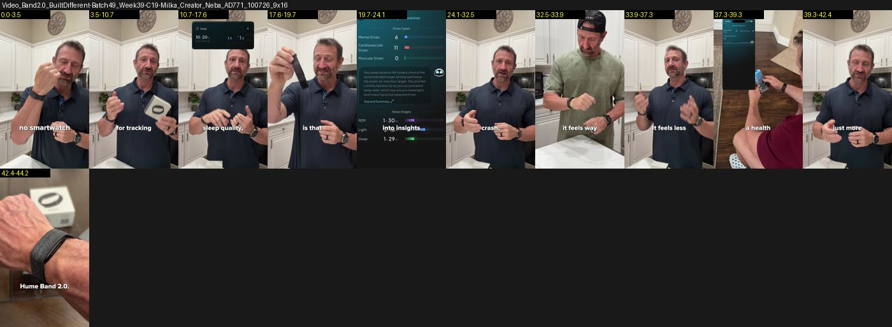

# Video_Band2.0_BuiltDifferent-Batch49_Week39-C19-Milka_Creator_Neba_AD771_100726_9x16

Master: `Video_Band2.0_BuiltDifferent-Batch49_Week39-C19-Milka_Creator_Neba_AD771_100726_Hook1_9x16.mp4` · 44.2s · 1080x1920

**Pacing:** 11 shots · avg 4.022s · median 3.433s · 2.26 cuts/10s · first cut 3.467s · 213.0 wpm · talk ratio 0.96 · cuts on word start 90.0% · cuts in speech gaps 70.0%
**Audio:** {'I_lufs': -21.2, 'LRA': 2.9, 'true_peak_db': -5.6} · BPM≈152.0 · music {'speech_rms_db': -24.8, 'pause_seconds': 0.0} · cuts with SFX/transient 50.0%

**Captions:** 75 cards · 1 words/card (median) · y≈0.722 of frame height · text height≈0.0363 · colours {'white': 69, 'dark/other': 4, 'red': 2} · cards crossing a cut: 0
Highlighted: a health, tool.
**Headlines:** 3:09元m (9.0–9.0s, white) | 88×VeryGood (10.0–10.0s, dark/other) | Stress Level (12.0–12.0s, white) | 30.0 (12.0–12.0s, white) | HRV (13.0–13.0s, white) | 67.2ms (13.0–13.0s, white) | Last:11/Mar/26 (13.0–13.0s, dark/other) | Sleep (14.0–14.0s, white)

**Hook (0–3s) spoken:** This wearable does something that no smartwatch or wearable can
**Hook on-screen:** This / does / no smartwatch / or wearable can do. / something that / wearable
**CTA (last 5s):** If you want deeper answers instead of just more data, I definitely check out the HumeBand 2 .0. · on-screen: Hume Band 2.0. / I'd definitely / data, / deeper answers

## Beat sheet

| # | in–out (s) | dur | transition | spoken | on-screen text |
|---|---|---|---|---|---|
| 1 | 0.00–3.47 | 3.47 |  | This wearable does something that no smartwatch or wearable can do. | This / wearable / does / something that / no smartwatch / or wearable can do. |
| 2 | 3.47–10.70 | 7.23 | cut | That's why the new HumeBand 2 .0 caught my attention. It's not just for tracking data, it's designed to actually explain what that data means. | or wearable can do / That's why / the new Hume Band 2.0 / HumeHealth / HumeBand Z.0 / caught my attention. |
| 3 | 10.70–17.63 | 6.93 | cut +SFX hit | It tracks things like recovery, stress, HRB, sleep quality, blood oxygen, skin temperature, and a ton of other health signals. | things / Stress Level (HEADLINE) / 30.0 (HEADLINE) / stress, / HRV (HEADLINE) / 67.2ms (HEADLINE) |
| 4 | 17.63–19.73 | 2.1 | cut +SFX hit | But what makes the difference is that the integration with | the difference / integration |
| 5 | 19.73–24.10 | 4.37 | cut | HumeAI connects it all together into insights that actually makes sense. | Yesterday's Resolution [blue] (HEADLINE) / Strain Types (HEADLINE) / MentalStrain (HEADLINE) / Cardiovascular (HEADLINE) / Strain (HEADLINE) / MuscularStrain (HEADLINE) |
| 6 | 24.10–32.50 | 8.4 | cut | So instead of staring at charts all day, you can understand things of like why your energy crash, why your recovery dropped, or why you even fell off after sleeping. And honestly, | So instead / at charts / understand / like why / crash, / recovery |
| 7 | 32.50–33.87 | 1.37 | cut | it feels way more useful than | it feels way |
| 8 | 33.87–37.30 | 3.43 | cut | just counting steps. It feels less like a fitness gadget and | counting / Itfeelsless / like a / fitness gadget |
| 9 | 37.30–39.30 | 2.0 | cut +SFX hit | more like a health intelligence tool. | fitness gadget / a health [red] / tool. [red] |
| 10 | 39.30–42.37 | 3.07 | cut +SFX hit | If you want deeper answers instead of just more data, I definitely check | tool. [red] / deeper answers / data, / I'd definitely |
| 11 | 42.37–44.24 | 1.88 | cut +SFX hit | out the HumeBand 2 .0. | I'd definitely / Hume Band 2.0. |

## Hook variants

| hook | file | dur | first cut | spoken 0–3s | on-screen 0–3s |
|---|---|---|---|---|---|
| 1 | `49_Week39-C19-Milka_Creator_Neba_AD771_100726_Hook1_9x16.mp4` | 44.2 | 3.467 | This wearable does something that no smartwatch or wearable can | This / does / no smartwatch / or wearable can do. / something that / wearable |
| 2 | `49_Week39-C19-Milka_Creator_Neba_AD771_100726_Hook2_9x16.mp4` | 45.5 | 1.867 | Smartwatches are great fitness tools, but this wearable is | HneBand20 / Smartwatches / are great / but this / fitness tools, / fitness tools. / wearable |
| 3 | `49_Week39-C19-Milka_Creator_Neba_AD771_100726_Hook3_9x16.mp4` | 44.0 | 3.2 | This does something no other wearable has figured out yet. | This does / no other / out yet. / something / wearable has |
| 3 | `49_Week39-C19-Milka_Creator_Neba_AD771_100726_Hook3_9x16.mp4` | 44.0 | 3.2 | This does something no other wearable has figured out yet. |  |

## Full transcript

This wearable does something that no smartwatch or wearable can do. That's why the new HumeBand 2.0 caught my attention. It's not just for tracking data, it's designed to actually explain what that data means. It tracks things like recovery, stress, HRB, sleep quality, blood oxygen, skin temperature, and a ton of other health signals. But what makes the difference is that the integration with HumeAI connects it all together into insights that actually makes sense. So instead of staring at charts all day, you can understand things of like why your energy crash, why your recovery dropped, or why you even fell off after sleeping. And honestly, it feels way more useful than just counting steps. It feels less like a fitness gadget and more like a health intelligence tool. If you want deeper answers instead of just more data, I definitely check out the HumeBand 2.0.