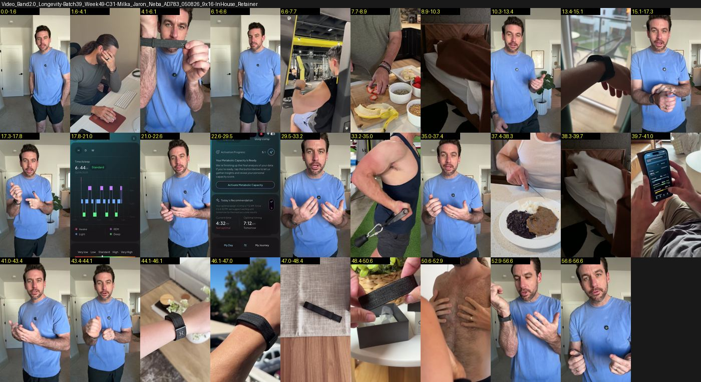

# Video_Band2.0_Longevity-Batch39_Week49-C31-Milka_Jaron_Neba_AD783_050826_9x16-InHouse_Retainer

Master: `Video_Band2.0_Longevity-Batch39_Week49-C31-Milka_Jaron_Neba_AD783_050826_9x16-InHouse_Retainer_Hook1.mp4` · 56.6s · 1080x1920

**Pacing:** 29 shots · avg 1.953s · median 1.669s · 4.94 cuts/10s · first cut 1.635s · 246.0 wpm · talk ratio 0.94 · cuts on word start 92.9% · cuts in speech gaps 82.1%
**Audio:** {'I_lufs': -16.8, 'LRA': 3.4, 'true_peak_db': 0.1} · BPM≈99.4 · music {'speech_rms_db': -21.7, 'pause_seconds': 0.0} · cuts with SFX/transient 78.6%

**Captions:** 79 cards · 1 words/card (median) · y≈0.69 of frame height · text height≈0.0234 · colours {'dark/other': 29, 'white': 49, 'green': 1} · cards crossing a cut: 0
Highlighted: Good
**Headlines:** Heart Rate (18.0–18.0s, white) | Range (18.0–18.0s, white) | 53-106bpm (18.0–18.0s, white) | High (18.0–18.0s, dark/other) | 07/Aug/26 (18.0–18.0s, dark/other) | Sleep (19.0–19.0s, white) | TimeAsleep (19.0–19.0s, white) | 6h44m (19.0–19.0s, white)

**Hook (0–3s) spoken:** What if everything that you think is keeping you young is actually aging
**Hook on-screen:** 
**CTA (last 5s):** to how you're aging, sooner you can get ahead of it. If you want to grab one while they're discounted, I left a link for you. · on-screen: 

## Beat sheet

| # | in–out (s) | dur | transition | spoken | on-screen text |
|---|---|---|---|---|---|
| 1 | 0.00–1.64 | 1.64 |  | What if everything that you think is keeping |  |
| 2 | 1.64–4.07 | 2.44 | cut +SFX hit | you young is actually aging you faster? |  |
| 3 | 4.07–6.11 | 2.04 | cut +SFX hit | Now you can find out just by wearing this. |  |
| 4 | 6.11–6.57 | 0.47 | cut +SFX hit | See, I train |  |
| 5 | 6.57–7.74 | 1.17 | cut +SFX hit | pretty regularly. |  |
| 6 | 7.74–8.94 | 1.2 | cut | I eat pretty decent and |  |
| 7 | 8.94–10.31 | 1.37 | cut +SFX hit | I get okay sleep. |  |
| 8 | 10.31–13.41 | 3.1 | cut +SFX hit | I thought I was crushing it. And then the Hume Band 2 .0, |  |
| 9 | 13.41–15.08 | 1.67 | cut +SFX hit | it told me that it wasn't so much. |  |
| 10 | 15.08–17.28 | 2.2 | cut +SFX hit | It told me that I was aging faster than I should be. |  |
| 11 | 17.28–17.78 | 0.5 | cut | You wear it |  |
| 12 | 17.78–21.02 | 3.24 | cut +SFX hit | and it tracks your heart rate, your sleep, your stress levels. | Heart Rate (HEADLINE) / Range (HEADLINE) / 53-106bpm (HEADLINE) / High (HEADLINE) / 07/Aug/26 (HEADLINE) / 9AM |
| 13 | 21.02–22.62 | 1.6 | cut +SFX hit | And every morning the app, it gives you |  |
| 14 | 22.62–29.50 | 6.87 | cut +SFX hit | scores that actually are helpful. Like your metabolic capacity, your metabolic momentum, an estimate of your biological age and | HealthReport (HEADLINE) / Feb9-Feb15 (HEADLINE) / HealthScore (HEADLINE) / 734 (HEADLINE) / Good [green] / 734 + |
| 15 | 29.50–33.20 | 3.7 | cut +SFX hit | what state of recovery you're in. Mine, it was not so good. | Older / Younger / yrs / BiologicalAge (HEADLINE) / yrs (HEADLINE) / Chronological Age |
| 16 | 33.20–35.00 | 1.8 | cut +SFX hit | It turns out I was overtraining. |  |
| 17 | 35.00–37.40 | 2.4 | cut +SFX hit | But luckily the app, it gave me a few things to do. |  |
| 18 | 37.40–38.30 | 0.9 | cut +SFX hit | More protein, |  |
| 19 | 38.30–39.67 | 1.37 | cut +SFX hit | a fixed sleep schedule, |  |
| 20 | 39.67–41.01 | 1.34 | cut +SFX hit | and a few more rest days. | 239.4m (HEADLINE) / 152.80 |
| 21 | 41.01–43.41 | 2.4 | cut +SFX hit | A few weeks later, my numbers totally turned around. |  |
| 22 | 43.41–44.14 | 0.73 | cut +SFX hit | Luckily for you, |  |
| 23 | 44.14–46.08 | 1.94 | cut | the Humband 2 .0 is still discounted for |  |
| 24 | 46.08–47.05 | 0.97 | cut +SFX hit | a little bit longer. |  |
| 25 | 47.05–48.41 | 1.37 | cut | There's no subscription fee. |  |
| 26 | 48.41–50.58 | 2.17 | cut +SFX hit | It's FSA and HSA eligible. |  |
| 27 | 50.58–52.92 | 2.33 | cut | The earlier you pay attention to how you're aging, |  |
| 28 | 52.92–56.59 | 3.67 | cut +SFX hit | sooner you can get ahead of it. If you want to grab one while they're discounted, I left a link for you. |  |
| 29 | 56.59–56.64 | 0.05 | cut |  |  |

## Hook variants

| hook | file | dur | first cut | spoken 0–3s | on-screen 0–3s |
|---|---|---|---|---|---|
| 1 | `Jaron_Neba_AD783_050826_9x16-InHouse_Retainer_Hook1_9x16.mp4` | 56.6 | 1.635 |  |  |
| 1 | `_Jaron_Neba_AD783_050826_9x16-InHouse_Retainer_Hook1_1x1.mp4` | 56.6 | 1.635 |  |  |
| 1 | `_Jaron_Neba_AD783_050826_9x16-InHouse_Retainer_Hook1_4x5.mp4` | 56.6 | 1.635 |  |  |
| 1 | `ilka_Jaron_Neba_AD783_050826_9x16-InHouse_Retainer_Hook1.mp4` | 56.6 | 1.635 | What if everything that you think is keeping you young is actually aging |  |
| 2 | `Jaron_Neba_AD783_050826_9x16-InHouse_Retainer_Hook2_9x16.mp4` | 56.6 | 5.339 |  |  |
| 2 | `_Jaron_Neba_AD783_050826_9x16-InHouse_Retainer_Hook2_1x1.mp4` | 55.8 | 5.339 |  |  |
| 2 | `_Jaron_Neba_AD783_050826_9x16-InHouse_Retainer_Hook2_4x5.mp4` | 56.6 | 5.339 |  |  |
| 2 | `ilka_Jaron_Neba_AD783_050826_9x16-InHouse_Retainer_Hook2.mp4` | 56.6 | 5.339 |  |  |
| 3 | `Jaron_Neba_AD783_050826_9x16-InHouse_Retainer_Hook3_9x16.mp4` | 58.0 | 1.935 |  |  |
| 3 | `_Jaron_Neba_AD783_050826_9x16-InHouse_Retainer_Hook3_1x1.mp4` | 58.0 | 1.935 |  |  |
| 3 | `_Jaron_Neba_AD783_050826_9x16-InHouse_Retainer_Hook3_4x5.mp4` | 58.0 | 1.935 |  |  |
| 3 | `ilka_Jaron_Neba_AD783_050826_9x16-InHouse_Retainer_Hook3.mp4` | 58.0 | 1.935 |  |  |

## Full transcript

What if everything that you think is keeping you young is actually aging you faster? Now you can find out just by wearing this. See, I train pretty regularly. I eat pretty decent and I get okay sleep. I thought I was crushing it. And then the Hume Band 2.0, it told me that it wasn't so much. It told me that I was aging faster than I should be. You wear it and it tracks your heart rate, your sleep, your stress levels. And every morning the app, it gives you scores that actually are helpful. Like your metabolic capacity, your metabolic momentum, an estimate of your biological age and what state of recovery you're in. Mine, it was not so good. It turns out I was overtraining. But luckily the app, it gave me a few things to do. More protein, a fixed sleep schedule, and a few more rest days. A few weeks later, my numbers totally turned around. Luckily for you, the Humband 2.0 is still discounted for a little bit longer. There's no subscription fee. It's FSA and HSA eligible. The earlier you pay attention to how you're aging, sooner you can get ahead of it. If you want to grab one while they're discounted, I left a link for you.