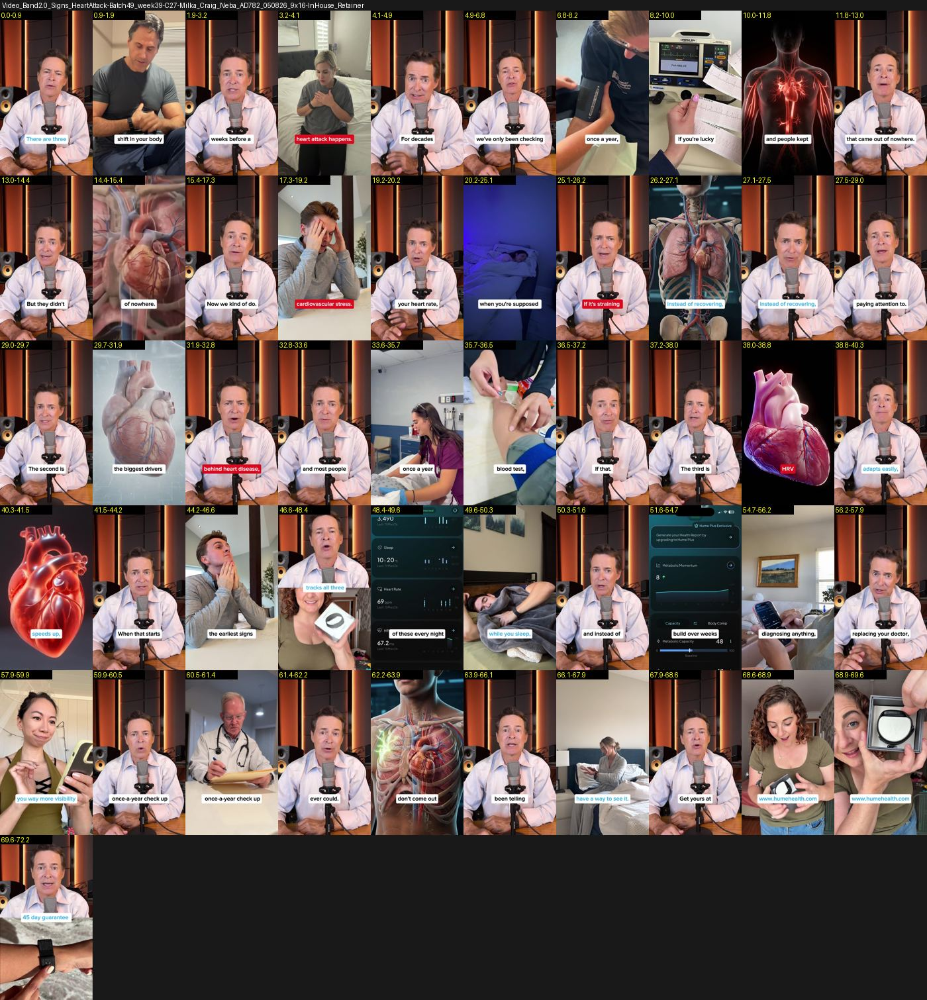

# Video_Band2.0_Signs_HeartAttack-Batch49_week39-C27-Milka_Craig_Neba_AD782_050826_9x16-InHouse_Retainer

Master: `Video_Band2.0_Signs_HeartAttack-Batch49_week39-C27-Milka_Craig_Neba_AD782_050826_9x16-InHouse_Retainer_Hook1_9x16.MP4` · 72.2s · 1080x1920

**Pacing:** 51 shots · avg 1.416s · median 1.266s · 6.92 cuts/10s · first cut 0.933s · 227.0 wpm · talk ratio 0.93 · cuts on word start 86.0% · cuts in speech gaps 64.0%
**Audio:** {'I_lufs': -19.4, 'LRA': 3.3, 'true_peak_db': -1.0} · BPM≈129.2 · music {'speech_rms_db': -23.4, 'pause_seconds': 0.6, 'pause_rms_db': -25.4, 'bed_minus_voice_db': -2.0, 'music_bed_likely': True} · cuts with SFX/transient 54.0%

**Captions:** 94 cards · 3.0 words/card (median) · y≈0.762 of frame height · text height≈0.0328 · colours {'blue': 15, 'white': 65, 'red': 8, 'dark/other': 6} · cards crossing a cut: 3
Highlighted: There are three, heartattackhappens, Medtrortic, having heart issues, cardiovascularstress., to be deep asleep, If it's straining, instead of recovering,, inflammation., behind heart disease,, HRV, adapts easily, slows down,, recovers., something's off.
**Headlines:** LIFEPAK200 (8.0–9.0s, white) | PushANALYZE (8.0–9.0s, white) | HumeBand(59%) (49.0–49.0s, white) | Connected (49.0–49.0s, green) | 3,490 (49.0–49.0s, white) | 4213 (49.0–49.0s, dark/other) | Last:11/Mar/26 (49.0–49.0s, dark/other) | Sleep (49.0–49.0s, white)

**Hook (0–3s) spoken:** There are three things that quietly shift in your body weeks before
**Hook on-screen:** There are three / shift in your body / things that quietly / weeks before a
**CTA (last 5s):** to see it. Get yours at humehealth .com, 45 day guarantee, and with 30 % off. · on-screen: 30%off! / 45dayguarantee / Get yours at / www.humehealth.com

## Beat sheet

| # | in–out (s) | dur | transition | spoken | on-screen text |
|---|---|---|---|---|---|
| 1 | 0.00–0.93 | 0.93 |  | There are three things that | There are three [blue] / things that quietly |
| 2 | 0.93–1.90 | 0.97 | cut +SFX hit | quietly shift in | things that quietly / shift in your body |
| 3 | 1.90–3.17 | 1.27 | cut +SFX hit | your body weeks before a | shift in your body / weeks before a / heartattackhappens [red] |
| 4 | 3.17–4.13 | 0.97 | cut | heart attack happens. | heartattackhappens [red] / Fordecades |
| 5 | 4.13–4.87 | 0.73 | cut +SFX hit | For decades, | Fordecades |
| 6 | 4.87–6.80 | 1.93 | cut | we've only been checking the wrong stuff. | Fordecades / we've only been checking / the wrong stuff, |
| 7 | 6.80–8.20 | 1.4 | cut +SFX hit | Blood pressure once a year, | ottingham / blood pressure / LIFEPAK200 (HEADLINE) / PushANALYZE (HEADLINE) / Medtrortic [blue] / maybe an EKG |
| 8 | 8.20–9.97 | 1.77 | cut +SFX hit | maybe an EKG if you're lucky, | LIFEPAK200 (HEADLINE) / PushANALYZE (HEADLINE) / Medtrortic [blue] / maybe an EKG / Medtronic / 52办：179 |
| 9 | 9.97–11.80 | 1.83 | cut +SFX hit | and people kept having heart issues that | and people kept / having heart issues [red] |
| 10 | 11.80–13.00 | 1.2 | cut +SFX hit | came out of nowhere. | that came out of nowhere. |
| 11 | 13.00–14.43 | 1.43 | cut | But they didn't actually come | But they didn't / actually come out |
| 12 | 14.43–15.37 | 0.93 | cut +SFX hit | out of nowhere. | actually come out / of nowhere. |
| 13 | 15.37–17.30 | 1.93 | cut | Now we kind of do. The first is | of nowhere. / Now we kind of do. / The first is |
| 14 | 17.30–19.20 | 1.9 | cut | overnight cardiovascular stress. | The first is / cardiovascularstress. [red] / Not just |
| 15 | 19.20–20.23 | 1.03 | cut | Not just your heart rate, | Not just / but how hard |
| 16 | 20.23–25.07 | 4.83 | cut | but how hard your heart's working at 3 AM when you're supposed to be deep asleep and recovering. | but how hard / your heart's working / when you're supposed / to be deep asleep [blue] / If it's straining [red] |
| 17 | 25.07–26.20 | 1.13 | cut +SFX hit | If it's straining every night | If it's straining [red] / every night |
| 18 | 26.20–27.13 | 0.93 | cut +SFX hit | instead of recovering, | every night / instead of recovering, [blue] |
| 19 | 27.13–27.50 | 0.37 | cut +SFX hit |  | instead of recovering, [blue] |
| 20 | 27.50–29.00 | 1.5 | cut | that's worth paying attention to. The | paying attention to. |
| 21 | 29.00–29.73 | 0.73 | cut | second is inflammation. | The second is |
| 22 | 29.73–31.93 | 2.2 | cut | It's one of the biggest drivers behind | inflammation. [red] / the biggest drivers |
| 23 | 31.93–32.83 | 0.9 | cut | heart disease. | behind heart disease, [red] |
| 24 | 32.83–33.57 | 0.73 | cut | And most people only | and most people |
| 25 | 33.57–35.70 | 2.13 | cut | get it checked once a year with a basic blood | only get it checked / blood test, |
| 26 | 35.70–36.53 | 0.83 | cut +SFX hit | test, if | blood test, |
| 27 | 36.53–37.20 | 0.67 | cut +SFX hit | that. | The third is |
| 28 | 37.20–37.97 | 0.77 | cut | The third is HRV. | The third is |
| 29 | 37.97–38.77 | 0.8 | cut | A | HRV [red] |
| 30 | 38.77–40.27 | 1.5 | cut +SFX hit | healthy heart adapts easily. | A healthy heart / adapts easily [blue] |
| 31 | 40.27–41.53 | 1.27 | cut | Speeds up, slows down, | adapts easily [blue] / slows down, [blue] |
| 32 | 41.53–44.20 | 2.67 | cut | recovers. When that starts declining over weeks, | recovers. [blue] / declining over weeks, / it's one of |
| 33 | 44.20–46.63 | 2.43 | cut +SFX hit | it's one of the earliest signs something's off. | it's one of / the earliest signs / something's off. [red] |
| 34 | 46.63–48.37 | 1.73 | cut +SFX hit | The Hume Band tracks all three of | The HumeBand [blue] / tracks all three [blue] |
| 35 | 48.37–49.57 | 1.2 | cut | these every night while you | tracks all three [blue] / HumeBand(59%) (HEADLINE) / Connected [green] (HEADLINE) / 3,490 (HEADLINE) / 4213 (HEADLINE) / Last:11/Mar/26 (HEADLINE) |
| 36 | 49.57–50.33 | 0.77 | cut | sleep. And instead | and instead of |
| 37 | 50.33–51.60 | 1.27 | cut +SFX hit | of one number a year, | and instead of / one number a year, |
| 38 | 51.60–54.70 | 3.1 | cut +SFX hit | you get to see the pattern build over weeks in your own data. It's | 3:09 (HEADLINE) / HealthScore (HEADLINE) / 730 (HEADLINE) / Good [green] (HEADLINE) / HumePlusExclusive / GenerateyourHealthReportby |
| 39 | 54.70–56.23 | 1.53 | cut +SFX hit | not diagnosing anything, | diagnosing anything, / and it's not |
| 40 | 56.23–57.90 | 1.67 | cut +SFX hit | and it's not replacing your doctor, | and it's not / replacing your doctor, |
| 41 | 57.90–59.87 | 1.97 | cut | but it's giving you way more visibility than | but it's giving / you way more visibility [blue] |
| 42 | 59.87–60.50 | 0.63 | cut +SFX hit | a once a | once-a-year check up |
| 43 | 60.50–61.43 | 0.93 | cut | year checkup ever | once-a-year check up / Blane Sd |
| 44 | 61.43–62.20 | 0.77 | cut +SFX hit | could. | once-a-year check up / Blane Sd / Heart attacks |
| 45 | 62.20–63.90 | 1.7 | cut +SFX hit | Heart attacks don't come out of nowhere. | Heart attacks / don't come out |
| 46 | 63.90–66.10 | 2.2 | cut | Your body's usually been telling you for weeks. | Your body's usually / been telling / now you actually |
| 47 | 66.10–67.90 | 1.8 | cut +SFX hit | Now you actually have a way to see it. | now you actually / have a way to see it. [blue] |
| 48 | 67.90–68.60 | 0.7 | cut +SFX hit | Get yours at humehealth | Get yours at |
| 49 | 68.60–68.87 | 0.27 | cut |  |  |
| 50 | 68.87–69.57 | 0.7 | cut +SFX hit | .com, | www.humehealth.com [blue] |
| 51 | 69.57–72.24 | 2.67 | cut +SFX hit | 45 day guarantee, and with 30 % off. | 45dayguarantee [blue] / 30%off! [blue] |

## Hook variants

| hook | file | dur | first cut | spoken 0–3s | on-screen 0–3s |
|---|---|---|---|---|---|
| 1 | `Craig_Neba_AD782_050826_9x16-InHouse_Retainer_Hook1_9x16.MP4` | 72.2 | 0.933 | There are three things that quietly shift in your body weeks before | There are three / shift in your body / things that quietly / weeks before a |
| 1 | `Craig_Neba_AD782_050826_9x16-InHouse_Retainer_Hook_1_4x5.mp4` | 72.2 | 0.933 | There are three things that quietly shift in your body weeks before a | There are three / shift in your body / things that quietly / weeks before a |
| 1 | `Craig_Neba_AD782_050826_9x16-InHouse_Retainer_Hook_1_1x1.mp4` | 72.2 | 0.933 | There are three things that quietly shift in your body weeks before a | There are three / shift in your body / things that quietly / weeksbeforea |
| 1 | `lka_Craig_Neba_AD782_050826_9x16-InHouse_Retainer_Hook_1.mp4` | 72.2 | 0.933 | There are three things that quietly shift in your body weeks before a |  |
| 2 | `Craig_Neba_AD782_050826_9x16-InHouse_Retainer_Hook2_9x16.MP4` | 69.9 | 2.167 | Your body usually starts sending signals, weeks before a heart |  |
| 2 | `Craig_Neba_AD782_050826_9x16-InHouse_Retainer_Hook_2_4x5.mp4` | 69.9 | 2.167 | Your body usually starts sending signals, weeks before a heart |  |
| 2 | `g_Neba_AD782_050826_9x16-InHouse_Retainer_Hook_2_1x1.mp4.mp4` | 69.9 | 2.167 | Your body usually starts sending signals, weeks before a heart | Your body usually / starts sending signals / weeksbefore |
| 2 | `lka_Craig_Neba_AD782_050826_9x16-InHouse_Retainer_Hook_2.mp4` | 69.9 | 2.167 | Your body usually starts sending signals, weeks before a heart |  |
| 3 | `raig_Neba_AD782_050826_9x16-InHouse_Retainer_Hook_3_9x16.mp4` | 71.0 | 1.633 | There are patterns that quietly build in your body weeks before something |  |
| 3 | `Craig_Neba_AD782_050826_9x16-InHouse_Retainer_Hook_3_4x5.mp4` | 71.0 | 1.633 | There are patterns that quietly build in your body weeks before something | There are patterns / in your body / something goeswrong / that quietly build / weeksbefore |
| 3 | `g_Neba_AD782_050826_9x16-InHouse_Retainer_Hook_3_1x1.mp4.mp4` | 71.0 | 1.633 | There are patterns that quietly build in your body weeks before something | Therearepatterns / in your body / somethinggoeswrong / that quietly build / weeksbefore |
| 3 | `lka_Craig_Neba_AD782_050826_9x16-InHouse_Retainer_Hook_3.mp4` | 71.0 | 1.633 | There are patterns that quietly build in your body weeks before something |  |

## Full transcript

There are three things that quietly shift in your body weeks before a heart attack happens. For decades, we've only been checking the wrong stuff. Blood pressure once a year, maybe an EKG if you're lucky, and people kept having heart issues that came out of nowhere. But they didn't actually come out of nowhere. Now we kind of do. The first is overnight cardiovascular stress. Not just your heart rate, but how hard your heart's working at 3 AM when you're supposed to be deep asleep and recovering. If it's straining every night instead of recovering, that's worth paying attention to. The second is inflammation. It's one of the biggest drivers behind heart disease. And most people only get it checked once a year with a basic blood test, if that. The third is HRV. A healthy heart adapts easily. Speeds up, slows down, recovers. When that starts declining over weeks, it's one of the earliest signs something's off. The Hume Band tracks all three of these every night while you sleep. And instead of one number a year, you get to see the pattern build over weeks in your own data. It's not diagnosing anything, and it's not replacing your doctor, but it's giving you way more visibility than a once a year checkup ever could. Heart attacks don't come out of nowhere. Your body's usually been telling you for weeks. Now you actually have a way to see it. Get yours at humehealth.com, 45 day guarantee, and with 30% off.