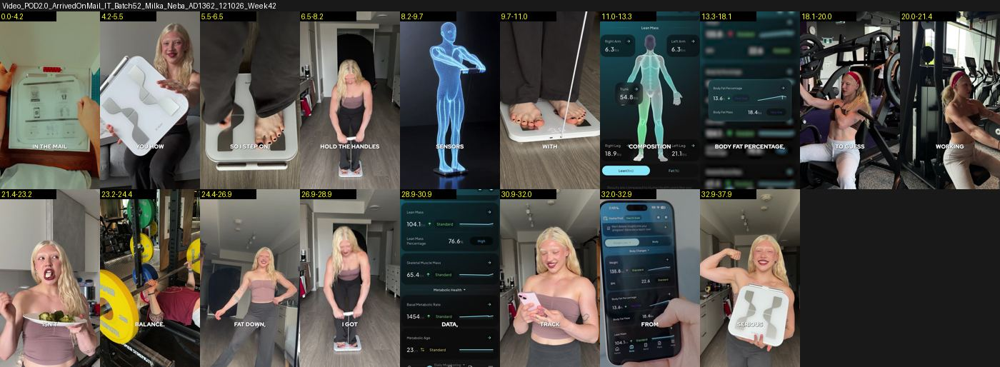

# Video_POD2.0_ArrivedOnMail_IT_Batch52_Milka_Neba_AD1362_121026_Week42

Master: `Video_POD2.0_ArrivedOnMail_IT_Batch52_Milka_Neba_AD1362_121026_Week42_9x16.mp4` · 37.9s · 1080x1920

**Pacing:** 18 shots · avg 2.104s · median 1.7s · 4.49 cuts/10s · first cut 4.233s · 221.0 wpm · talk ratio 0.91 · cuts on word start 88.2% · cuts in speech gaps 64.7%
**Audio:** {'I_lufs': -20.5, 'LRA': 1.9, 'true_peak_db': -4.6} · BPM≈107.7 · music {'speech_rms_db': -24.7, 'pause_seconds': 0.2} · cuts with SFX/transient 58.8%

**Captions:** 112 cards · 1.0 words/card (median) · y≈0.744 of frame height · text height≈0.0281 · colours {'white': 94, 'dark/other': 14, 'blue': 3, 'yellow': 1} · cards crossing a cut: 0
Highlighted: IT HAS, DIRECT, Lean(lbs), 35
**Headlines:** Age (11.0–11.0s, dark/other) | Metabolic Age (11.0–11.0s, white) | Height (11.0–11.0s, white) | 25yrs (11.0–11.0s, white) | 23yrs (11.0–11.0s, white) | 165cm (11.0–11.0s, white) | LeanMass (11.0–13.0s, white) | Right Arm (11.0–13.0s, white)

**Hook (0–3s) spoken:** My HumePod 2 .0 just arrived in the mail today.
**Hook on-screen:** 18888 / FRoHS / IN THE MAIL / JUST / MYHUMEPOD2.0 / TODAY.
**CTA (last 5s):** This is awesome, you guys. If you're serious about your fitness, you need one of these. · on-screen: FITNESS, / Hume / ONE OF / SERIOUS / THISISAWESOME, / YOU GUYS.

## Beat sheet

| # | in–out (s) | dur | transition | spoken | on-screen text |
|---|---|---|---|---|---|
| 1 | 0.00–4.23 | 4.23 |  | My HumePod 2 .0 just arrived in the mail today. This is so exciting. | MYHUMEPOD2.0 / FRoHS / 18888 / JUST / IN THE MAIL / TODAY. |
| 2 | 4.23–5.50 | 1.27 | cut +SFX hit | Let me show you how it works. | Hume / LETMESHOW / YOU HOW / IT WORKS. |
| 3 | 5.50–6.53 | 1.03 | cut +SFX hit | So I step on, | SOISTEPON, |
| 4 | 6.53–8.17 | 1.63 | cut +SFX hit | hold the handles and boom. | HOLDTHEHANDLES / IT HAS [blue] |
| 5 | 8.17–9.70 | 1.53 | cut | It has sensors in direct contact | IT HAS [blue] / DIRECT [blue] |
| 6 | 9.70–10.97 | 1.27 | cut +SFX hit | with your skin to | WITH |
| 7 | 10.97–13.33 | 2.37 | cut +SFX hit | measure your body composition in seconds. | Age (HEADLINE) / Metabolic Age (HEADLINE) / Height (HEADLINE) / 25yrs (HEADLINE) / 23yrs (HEADLINE) / 165cm (HEADLINE) |
| 8 | 13.33–18.07 | 4.73 | cut +SFX hit | See this? It tells me my muscle mass, body fat percentage, even my metabolic rate. | LeanMass (HEADLINE) / Right Arm (HEADLINE) / LeftArm (HEADLINE) / 6.31bs (HEADLINE) / Trunk / Right Leg |
| 9 | 18.07–20.03 | 1.97 | cut +SFX hit | So I never have to guess if my workout program | STAIRC (HEADLINE) / NEVERHAVE / TO GUESS / PROGRAM |
| 10 | 20.03–21.40 | 1.37 | cut | is working or not because | PROGRAM / ORNOT, |
| 11 | 21.40–23.17 | 1.77 | cut +SFX hit | health isn't just about weight. | ORNOT, / ISN'T / 25 [green] (HEADLINE) / IT'S |
| 12 | 23.17–24.37 | 1.2 | cut | It's about balance. | 25 [green] (HEADLINE) / IT'S / HAMMERS / 35 [yellow] / BALANCE / HRMM |
| 13 | 24.37–26.87 | 2.5 | cut | Muscle up, fat down, that's the goal. | HAMMERS / 35 [yellow] / BALANCE / HRMM / FATDOWN / THAT'S |
| 14 | 26.87–28.90 | 2.03 | cut | This is why I got the HumePod 2. real | THISIS WHY / THE HUME POD 2, |
| 15 | 28.90–30.87 | 1.97 | cut | data, real progress, | BodyFat Percentage (HEADLINE) / 13.6% (HEADLINE) / Verylow (HEADLINE) / 18.4ibs (HEADLINE) / BodyFatMass (HEADLINE) / LeanMass |
| 16 | 30.87–31.97 | 1.1 | cut +SFX hit | and I can track everything | TRACK |
| 17 | 31.97–32.93 | 0.97 | cut | from my phone. | 2:496 [blue] (HEADLINE) / SOS (HEADLINE) / HumePod [blue] (HEADLINE) / pregress?enefateafepoftnow! (HEADLINE) / Body (HEADLINE) / WeightLoss (HEADLINE) |
| 18 | 32.93–37.87 | 4.93 | cut +SFX hit | This is awesome, you guys. If you're serious about your fitness, you need one of these. | THISISAWESOME, / YOU GUYS. / SERIOUS / Hume / FITNESS, / ONE OF |

## Full transcript

My HumePod 2.0 just arrived in the mail today. This is so exciting. Let me show you how it works. So I step on, hold the handles and boom. It has sensors in direct contact with your skin to measure your body composition in seconds. See this? It tells me my muscle mass, body fat percentage, even my metabolic rate. So I never have to guess if my workout program is working or not because health isn't just about weight. It's about balance. Muscle up, fat down, that's the goal. This is why I got the HumePod 2. real data, real progress, and I can track everything from my phone. This is awesome, you guys. If you're serious about your fitness, you need one of these.