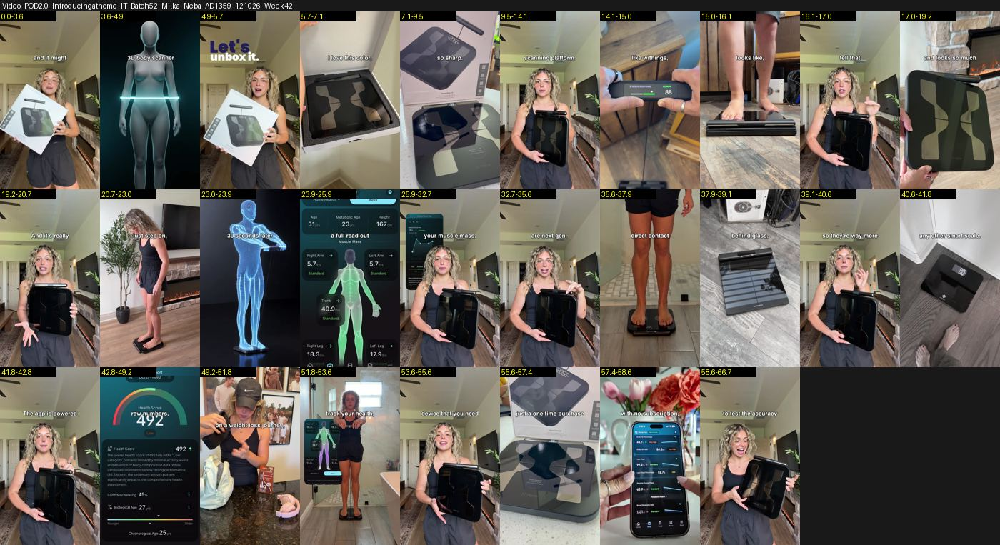

# Video_POD2.0_Introducingathome_IT_Batch52_Milka_Neba_AD1359_121026_Week42

Master: `Video_POD2.0_Introducingathome_IT_Batch52_Milka_Neba_AD1359_121026_Week42_9X16_HOOK1.mp4` · 66.7s · 1080x1920

**Pacing:** 28 shots · avg 2.382s · median 1.784s · 4.05 cuts/10s · first cut 3.6s · 246.0 wpm · talk ratio 0.94 · cuts on word start 85.2% · cuts in speech gaps 55.6%
**Audio:** {'I_lufs': -26.9, 'LRA': 4.7, 'true_peak_db': -3.7} · BPM≈107.7 · music {'speech_rms_db': -30.4, 'pause_seconds': 0.0} · cuts with SFX/transient 59.3%

**Captions:** 102 cards · 1.0 words/card (median) · y≈0.649 of frame height · text height≈0.0222 · colours {'white': 63, 'dark/other': 36, 'red': 2, 'blue': 1} · cards crossing a cut: 0
Highlighted: CHOCOLATE, CHOCOLATE, HumePod
**Headlines:** Thisis (0.0–1.0s, dark/other) | the new (0.5–1.0s, white) | Hume Pod2.0 (0.5–1.0s, dark/other) | and it might (1.5–1.5s, white) | just be the best (2.0–2.5s, white) | and most accurate (3.0–3.0s, white) | 3D body scanner (3.5–4.0s, white) | at home. (4.5–4.5s, white)

**Hook (0–3s) spoken:** This is the new Q -Pod 2 .0 and it might just be the best and
**Hook on-screen:** Hume Pod2.0 / Thisis / and it might / just be the best / the new
**CTA (last 5s):** to test the accuracy on this and see my metabolic age, which is kind of a thing right now · on-screen: and see / my metabolic age, / right now. / to test the accuracy

## Beat sheet

| # | in–out (s) | dur | transition | spoken | on-screen text |
|---|---|---|---|---|---|
| 1 | 0.00–3.60 | 3.6 |  | This is the new Q -Pod 2 .0 and it might just be the best and most accurate 3D | Thisis (HEADLINE) / the new (HEADLINE) / Hume Pod2.0 (HEADLINE) / and it might (HEADLINE) / just be the best (HEADLINE) / and most accurate (HEADLINE) |
| 2 | 3.60–4.87 | 1.27 | cut +SFX hit | body scanner at home. | 3D body scanner (HEADLINE) / at home. (HEADLINE) |
| 3 | 4.87–5.73 | 0.87 | cut +SFX hit | Let's unbox it. | at home. (HEADLINE) / Let' (HEADLINE) / unboxit. (HEADLINE) / First of all, (HEADLINE) |
| 4 | 5.73–7.07 | 1.33 | cut | First of all, I love this color. | First of all, (HEADLINE) / I love this color, (HEADLINE) / 2056. (HEADLINE) / it literally looks (HEADLINE) / HumePod2.0 |
| 5 | 7.07–9.50 | 2.43 | cut +SFX hit | It literally looks so sharp. It's so sleek to | 2056. (HEADLINE) / it literally looks (HEADLINE) / HumePod2.0 / so sharp. (HEADLINE) / 2056 (HEADLINE) / it's so sleek (HEADLINE) |
| 6 | 9.50–14.13 | 4.63 | cut +SFX hit | be like a low profile scanning platform. This is the kind of a direct competitor with devices like | to be like a low profile (HEADLINE) / scanning platform. (HEADLINE) / This is the (HEADLINE) / competitor (HEADLINE) / like withings, (HEADLINE) |
| 7 | 14.13–15.00 | 0.87 | cut | widdings. And | like withings, (HEADLINE) |
| 8 | 15.00–16.13 | 1.13 | cut +SFX hit | if you know what that one looks like, | and if you know (HEADLINE) / you can already (HEADLINE) |
| 9 | 16.13–16.97 | 0.83 | cut | you can already tell that | you can already (HEADLINE) |
| 10 | 16.97–19.23 | 2.27 | cut +SFX hit | this one feels and looks so much more premium. | this one feels (HEADLINE) / XHume / and looks so much (HEADLINE) / And it's really (HEADLINE) |
| 11 | 19.23–20.70 | 1.47 | cut | And it's really easy to use. | And it's really (HEADLINE) / easy to use. (HEADLINE) |
| 12 | 20.70–23.03 | 2.33 | cut +SFX hit | You literally just step on, grab the handles, and about 30 | just step on, (HEADLINE) / grab the handles, (HEADLINE) / 30secondslater [blue] (HEADLINE) |
| 13 | 23.03–23.93 | 0.9 | cut +SFX hit | seconds later, you've | 30secondslater [blue] (HEADLINE) |
| 14 | 23.93–25.87 | 1.93 | cut | got a full readout of your body with | Hume Pod (HEADLINE) / Body [blue] (HEADLINE) / Hume Health (HEADLINE) / Metabolic Age (HEADLINE) / Height (HEADLINE) / Age (HEADLINE) |
| 15 | 25.87–32.67 | 6.8 | cut +SFX hit | clinical grade accuracy. You can track your body fat, your muscle mass, viscual fat, metabolic age, and so much more. | with clinical (HEADLINE) / grade accuracy. (HEADLINE) / your body fat, (HEADLINE) / your muscle mass, (HEADLINE) / visceral fat, (HEADLINE) / metabolic age, (HEADLINE) |
| 16 | 32.67–35.60 | 2.93 | cut | The sensors are next -gen called direct read, | The sensors (HEADLINE) / are next gen. (HEADLINE) / called DirectRead, (HEADLINE) |
| 17 | 35.60–37.87 | 2.27 | cut +SFX hit | which means that they're in direct contact with your skin instead | that they're in [red] (HEADLINE) / direct contact [red] (HEADLINE) |
| 18 | 37.87–39.07 | 1.2 | cut | of behind glass, | MH4D (HEADLINE) / behind glass, (HEADLINE) / WITHINGS / so they're way more (HEADLINE) |
| 19 | 39.07–40.63 | 1.57 | cut | so they're way more accurate than any | so they're way more (HEADLINE) / accurate than (HEADLINE) |
| 20 | 40.63–41.83 | 1.2 | cut +SFX hit | other smart scale. | any other smart scale. (HEADLINE) |
| 21 | 41.83–42.77 | 0.93 | cut +SFX hit | The app is PowerPie | The app is powered (HEADLINE) |
| 22 | 42.77–49.23 | 6.47 | cut +SFX hit | Prof AI, which is amazing because it doesn't just give you raw numbers, it interprets your data so you can make better choices. | Pro.FActiveIntelligence (HEADLINE) / Unlockreal-timeinsightsandtimely (HEADLINE) / recommendationspoweredby (HEADLINE) / continuousmonitoring (HEADLINE) / by ProfAl, (HEADLINE) / ActiveIntelligence |
| 23 | 49.23–51.77 | 2.53 | cut +SFX hit | Whether you are on a weight loss journey, health journey, | Whether you are [red] (HEADLINE) / CHOCOLATE [red] / on a weight loss journey, [red] (HEADLINE) / healthjourney [red] (HEADLINE) / CHOCOLATE [red] |
| 24 | 51.77–53.57 | 1.8 | cut | or just wanna track your health, | or just want to [red] (HEADLINE) / 5.7ms (HEADLINE) / 18.3 / track your health, (HEADLINE) |
| 25 | 53.57–55.60 | 2.03 | cut | this is the one device that you need. It's | this is the one (HEADLINE) / device that you need (HEADLINE) |
| 26 | 55.60–57.37 | 1.77 | cut +SFX hit | seriously just a one -time purchase with | 2056 (HEADLINE) / just a one time purchase (HEADLINE) / HumePod2.0 / Pleanechorgefor / ifir'snotturnlngon / 2056. (HEADLINE) |
| 27 | 57.37–58.60 | 1.23 | cut +SFX hit | no subscription and | just a one time purchase (HEADLINE) / HumePod2.0 / 2056. (HEADLINE) / pleasechargefer / with no subscription (HEADLINE) / HumePod [blue] |
| 28 | 58.60–66.69 | 8.09 | cut | right now it's 10 % off for the launch I'm really excited to test the accuracy on this and see my metabolic age, which is kind of a thing right now | and right now (HEADLINE) / it's 10%off (HEADLINE) / I'm really excited (HEADLINE) / to test the accuracy (HEADLINE) / and see (HEADLINE) / my metabolic age, (HEADLINE) |

## Hook variants

| hook | file | dur | first cut | spoken 0–3s | on-screen 0–3s |
|---|---|---|---|---|---|
| 1 | `me_IT_Batch52_Milka_Neba_AD1359_121026_Week42_9X16_HOOK1.mp4` | 66.7 | 3.6 | This is the new Q -Pod 2 .0 and it might just be the best and | Hume Pod2.0 / Thisis / and it might / just be the best / the new |
| 1 | `me_IT_Batch52_Milka_Neba_AD1359_121026_Week42_9X16_HOOK1.mp4` | 66.7 | 5.733 | This is the new HumePod 2 .0, and it might just be the best and |  |
| 2 | `me_IT_Batch52_Milka_Neba_AD1359_121026_Week42_9X16_HOOK2.mp4` | 66.0 | 3.0 | This is the new humepod 2 .0 and it honestly could be the most accurate body | HumePod2.0 / Thisis / and it honestly / could be / the most accurate / the new |
| 2 | `me_IT_Batch52_Milka_Neba_AD1359_121026_Week42_9X16_HOOK2.mp4` | 66.0 | 3.0 | This is the new HumePod 2 .0, and it honestly could be the most accurate body |  |
| 3 | `me_IT_Batch52_Milka_Neba_AD1359_121026_Week42_9X16_HOOK3.mp4` | 65.4 | 2.5 | Look at this, this is the new Q -Pod 2 .0, and it might just be the best |  |
| 3 | `me_IT_Batch52_Milka_Neba_AD1359_121026_Week42_9X16_HOOK3.mp4` | 65.4 | 2.5 | Look at this, this is the new Q -Pod 2 .0 and it might just be the best |  |

## Full transcript

This is the new Q-Pod 2.0 and it might just be the best and most accurate 3D body scanner at home. Let's unbox it. First of all, I love this color. It literally looks so sharp. It's so sleek to be like a low profile scanning platform. This is the kind of a direct competitor with devices like widdings. And if you know what that one looks like, you can already tell that this one feels and looks so much more premium. And it's really easy to use. You literally just step on, grab the handles, and about 30 seconds later, you've got a full readout of your body with clinical grade accuracy. You can track your body fat, your muscle mass, viscual fat, metabolic age, and so much more. The sensors are next-gen called direct read, which means that they're in direct contact with your skin instead of behind glass, so they're way more accurate than any other smart scale. The app is PowerPie Prof AI, which is amazing because it doesn't just give you raw numbers, it interprets your data so you can make better choices. Whether you are on a weight loss journey, health journey, or just wanna track your health, this is the one device that you need. It's seriously just a one-time purchase with no subscription and right now it's 10% off for the launch I'm really excited to test the accuracy on this and see my metabolic age, which is kind of a thing right now