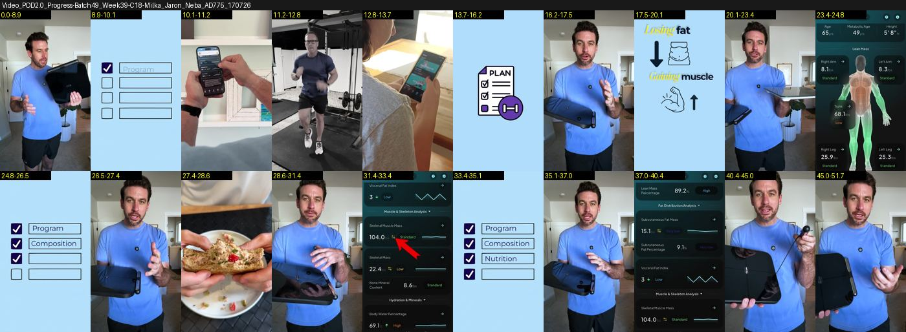

# Video_POD2.0_Progress-Batch49_Week39-C18-Milka_Jaron_Neba_AD775_170726

Master: `Video_POD2.0_Progress-Batch49_Week39-C18-Milka_Jaron_Neba_AD775_170726_9x16_hook1.mp4` · 51.7s · 1080x1920

**Pacing:** 20 shots · avg 2.587s · median 1.78s · 3.67 cuts/10s · first cut 8.92s · 228.0 wpm · talk ratio 0.91 · cuts on word start 89.5% · cuts in speech gaps 78.9%
**Audio:** {'I_lufs': -17.4, 'LRA': 3.9, 'true_peak_db': 0.1} · BPM≈123.0 · music {'speech_rms_db': -22.8, 'pause_seconds': 1.2, 'pause_rms_db': -25.4, 'bed_minus_voice_db': -2.6, 'music_bed_likely': True} · cuts with SFX/transient 73.7%

**Captions:** 59 cards · 1 words/card (median) · y≈0.63 of frame height · text height≈0.0293 · colours {'white': 42, 'dark/other': 17} · cards crossing a cut: 0
**Headlines:** 0000 (9.0–9.0s, dark/other) | Losing fat (18.0–19.0s, yellow) | Gaining muscle (19.0–19.0s, yellow) | HumePod (24.0–24.0s, white) | StepOnScale (24.0–24.0s, green) | Age (24.0–24.0s, dark/other) | Metabolic Age (24.0–24.0s, white) | Height (24.0–24.0s, white)

**Hook (0–3s) spoken:** You can go to the gym for years and still not see any
**Hook on-screen:** 
**CTA (last 5s):** get the basics down, get the data and the results, they're going to follow. If you want to grab one, I'll leave a link. · on-screen: 

## Beat sheet

| # | in–out (s) | dur | transition | spoken | on-screen text |
|---|---|---|---|---|---|
| 1 | 0.00–8.92 | 8.92 |  | You can go to the gym for years and still not see any progress. And seriously, it's probably not because you're not trying. You're just missing a few key pieces of information. |  |
| 2 | 8.92–10.12 | 1.2 | cut +SFX hit | One, a program. | 0000 (HEADLINE) |
| 3 | 10.12–11.16 | 1.04 | cut +SFX hit | You need some structure, |  |
| 4 | 11.16–12.76 | 1.6 | cut | not just random workouts you |  |
| 5 | 12.76–13.68 | 0.92 | cut | need to follow a plan |  |
| 6 | 13.68–16.16 | 2.48 | cut +SFX hit | that's gonna meet your goals. Two, composition. | PLAN / Program |
| 7 | 16.16–17.52 | 1.36 | cut +SFX hit | Real results come from losing |  |
| 8 | 17.52–20.08 | 2.56 | cut +SFX hit | fat and gaining muscle at the same time. | Losing fat [yellow] (HEADLINE) / Gaining muscle [yellow] (HEADLINE) |
| 9 | 20.08–23.44 | 3.36 | cut | A regular scale, it only shows weight. I use the Hume Pod. It |  |
| 10 | 23.44–24.80 | 1.36 | cut +SFX hit | maps my entire body. | HumePod (HEADLINE) / StepOnScale [green] (HEADLINE) / Age (HEADLINE) / Metabolic Age (HEADLINE) / Height (HEADLINE) / 49yrs (HEADLINE) |
| 11 | 24.80–26.48 | 1.68 | cut +SFX hit | And number three, nutrition. | Program / Composition / Nutrition |
| 12 | 26.48–27.40 | 0.92 | cut +SFX hit | You need to know what | Program / Composition / Nutrition |
| 13 | 27.40–28.56 | 1.16 | cut +SFX hit | your body needs. The |  |
| 14 | 28.56–31.40 | 2.84 | cut +SFX hit | pod, it finds my BMR based on my | 1648-al |
| 15 | 31.40–33.40 | 2.0 | cut | actual skeletal muscle mass and | 1648-al / HumePod (HEADLINE) / StepOnScale [green] (HEADLINE) / Visceral FatIndex (HEADLINE) / Low [blue] (HEADLINE) / Muscle&SkeletonAnalysis (HEADLINE) |
| 16 | 33.40–35.08 | 1.68 | cut +SFX hit | for consistency. | HumePod (HEADLINE) / StepOnScale [green] (HEADLINE) / Visceral FatIndex (HEADLINE) / Low [blue] (HEADLINE) / Muscle&SkeletonAnalysis (HEADLINE) / SkeletalMuscleMass (HEADLINE) |
| 17 | 35.08–36.96 | 1.88 | cut +SFX hit | The best accountability is data. |  |
| 18 | 36.96–40.36 | 3.4 | cut | And this tracks 45 metrics that give me a daily plan. | HumePod (HEADLINE) / StepOnScale [green] (HEADLINE) / BodyFatPercentage (HEADLINE) / 10.5%个 (HEADLINE) / Verylow (HEADLINE) / 17.31bs (HEADLINE) |
| 19 | 40.36–44.96 | 4.6 | cut +SFX hit | And seeing my numbers improve, when I scan this, it keeps me going. It really does. | HumePod (HEADLINE) / StepOnScale [green] (HEADLINE) / Low / Standard / SkeletalMass / 22.4ibs |
| 20 | 44.96–51.73 | 6.77 | cut +SFX hit | If you've hit a plateau, go down the list, get the basics down, get the data and the results, they're going to follow. If you want to grab one, I'll leave a link. |  |

## Hook variants

| hook | file | dur | first cut | spoken 0–3s | on-screen 0–3s |
|---|---|---|---|---|---|
| 1 | `ch49_Week39-C18-Milka_Jaron_Neba_AD775_170726_9x16_hook1.mp4` | 51.7 | 8.92 | You can go to the gym for years and still not see any |  |
| 1 | `ch49_Week39-C18-Milka_Jaron_Neba_AD775_170726_9x16_hook1.mp4` | 51.7 | 3.72 |  |  |
| 2 | `ch49_Week39-C18-Milka_Jaron_Neba_AD775_170726_9x16_hook2.mp4` | 50.3 | 2.64 |  |  |
| 2 | `ch49_Week39-C18-Milka_Jaron_Neba_AD775_170726_9x16_hook2.mp4` | 50.3 | 2.64 |  |  |
| 3 | `ch49_Week39-C18-Milka_Jaron_Neba_AD775_170726_9x16_hook3.mp4` | 53.7 | 1.88 |  |  |
| 3 | `ch49_Week39-C18-Milka_Jaron_Neba_AD775_170726_9x16_hook3.mp4` | 53.7 | 1.88 |  |  |

## Full transcript

You can go to the gym for years and still not see any progress. And seriously, it's probably not because you're not trying. You're just missing a few key pieces of information. One, a program. You need some structure, not just random workouts you need to follow a plan that's gonna meet your goals. Two, composition. Real results come from losing fat and gaining muscle at the same time. A regular scale, it only shows weight. I use the Hume Pod. It maps my entire body. And number three, nutrition. You need to know what your body needs. The pod, it finds my BMR based on my actual skeletal muscle mass and for consistency. The best accountability is data. And this tracks 45 metrics that give me a daily plan. And seeing my numbers improve, when I scan this, it keeps me going. It really does. If you've hit a plateau, go down the list, get the basics down, get the data and the results, they're going to follow. If you want to grab one, I'll leave a link.