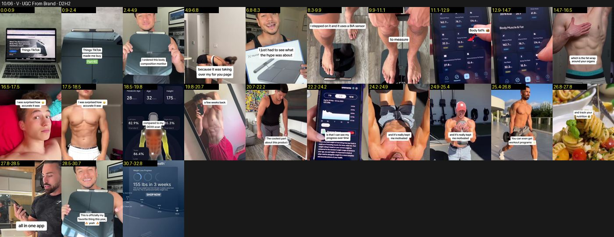

# 10/06 - V - UGC From Brand - D2H2

Master: `10/06 - V - UGC From Brand - D2H2` · 32.8s · 720x900

**Pacing:** 23 shots · avg 1.427s · median 1.434s · 6.7 cuts/10s · first cut 0.9s · 261.0 wpm · talk ratio 0.87 · cuts on word start 81.8% · cuts in speech gaps 68.2%
**Audio:** {'I_lufs': -16.1, 'LRA': 3.7, 'true_peak_db': -2.9} · BPM≈99.4 · music {'speech_rms_db': -21.1, 'pause_seconds': 2.3, 'pause_rms_db': -21.6, 'bed_minus_voice_db': -0.5, 'music_bed_likely': True} · cuts with SFX/transient 86.4%

**Captions:** 117 cards · 1 words/card (median) · y≈0.607 of frame height · text height≈0.0333 · colours {'white': 81, 'green': 1, 'dark/other': 29, 'blue': 4, 'red': 1, 'yellow': 1} · cards crossing a cut: 8
Highlighted: Part45, Excebent, Excellent, Excelent, Viscer., Ecellent, Standand
**Headlines:** I stepped on it and it uses a BIA sensor (9.0–10.0s, white) | BodyMusele&Fat (11.0–11.0s, white) | Fat fee Mags (11.0–11.0s, dark/other) | MuseleRate (11.0–11.0s, dark/other) | Musele Mas (11.0–11.0s, white) | 174:415 (11.0–11.0s, white) | 78.76 (11.0–11.0s, white) | 162.7/15 (11.0–11.0s, white)

**Hook (0–3s) spoken:** Things TikTok made me buy part 45. I ordered this body
**Hook on-screen:** BodyPod,Yourp / BodyPod,Yourpersonal / HumeHealth / Iorderedthisbody / Meet The Revolutic / MeetTheRevolutionary / Part45 / Things TikTok / compositionmonitor / made me buy / metabolicco / metaboliccoach.
**CTA (last 5s):** in one app. This is officially my favorite thing this year. · on-screen: %BodyFat (%) / 126.5lb / 127.1 tb / 127.1lb / 128 tb / 130lb / 155lbsin3weeks / 23.4% / 24.2% / 25.6% / 26.5% / 70%ofyourweightlossfromthelast3weekscamefrom

## Beat sheet

| # | in–out (s) | dur | transition | spoken | on-screen text |
|---|---|---|---|---|---|
| 1 | 0.00–0.90 | 0.9 |  | Things TikTok made me | HumeHealth / MeetTheRevolutionary / BodyPod,Yourpersonal / metaboliccoach. / Things TikTok / Meet The Revolutic |
| 2 | 0.90–2.37 | 1.47 | cut +SFX hit | buy part 45. | HumeHealth / Things TikTok / Meet The Revolutic / BodyPod,Yourp / metabolicco / made me buy |
| 3 | 2.37–4.90 | 2.53 | cut +SFX hit | I ordered this body composition monitor from Hume because | Things TikTok / made me buy / Part45 [green] / Iorderedthisbody / compositionmonitor / OmUHX |
| 4 | 4.90–6.83 | 1.93 | cut +SFX hit | it was taking over my 4U page. | Iorderedthisbody / compositionmonitor / from Hume / because it was taking / over my foryoupage |
| 5 | 6.83–8.27 | 1.43 | cut +SFX hit | I just had to see what the hype was about. | I just had to see what / the hype was about / JEALTH |
| 6 | 8.27–9.90 | 1.63 | cut +SFX hit | I stepped on it and it uses a BIA sensor | I just had to see what / the hype was about / I stepped on it and it uses a BIA sensor (HEADLINE) |
| 7 | 9.90–11.10 | 1.2 | cut | to measure my body | I stepped on it and it uses a BIA sensor (HEADLINE) / BodyMusele&Fat (HEADLINE) / Fat fee Mags (HEADLINE) / MuseleRate (HEADLINE) / Musele Mas (HEADLINE) / 174:415 (HEADLINE) |
| 8 | 11.10–12.87 | 1.77 | cut +SFX hit | fat percentage, muscle mass, | BodyMusele&Fat (HEADLINE) / Fat fee Mags (HEADLINE) / MuseleRate (HEADLINE) / Musele Mas (HEADLINE) / 174:415 (HEADLINE) / 78.76 (HEADLINE) |
| 9 | 12.87–14.70 | 1.83 | cut +SFX hit | hydration level, and even visceral fat, | Fat Mass / Plans / BodyFatRate / 15.5% / Standard / BodyWater (HEADLINE) |
| 10 | 14.70–16.50 | 1.8 | cut | which is the fat wrap around your organs. | whichis thefat wrap / aroundyourorgans |
| 11 | 16.50–17.47 | 0.97 | cut +SFX hit | I was surprised how | Iwassurprisedhow (HEADLINE) / accurateitwas (HEADLINE) |
| 12 | 17.47–18.53 | 1.07 | cut +SFX hit | accurate it was compared | Iwassurprisedhow (HEADLINE) / accurateitwas (HEADLINE) |
| 13 | 18.53–19.83 | 1.3 | cut +SFX hit | to my DEXA scan a few | Height (HEADLINE) / MetabolicAge (HEADLINE) / Age (HEADLINE) / 28 (HEADLINE) / 175 (HEADLINE) / ears (HEADLINE) |
| 14 | 19.83–20.70 | 0.87 | cut +SFX hit | weeks back. The coolest | afewweeksback (HEADLINE) |
| 15 | 20.70–22.20 | 1.5 | cut +SFX hit | part about this product is that | Thecoolestpart / aboutthisproduct / 2:174 (HEADLINE) / BodyMeasurementa (HEADLINE) / 12M (HEADLINE) / Avgfor25May-22Jun.2023 (HEADLINE) |
| 16 | 22.20–24.17 | 1.97 | cut +SFX hit | I can see my progress over time and | 2:174 (HEADLINE) / BodyMeasurementa (HEADLINE) / 12M (HEADLINE) / Avgfor25May-22Jun.2023 (HEADLINE) / 127.2bs (HEADLINE) / 144 0s (HEADLINE) |
| 17 | 24.17–24.93 | 0.77 | cut +SFX hit | it's really kept me | and it'sreallykept / memotivated |
| 18 | 24.93–25.40 | 0.47 | cut | motivated. | and it'sreallykept / memotivated |
| 19 | 25.40–26.77 | 1.37 | cut +SFX hit | You can even get workout programs and | and it'sreallykept / memotivated / Youcanevenget / workoutprograms |
| 20 | 26.77–27.77 | 1.0 | cut +SFX hit | track your nutrition | and track your / nutrition |
| 21 | 27.77–28.50 | 0.73 | cut +SFX hit | all in one app. This | all in one app |
| 22 | 28.50–30.70 | 2.2 | cut +SFX hit | is officially my favorite thing this year. | Thisis officiallymy / favoritethingthis year, / yeah |
| 23 | 30.70–32.83 | 2.13 | cut +SFX hit |  | XHumeHealth (HEADLINE) / Weight Loss Progress (HEADLINE) / 155lbsin3weeks (HEADLINE) / 70%ofyourweightlossfromthelast3weekscamefrom / BodyFat.This isoptimalandhealthyweightloss. / %BodyFat (%) |

## Full transcript

Things TikTok made me buy part 45. I ordered this body composition monitor from Hume because it was taking over my 4U page. I just had to see what the hype was about. I stepped on it and it uses a BIA sensor to measure my body fat percentage, muscle mass, hydration level, and even visceral fat, which is the fat wrap around your organs. I was surprised how accurate it was compared to my DEXA scan a few weeks back. The coolest part about this product is that I can see my progress over time and it's really kept me motivated. You can even get workout programs and track your nutrition all in one app. This is officially my favorite thing this year.