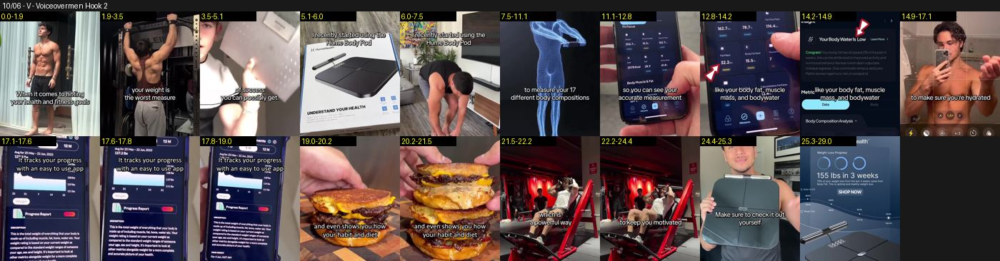

# 10/06 - V - Voiceovermen Hook 2

Master: `10/06 - V - Voiceovermen Hook 2` · 29.0s · 1080x1350

**Pacing:** 19 shots · avg 1.524s · median 1.4s · 6.22 cuts/10s · first cut 1.9s · 267.0 wpm · talk ratio 0.9 · cuts on word start 66.7% · cuts in speech gaps 61.1%
**Audio:** {'I_lufs': -19.5, 'LRA': 3.0, 'true_peak_db': -3.3} · BPM≈117.5 · music {'speech_rms_db': -23.4, 'pause_seconds': 2.5, 'pause_rms_db': -24.7, 'bed_minus_voice_db': -1.3, 'music_bed_likely': True} · cuts with SFX/transient 33.3%

**Captions:** 107 cards · 1 words/card (median) · y≈0.633 of frame height · text height≈0.0333 · colours {'white': 73, 'dark/other': 28, 'red': 6} · cards crossing a cut: 14
Highlighted: to make sureyou'rehydrated, andyour overall health score., VIEW, and even showsyou how, your habit and diet, yourhealth,
**Headlines:** I recentlystarted usingthe (5.0–5.5s, white) | Hume Body Pod (5.0–7.0s, white) | HumeHealth (5.0–5.5s, white) | UNDERSTANDYOURHEALTH (5.0–5.5s, white) | recentlystartedusingthe (6.0–7.0s, white) | Body Fat PeFe (11.0–11.0s, white) | Weigtht (11.0–11.0s, white) | BedyMassIndex (11.0–11.0s, white)

**Hook (0–3s) spoken:** When it comes to hitting your health and fitness goals, your weight is the worst measure
**Hook on-screen:** When it comes to hitting / the worst measure / your health and fitness goals / your weight is
**CTA (last 5s):** journey. Make sure to check it out yourself and thank me later. · on-screen: %BodyFat (%) / 126.51b / 126.5lb / 127.1 tb / 127.11b / 127.1lb / 128 tb / 128lb / 130b / 130起 / 155lbsin3weeks / 23.4%

## Beat sheet

| # | in–out (s) | dur | transition | spoken | on-screen text |
|---|---|---|---|---|---|
| 1 | 0.00–1.90 | 1.9 |  | When it comes to hitting your health and fitness goals, | When it comes to hitting / your health and fitness goals |
| 2 | 1.90–3.47 | 1.57 | cut | your weight is the worst measure of | When it comes to hitting / your health and fitness goals / your weight is / the worst measure |
| 3 | 3.47–5.13 | 1.67 | cut | success you can possibly get. | your weight is / the worst measure / of success / you can possibly get. / I recentlystarted usingthe (HEADLINE) / Hume Body Pod (HEADLINE) |
| 4 | 5.13–6.03 | 0.9 | cut | I recently started using | I recentlystarted usingthe (HEADLINE) / Hume Body Pod (HEADLINE) / HumeHealth (HEADLINE) / UNDERSTANDYOURHEALTH (HEADLINE) / SMARTIODYCOMPOSITIONANALYZER / SALANCEOECOMPOSITIONCORPOTTLLECONNETEU |
| 5 | 6.03–7.47 | 1.43 | cut | the Hume Body Pod, | Hume Body Pod (HEADLINE) / recentlystartedusingthe (HEADLINE) |
| 6 | 7.47–11.10 | 3.63 | cut | which uses small electrical current to measure your 17 different body compositions. | Hume Body Pod (HEADLINE) / recentlystartedusingthe (HEADLINE) / whichusessmall / electrical current / to measure your 17 / different body compositions |
| 7 | 11.10–12.77 | 1.67 | cut | So you can see your accurate measurement, | Body Fat PeFe (HEADLINE) / Weigtht (HEADLINE) / BedyMassIndex (HEADLINE) / MetriesBreakdew (HEADLINE) / Fit Feeus (HEADLINE) / weight (HEADLINE) |
| 8 | 12.77–14.17 | 1.4 | cut | like your body fat, muscle mass, | Measures / Home / Muscle Mass (HEADLINE) / BodyFatRate (HEADLINE) / FatFreeMass (HEADLINE) / MuscleRate (HEADLINE) |
| 9 | 14.17–14.90 | 0.73 | cut +SFX hit | and body water to | mass,andbodywater / Insight (HEADLINE) / YourBodyWaterlsLow (HEADLINE) / LeamMore (HEADLINE) / Congrats!Yourbodyfathasdropped2% inthepast4 / weeks,thiscanbeattributedtoimprovedactivityand |
| 10 | 14.90–17.07 | 2.17 | cut | make sure you're hydrated and your overall health score. | to make sureyou'rehydrated [red] / 1,5x / 4:3 / andyour overall health score. [red] / 4W (HEADLINE) / 12M (HEADLINE) |
| 11 | 17.07–17.63 | 0.57 | cut | It tracks your progress | 4W (HEADLINE) / 12M (HEADLINE) / Avgfor25May-22Jun,2023 (HEADLINE) / 127.21hs (HEADLINE) / Ittracksyour progress (HEADLINE) / withaneasytouseapp (HEADLINE) |
| 12 | 17.63–17.80 | 0.17 | cut +SFX hit |  | 4W (HEADLINE) / 12M (HEADLINE) / Avgfor25May-22Jun,2023 (HEADLINE) / withaneasytouseapp (HEADLINE) / 128lbs (HEADLINE) / 111 bs |
| 13 | 17.80–18.97 | 1.17 | cut +SFX hit | with an easy to use app, | 4W (HEADLINE) / 12M (HEADLINE) / Avgfor25May-22Jun,2023 (HEADLINE) / withaneasytouseapp (HEADLINE) / 128lbs (HEADLINE) / 111 bs |
| 14 | 18.97–20.20 | 1.23 | cut +SFX hit | and it even shows you how your habit | and even showsyou how [red] / your habit and diet [red] |
| 15 | 20.20–21.50 | 1.3 | cut | and diet is impacting your health, | and even showsyou how [red] / your habit and diet [red] / is impacting / yourhealth, [red] |
| 16 | 21.50–22.17 | 0.67 | cut | which is a powerful | whichis / apowerfulway |
| 17 | 22.17–24.37 | 2.2 | cut +SFX hit | way to keep you motivated through your finished journey. | whichis / apowerfulway / tokeepyoumotivated / through your fitness / journey. |
| 18 | 24.37–25.33 | 0.97 | cut | Make sure to check it out yourself | through your fitness / journey. / Makesuretocheckitout / yourself |
| 19 | 25.33–28.96 | 3.62 | cut +SFX hit | and thank me later. | Makesuretocheckitout / yourself / XHumeHealth (HEADLINE) / Weight Loss Progress (HEADLINE) / 155lbsin3weeks (HEADLINE) / 70%ofyourweightlossfromthelast3weekscamefrom |

## Full transcript

When it comes to hitting your health and fitness goals, your weight is the worst measure of success you can possibly get. I recently started using the Hume Body Pod, which uses small electrical current to measure your 17 different body compositions. So you can see your accurate measurement, like your body fat, muscle mass, and body water to make sure you're hydrated and your overall health score. It tracks your progress with an easy to use app, and it even shows you how your habit and diet is impacting your health, which is a powerful way to keep you motivated through your finished journey. Make sure to check it out yourself and thank me later.