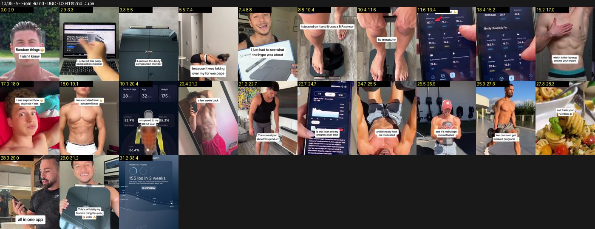

# 10/08 - V - From Brand - UGC - D2H1 – 2nd Dupe

Master: `10/08 - V - From Brand - UGC - D2H1 – 2nd Dupe` · 33.4s · 720x900

**Pacing:** 23 shots · avg 1.451s · median 1.433s · 6.59 cuts/10s · first cut 2.9s · 264.0 wpm · talk ratio 0.86 · cuts on word start 86.4% · cuts in speech gaps 72.7%
**Audio:** {'I_lufs': -16.1, 'LRA': 3.7, 'true_peak_db': -3.2} · BPM≈129.2 · music {'speech_rms_db': -20.8, 'pause_seconds': 2.3, 'pause_rms_db': -21.3, 'bed_minus_voice_db': -0.5, 'music_bed_likely': True} · cuts with SFX/transient 72.7%

**Captions:** 116 cards · 1.0 words/card (median) · y≈0.59 of frame height · text height≈0.0317 · colours {'white': 79, 'green': 1, 'red': 1, 'dark/other': 31, 'blue': 4} · cards crossing a cut: 8
Highlighted: Part13, eralFa, Low, Excelint, Eucellent, Excellent
**Headlines:** XHumel (8.0–8.0s, white) | I stepped on it and it uses a BIA sensor (9.0–10.0s, white) | BodyMuscle&Fat (12.0–14.0s, white) | FatFreeMass (12.0–13.0s, white) | MuscleRate (12.0–13.0s, white) | MuscleMass (12.0–13.0s, white) | 174.4ibs (12.0–13.0s, white) | 78.7% (12.0–12.0s, white)

**Hook (0–3s) spoken:** Random things I wish I knew about sooner. Part 13. I ordered
**Hook on-screen:** I wishI knew / Part13 / Random things / aboutsooner
**CTA (last 5s):** in one app. This is officially my favorite thing this year. · on-screen: % BodyFat (%) / (%) % / 126.51b / 126.5tb / 127.1 Ib / 127.116 / 127.1lb / 128 tb / 128ID / 130b / 130ib / 155lbsin3weeks

## Beat sheet

| # | in–out (s) | dur | transition | spoken | on-screen text |
|---|---|---|---|---|---|
| 1 | 0.00–2.90 | 2.9 |  | Random things I wish I knew about sooner. Part 13. | Random things / I wishI knew / aboutsooner / Part13 [green] |
| 2 | 2.90–3.27 | 0.37 | cut +SFX hit | I ordered | Random things / I wishI knew / aboutsooner / Part13 [green] / HumeHealth / Meet TheRevolutionary |
| 3 | 3.27–5.47 | 2.2 | cut | this body composition monitor from Hume because | HumeHealth / Meet TheRevolutionary / BodyPod,Your nersonal / metaboliccoa / Niect generation home health moritc / WSJ |
| 4 | 5.47–7.37 | 1.9 | cut +SFX hit | it was taking over my 4U page. | Iorderedthisbody / compositionmonitor / XHume / fromHume / because it was taking / over myforyou page |
| 5 | 7.37–8.80 | 1.43 | cut +SFX hit | I just had to see what the hype was about. | because it was taking / over myforyou page / I just had to see what / XHumel (HEADLINE) / the hype was about |
| 6 | 8.80–10.43 | 1.63 | cut +SFX hit | I stepped on it and it uses a BIA sensor | I stepped on it and it uses a BIA sensor (HEADLINE) |
| 7 | 10.43–11.63 | 1.2 | cut | to measure my body | I stepped on it and it uses a BIA sensor (HEADLINE) / to measure |
| 8 | 11.63–13.40 | 1.77 | cut +SFX hit | fat percentage, muscle mass, | BodyMuscle&Fat (HEADLINE) / FatFreeMass (HEADLINE) / MuscleRate (HEADLINE) / MuscleMass (HEADLINE) / 174.4ibs (HEADLINE) / 78.7% (HEADLINE) |
| 9 | 13.40–15.23 | 1.83 | cut | hydration level, and even visceral fat, | BodyMuscle&Fat (HEADLINE) / FatFreeMass (HEADLINE) / MuscleRate (HEADLINE) / MuscleMass (HEADLINE) / 174.4ibs (HEADLINE) / BodyFatRate |
| 10 | 15.23–17.03 | 1.8 | cut | which is the fat wrap around your organs. | whichisthefatwrap / aroundyour organs / I wassurprisedhow (HEADLINE) / accurateitwas (HEADLINE) |
| 11 | 17.03–18.00 | 0.97 | cut | I was surprised how | I wassurprisedhow (HEADLINE) / accurateitwas (HEADLINE) |
| 12 | 18.00–19.07 | 1.07 | cut +SFX hit | accurate it was compared | I wassurprisedhow (HEADLINE) / accurateitwas (HEADLINE) / Body [blue] (HEADLINE) / Data (HEADLINE) / Height (HEADLINE) / Metabolic Age (HEADLINE) |
| 13 | 19.07–20.37 | 1.3 | cut +SFX hit | to my DEXA scan a few | Body [blue] (HEADLINE) / Data (HEADLINE) / Height (HEADLINE) / Metabolic Age (HEADLINE) / Age (HEADLINE) / 28 (HEADLINE) |
| 14 | 20.37–21.23 | 0.87 | cut +SFX hit | weeks back. The coolest | compared to my / DEXAscan / Standard / Torso / RightArm (HEADLINE) / LeftArm (HEADLINE) |
| 15 | 21.23–22.73 | 1.5 | cut +SFX hit | part about this product is that | Thecoolestpart / aboutthisproduct |
| 16 | 22.73–24.70 | 1.97 | cut +SFX hit | I can see my progress over time and | BodyMeasurements (HEADLINE) / 4W (HEADLINE) / 12M (HEADLINE) / Avgfor25May-22Jun,2023 (HEADLINE) / 127.2lbs (HEADLINE) / 1441bs (HEADLINE) |
| 17 | 24.70–25.47 | 0.77 | cut +SFX hit | it's really kept me | and it'sreallykept / memotivated |
| 18 | 25.47–25.93 | 0.47 | cut +SFX hit | motivated. | and it'sreallykept / memotivated |
| 19 | 25.93–27.30 | 1.37 | cut +SFX hit | You can even get workout programs and | You canevenget / workoutprograms |
| 20 | 27.30–28.30 | 1.0 | cut +SFX hit | track your nutrition | You canevenget / workoutprograms / andtrackyour / nutrition |
| 21 | 28.30–29.03 | 0.73 | cut +SFX hit | all in one app. This | andtrackyour / nutrition / Thisis officiallymy / favorite thing this year, / yeah |
| 22 | 29.03–31.23 | 2.2 | cut +SFX hit | is officially my favorite thing this year. | Thisis officiallymy / favorite thing this year, / yeah / XHumeHealth (HEADLINE) / WeightLossProgress (HEADLINE) / 155lbsin3weeks (HEADLINE) |
| 23 | 31.23–33.36 | 2.13 | cut |  | XHumeHealth (HEADLINE) / WeightLossProgress (HEADLINE) / 155lbsin3weeks (HEADLINE) / 70%ofyourweightlossfromthelast3weekscamefrom / BodyFat.Thisisoptimalandhealthyweightloss. / 26.5% |

## Hook variants

| hook | file | dur | first cut | spoken 0–3s | on-screen 0–3s |
|---|---|---|---|---|---|
| None | `10/08 - V - From Brand - UGC - D2H1 – 2nd Dupe` | 33.4 | 2.9 | Random things I wish I knew about sooner. Part 13. I ordered | I wishI knew / Part13 / Random things / aboutsooner |
| None | `10/08 - V - From Brand - UGC - D2H1 – 2nd Dupe` | 33.4 | 2.9 | Random things I wish I knew about sooner. Part 13. I ordered | I wishI knew / Part13 / Random things / aboutsooner |

## Full transcript

Random things I wish I knew about sooner. Part 13. I ordered this body composition monitor from Hume because it was taking over my 4U page. I just had to see what the hype was about. I stepped on it and it uses a BIA sensor to measure my body fat percentage, muscle mass, hydration level, and even visceral fat, which is the fat wrap around your organs. I was surprised how accurate it was compared to my DEXA scan a few weeks back. The coolest part about this product is that I can see my progress over time and it's really kept me motivated. You can even get workout programs and track your nutrition all in one app. This is officially my favorite thing this year.