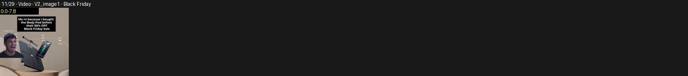

# 11/29 - Video - V2_image1 - Black Friday

Master: `11/29 - Video - V2_image1 - Black Friday` · 7.8s · 1080x1080

**Pacing:** 1 shots · avg 7.78s · median 7.78s · 0.0 cuts/10s · first cut Nones · None wpm · talk ratio 0.0 · cuts on word start None% · cuts in speech gaps None%
**Audio:** {'I_lufs': -14.1, 'LRA': 2.0, 'true_peak_db': -4.5} · BPM≈117.5 · music None · cuts with SFX/transient None%

**Captions:** 17 cards · 1 words/card (median) · y≈0.456 of frame height · text height≈0.025 · colours {'white': 17} · cards crossing a cut: 0
**Headlines:** MernbecauseIbought (0.0–7.0s, white) | theBodyPodbefore (0.0–7.0s, white) | their50%OFF (0.0–7.0s, white) | BlackFridaySale (0.0–7.0s, white) | %BodyFat (%) (0.0–7.0s, white)

**Hook (0–3s) spoken:** 
**Hook on-screen:** %BodyFat (%) / 126.5 tb / 126.5b / 127.1 lb / 130Ib / 23.4% / 24.2% / 26.5% / BlackFridaySale / MernbecauseIbought / Weigh! / theBodyPodbefore / their50%OFF
**CTA (last 5s):**  · on-screen: %BodyFat (%) / 126.5 tb / 126.5b / 127.1 lb / 130lb / 23.4% / 24.2% / 26.5% / BlackFridaySale / MernbecauseIbought / Weight (ib) / theBodyPodbefore

## Beat sheet

| # | in–out (s) | dur | transition | spoken | on-screen text |
|---|---|---|---|---|---|
| 1 | 0.00–7.78 | 7.78 |  |  | MernbecauseIbought (HEADLINE) / theBodyPodbefore (HEADLINE) / their50%OFF (HEADLINE) / BlackFridaySale (HEADLINE) / %BodyFat (%) (HEADLINE) / 26.5% |

## Full transcript

