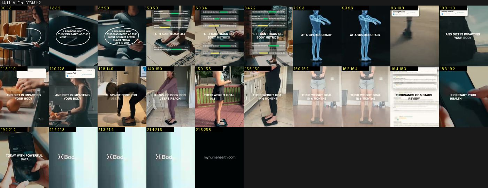

# 14/11 - V - Fin - BFCM-h2

Master: `14/11 - V - Fin - BFCM-h2` · 25.8s · 720x900

**Pacing:** 25 shots · avg 1.032s · median 0.767s · 9.3 cuts/10s · first cut 1.333s · 191.0 wpm · talk ratio 0.77 · cuts on word start 50.0% · cuts in speech gaps 41.7%
**Audio:** {'I_lufs': -14.5, 'LRA': 8.7, 'true_peak_db': -0.6} · BPM≈136.0 · music {'speech_rms_db': -17.3, 'pause_seconds': 5.6, 'pause_rms_db': -21.6, 'bed_minus_voice_db': -4.3, 'music_bed_likely': True} · cuts with SFX/transient 50.0%

**Captions:** 31 cards · 1 words/card (median) · y≈0.505 of frame height · text height≈0.04 · colours {'white': 28, 'dark/other': 3} · cards crossing a cut: 9
**Headlines:** XBody Pod (0.0–0.0s, white) | +4LBS% (5.5–6.0s, white) | MUSCLEMASS (5.5–6.0s, white) | VISCERALFAT (5.5–6.0s, white) | WEIGHT (5.5–6.0s, white) | -12LBS (5.5–6.0s, white) | -0.5% (6.0–6.0s, white) | MuscleMass (10.0–11.0s, white)

**Hook (0–3s) spoken:** Three reasons why this was rated as the most sought -after
**Hook on-screen:** 3REASONSWHY / BLACK / MOSTSOUGHT / MOSTSOUGHTAFTER / THISWASRATED / THISWASRATEDASTHE / XBody Pod
**CTA (last 5s):**  · on-screen: XBod / myhumehealth.com / shop now.

## Beat sheet

| # | in–out (s) | dur | transition | spoken | on-screen text |
|---|---|---|---|---|---|
| 1 | 0.00–1.33 | 1.33 |  | Three reasons why | XBody Pod (HEADLINE) / 3REASONSWHY |
| 2 | 1.33–3.17 | 1.83 | cut | this was rated as the most sought -after Black | 3REASONSWHY / THISWASRATED / THISWASRATEDASTHE / MOSTSOUGHT / MOSTSOUGHTAFTER / BLACK |
| 3 | 3.17–5.30 | 2.13 | cut +SFX hit | Friday gift in 2024. | 3REASONSWHY / THISWASRATEDASTHE / MOSTSOUGHTAFTER / BLACKFRIDAY / GIFTIN / GIFTIN2024 |
| 4 | 5.30–5.87 | 0.57 | cut | It can track 45 | +4LBS% (HEADLINE) / MUSCLEMASS (HEADLINE) / VISCERALFAT (HEADLINE) / WEIGHT (HEADLINE) / -12LBS (HEADLINE) / 1.ITCANTRACK45+ |
| 5 | 5.87–6.40 | 0.53 | cut | body | +4LBS% (HEADLINE) / MUSCLEMASS (HEADLINE) / VISCERALFAT (HEADLINE) / WEIGHT (HEADLINE) / -12LBS (HEADLINE) / 1.ITCANTRACK45+ |
| 6 | 6.40–7.17 | 0.77 | cut | metrics at | +4LBS% (HEADLINE) / MUSCLEMASS (HEADLINE) / VISCERALFAT (HEADLINE) / WEIGHT (HEADLINE) / -12LBS (HEADLINE) / 1.ITCANTRACK45+ |
| 7 | 7.17–9.30 | 2.13 | cut +SFX hit | a 98 % accuracy Shows | ATA98%ACCURACY |
| 8 | 9.30–9.57 | 0.27 | cut +SFX hit |  | ATA98%ACCURACY |
| 9 | 9.57–10.83 | 1.27 | cut +SFX hit | how your habit and diet | MuscleMass (HEADLINE) / 6:25AM (HEADLINE) / GainingMuscle (HEADLINE) / Muscle: 85.1% (HEADLINE) |
| 10 | 10.83–11.27 | 0.43 | cut +SFX hit | is impacting | MuscleMass (HEADLINE) / 6:25AM (HEADLINE) / GainingMuscle (HEADLINE) / Muscle: 85.1% (HEADLINE) / ANDDIETISIMPACTING / YOURBODY |
| 11 | 11.27–11.90 | 0.63 | cut +SFX hit | your | MuscleMass (HEADLINE) / 6:25AM (HEADLINE) / GainingMuscle (HEADLINE) / Muscle: 85.1% (HEADLINE) / ANDDIETISIMPACTING / YOURBODY |
| 12 | 11.90–12.77 | 0.87 | cut +SFX hit | body 80 | ANDDIETISIMPACTING / YOURBODY / BodyFatPercentage (HEADLINE) / 12:42AM> (HEADLINE) / LosingFat (HEADLINE) / Fat:12.4% (HEADLINE) |
| 13 | 12.77–14.00 | 1.23 | cut +SFX hit | % of body pod users | 80%OFBODYPOD / USES |
| 14 | 14.00–14.97 | 0.97 | cut | reach their weight | 3.80%OFBODYPOD / USERSREACH |
| 15 | 14.97–15.50 | 0.53 | cut | goal in | THEIR WEIGHT GOAL / IN6 |
| 16 | 15.50–15.90 | 0.4 | cut | six months | THEIR WEIGHT GOAL |
| 17 | 15.90–16.23 | 0.33 | cut +SFX hit | Thousands | THEIR WEIGHT GOAL / IN6MONTHS |
| 18 | 16.23–16.37 | 0.13 | cut |  | THEIR WEIGHT GOAL / IN6MONTHS |
| 19 | 16.37–18.27 | 1.9 | cut | of five stars review kickstart | THEIR WEIGHT GOAL / IN6MONTHS / THOUSANDSOF5STARS / REVIEW |
| 20 | 18.27–19.23 | 0.97 | cut | your health journey | THOUSANDSOF5STARS / REVIEW / MetisBreakdowny |
| 21 | 19.23–21.17 | 1.93 | cut +SFX hit | today with powerful data | MetisBreakdowny / TODAY WITHPOWERFUL / DATA / 72.4% / XBod (HEADLINE) |
| 22 | 21.17–21.27 | 0.1 | cut +SFX hit |  | XBod (HEADLINE) |
| 23 | 21.27–21.37 | 0.1 | cut +SFX hit |  | XBod (HEADLINE) |
| 24 | 21.37–21.47 | 0.1 | cut |  | XBod (HEADLINE) |
| 25 | 21.47–25.80 | 4.33 | cut |  | XBod (HEADLINE) / shop now. (HEADLINE) / myhumehealth.com |

## Full transcript

Three reasons why this was rated as the most sought-after Black Friday gift in 2024. It can track 45 body metrics at a 98% accuracy Shows how your habit and diet is impacting your body 80% of body pod users reach their weight goal in six months Thousands of five stars review kickstart your health journey today with powerful data