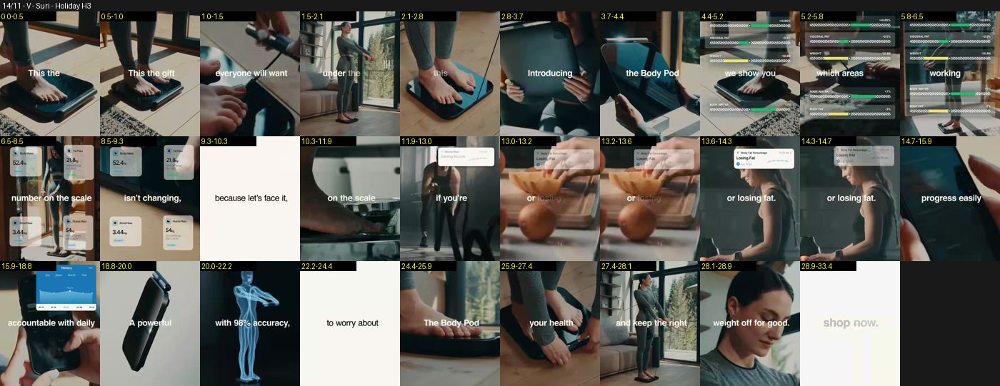

# 14/11 - V - Suri - Holiday H3

Master: `14/11 - V - Suri - Holiday H3` · 33.4s · 720x900

**Pacing:** 29 shots · avg 1.151s · median 0.767s · 8.39 cuts/10s · first cut 0.5s · 223.0 wpm · talk ratio 0.79 · cuts on word start 78.6% · cuts in speech gaps 53.6%
**Audio:** {'I_lufs': -14.2, 'LRA': 3.5, 'true_peak_db': -0.8} · BPM≈117.5 · music {'speech_rms_db': -16.7, 'pause_seconds': 6.4, 'pause_rms_db': -19.8, 'bed_minus_voice_db': -3.1, 'music_bed_likely': True} · cuts with SFX/transient 57.1%

**Captions:** 35 cards · 1 words/card (median) · y≈0.465 of frame height · text height≈0.0333 · colours {'white': 35} · cards crossing a cut: 2
**Headlines:** This the gift (0.5–0.5s, white) | this (2.0–2.0s, white) | Introducing (3.0–3.0s, white) | the Body (3.5–3.5s, white) | MUSCLEMASS (4.5–6.0s, white) | +4LBS% (4.5–6.0s, white) | -0.5% (4.5–6.0s, white) | VISCERALFAT (4.5–6.0s, white)

**Hook (0–3s) spoken:** This is the gift everyone will want under the tree this year, introducing
**Hook on-screen:** This the / This the gift / everyone will want / this / this year! / underthe
**CTA (last 5s):**  · on-screen: XBody / XBody Pod / myhumehealth.com / shop now.

## Beat sheet

| # | in–out (s) | dur | transition | spoken | on-screen text |
|---|---|---|---|---|---|
| 1 | 0.00–0.50 | 0.5 |  | This is | This the |
| 2 | 0.50–1.00 | 0.5 | cut | the gift everyone | This the gift (HEADLINE) |
| 3 | 1.00–1.53 | 0.53 | cut | will want | everyone will want / underthe |
| 4 | 1.53–2.13 | 0.6 | cut | under the tree | underthe / this (HEADLINE) |
| 5 | 2.13–2.80 | 0.67 | cut +SFX hit | this year, | this (HEADLINE) / this year! |
| 6 | 2.80–3.73 | 0.93 | cut | introducing the BodyPod. | this year! / Introducing (HEADLINE) / the Body (HEADLINE) |
| 7 | 3.73–4.37 | 0.63 | cut +SFX hit |  | the Body (HEADLINE) / the Body Pod |
| 8 | 4.37–5.17 | 0.8 | cut | We show you which areas | the Body Pod / MUSCLEMASS (HEADLINE) / +4LBS% (HEADLINE) / -0.5% (HEADLINE) / VISCERALFAT (HEADLINE) / WEIGHT |
| 9 | 5.17–5.77 | 0.6 | cut | you'll need to | MUSCLEMASS (HEADLINE) / +4LBS% (HEADLINE) / -0.5% (HEADLINE) / VISCERALFAT (HEADLINE) / BODYWATER / WEIGHT (HEADLINE) |
| 10 | 5.77–6.50 | 0.73 | cut +SFX hit | be working on, | MUSCLEMASS (HEADLINE) / +4LBS% (HEADLINE) / -0.5% (HEADLINE) / VISCERALFAT (HEADLINE) / BODYWATER / WEIGHT (HEADLINE) |
| 11 | 6.50–8.50 | 2.0 | cut | even when the number on the scale isn't changing. | FatMass (HEADLINE) / BodyWater (HEADLINE) / 21.8kg (HEADLINE) / 52.4% (HEADLINE) / NormalRange (HEADLINE) / (8.1-16.2) (HEADLINE) |
| 12 | 8.50–9.27 | 0.77 | cut +SFX hit | Because | isn't changing. (HEADLINE) |
| 13 | 9.27–10.30 | 1.03 | cut +SFX hit | let's face it, | isn't changing. (HEADLINE) / because let's face it |
| 14 | 10.30–11.87 | 1.57 | cut | the number on the scale doesn't tell | because let's face it / onthe scale |
| 15 | 11.87–13.00 | 1.13 | cut +SFX hit | you if you're gaining muscle or | Muscle Mass (HEADLINE) / Gaining Muscle (HEADLINE) / 0-00-0-0 (HEADLINE) / if you're (HEADLINE) |
| 16 | 13.00–13.17 | 0.17 | cut +SFX hit |  | f Body Fat Percentage (HEADLINE) / Losing Fat (HEADLINE) / orlosilny [red] (HEADLINE) |
| 17 | 13.17–13.63 | 0.47 | cut | losing fat, | f Body Fat Percentage (HEADLINE) / Losing Fat (HEADLINE) / orlosilny [red] (HEADLINE) |
| 18 | 13.63–14.27 | 0.63 | cut |  | Losing Fat (HEADLINE) / +Body Fat Percentage (HEADLINE) / 12:42AM (HEADLINE) / or losing fat. (HEADLINE) |
| 19 | 14.27–14.70 | 0.43 | cut | track your progress | Losing Fat (HEADLINE) / +Body Fat Percentage (HEADLINE) / 12:42AM (HEADLINE) / or losing fat. (HEADLINE) |
| 20 | 14.70–15.90 | 1.2 | cut +SFX hit | easily, and | progress easily (HEADLINE) |
| 21 | 15.90–18.83 | 2.93 | cut +SFX hit | keep yourself accountable with daily weekly charts. A | and keep yourself (HEADLINE) / History [blue] (HEADLINE) / Day [blue] (HEADLINE) / Week [blue] (HEADLINE) / Month [blue] (HEADLINE) / Year [blue] (HEADLINE) |
| 22 | 18.83–20.03 | 1.2 | cut +SFX hit | powerful body analyzer | A powerful (HEADLINE) / body analyzer (HEADLINE) |
| 23 | 20.03–22.17 | 2.13 | cut +SFX hit | with 98 % accuracy, | body analyzer (HEADLINE) / with 98%accuracy (HEADLINE) / you nevar |
| 24 | 22.17–24.43 | 2.27 | cut +SFX hit | you never have to worry about guessing ever again. | you nevar / to worry about (HEADLINE) / guessing ever again. (HEADLINE) |
| 25 | 24.43–25.87 | 1.43 | cut | The BodyPod. designed | guessing ever again. (HEADLINE) / The Body Pod (HEADLINE) |
| 26 | 25.87–27.40 | 1.53 | cut +SFX hit | to optimize your health and keep | your health (HEADLINE) |
| 27 | 27.40–28.13 | 0.73 | cut +SFX hit | the right weight off | your health (HEADLINE) / weight off for good |
| 28 | 28.13–28.87 | 0.73 | cut +SFX hit | for good. | weight off for good |
| 29 | 28.87–33.37 | 4.5 | cut +SFX hit |  | XBody (HEADLINE) / XBody Pod (HEADLINE) / shop now. (HEADLINE) / myhumehealth.com |

## Full transcript

This is the gift everyone will want under the tree this year, introducing the BodyPod. We show you which areas you'll need to be working on, even when the number on the scale isn't changing. Because let's face it, the number on the scale doesn't tell you if you're gaining muscle or losing fat, track your progress easily, and keep yourself accountable with daily weekly charts. A powerful body analyzer with 98% accuracy, you never have to worry about guessing ever again. The BodyPod. designed to optimize your health and keep the right weight off for good.