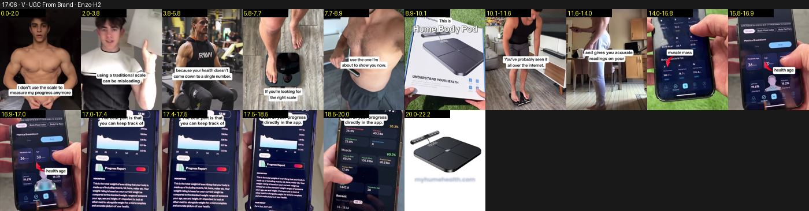

# 17/06 - V - UGC From Brand - Enzo-H2

Master: `17/06 - V - UGC From Brand - Enzo-H2` · 22.2s · 720x900

**Pacing:** 16 shots · avg 1.387s · median 1.484s · 6.76 cuts/10s · first cut 2.0s · 329.0 wpm · talk ratio 0.92 · cuts on word start 73.3% · cuts in speech gaps 93.3%
**Audio:** {'I_lufs': -21.5, 'LRA': 2.7, 'true_peak_db': -4.4} · BPM≈129.2 · music {'speech_rms_db': -25.5, 'pause_seconds': 0.0} · cuts with SFX/transient 40.0%

**Captions:** 94 cards · 1.0 words/card (median) · y≈0.605 of frame height · text height≈0.0383 · colours {'white': 71, 'dark/other': 20, 'blue': 2, 'red': 1} · cards crossing a cut: 12
Highlighted: Eocelent, Body, VIEW
**Headlines:** RIIW (4.0–4.5s, white) | RIW (5.0–5.0s, white) | RIIW (5.5–5.5s, white) | Thisis (9.0–9.0s, white) | Hume BodyPod (9.0–9.0s, white) | >(HumeHealth (9.0–9.0s, white) | UNDERSTANDYOURHEALTH (9.0–9.0s, white) | 9-06 (14.0–14.0s, white)

**Hook (0–3s) spoken:** I don't use the scale to measure my progress anymore. Using a traditional scale
**Hook on-screen:** I don'tusethescaleto / can be misleading / measuremyprogressanymore / using a traditional scale
**CTA (last 5s):** part is that you can keep track of your progress directly in the app. So if you're interested, check them out at humahealth .com. · on-screen: 105.8lbs / 111 bs / 119bs / 128 lbs / 136lbs / 1389 / 1442.8 / 144bs / 15-18Jul / 17.4% / 21 / 23.8%

## Beat sheet

| # | in–out (s) | dur | transition | spoken | on-screen text |
|---|---|---|---|---|---|
| 1 | 0.00–2.00 | 2.0 |  | I don't use the scale to measure my progress anymore. | I don'tusethescaleto / measuremyprogressanymore |
| 2 | 2.00–3.83 | 1.83 | cut | Using a traditional scale can be misleading because | using a traditional scale / can be misleading |
| 3 | 3.83–5.77 | 1.93 | cut | your health doesn't come down to a single number. | using a traditional scale / can be misleading / RIIW (HEADLINE) / becauseyourhealthdoesn't / come down toa singlenumber. / RIW (HEADLINE) |
| 4 | 5.77–7.70 | 1.93 | cut +SFX hit | If you're looking for the right scale to track your progress, | becauseyourhealthdoesn't / come down toa singlenumber. / RIIW (HEADLINE) / If you're looking for / the right scale / to track your progress |
| 5 | 7.70–8.93 | 1.23 | cut +SFX hit | use the one I'm about to show you now. | usetheoneI'm / about to show you now. |
| 6 | 8.93–10.13 | 1.2 | cut +SFX hit | This is the Hume Body Pod. | Thisis (HEADLINE) / Hume BodyPod (HEADLINE) / >(HumeHealth (HEADLINE) / UNDERSTANDYOURHEALTH (HEADLINE) / You've probably seen it / all overthe internet. |
| 7 | 10.13–11.60 | 1.47 | cut +SFX hit | You've probably seen it all over the internet. | You've probably seen it / all overthe internet. |
| 8 | 11.60–13.97 | 2.37 | cut | It pairs up with your phone and gives you accurate readings on your | It pairs up with your phone / and gives you accurate / readings on your |
| 9 | 13.97–15.80 | 1.83 | cut | body fat percentage, also mass body water, | 9-06 (HEADLINE) / 2-05 (HEADLINE) / BodyFatPerc (HEADLINE) / BodyMass Index (HEADLINE) / Weight (HEADLINE) / MetricsBreakdown (HEADLINE) |
| 10 | 15.80–16.87 | 1.07 | cut +SFX hit | and even your health age. | Measures / 1471015202513691317212631471115202530471015202530 (HEADLINE) / BodyFatPerc (HEADLINE) / BodyMassIndex (HEADLINE) / Weight (HEADLINE) / MetricsBreakdown (HEADLINE) |
| 11 | 16.87–17.03 | 0.17 | cut | The | 4W (HEADLINE) / 12M (HEADLINE) / The best part is that (HEADLINE) / you can keep track of (HEADLINE) / 144bs (HEADLINE) / 136lbs (HEADLINE) |
| 12 | 17.03–17.37 | 0.33 | cut +SFX hit | best | 4W (HEADLINE) / 12M (HEADLINE) / The best part is that (HEADLINE) / you can keep track of (HEADLINE) / 144bs (HEADLINE) / 136lbs (HEADLINE) |
| 13 | 17.37–17.53 | 0.17 | cut | part | 4W (HEADLINE) / 12M (HEADLINE) / The best part is that (HEADLINE) / you can keep track of (HEADLINE) / 144bs (HEADLINE) / 136lbs (HEADLINE) |
| 14 | 17.53–18.53 | 1.0 | cut | is that you can keep track of | 144bs (HEADLINE) / 136lbs (HEADLINE) / 128 lbs (HEADLINE) / 111 bs / 25 / 31 |
| 15 | 18.53–20.03 | 1.5 | cut | your progress directly in the app. | trackofyourprogress (HEADLINE) / directly in the app. (HEADLINE) / 1389 (HEADLINE) / 26.3% (HEADLINE) / BodyFat Percentage (HEADLINE) / FatMass (HEADLINE) |
| 16 | 20.03–22.18 | 2.15 | cut | So if you're interested, check them out at humahealth .com. | KickstartYourHealth / JourneyToday (HEADLINE) / myhumeheolth.com (HEADLINE) |

## Full transcript

I don't use the scale to measure my progress anymore. Using a traditional scale can be misleading because your health doesn't come down to a single number. If you're looking for the right scale to track your progress, use the one I'm about to show you now. This is the Hume Body Pod. You've probably seen it all over the internet. It pairs up with your phone and gives you accurate readings on your body fat percentage, also mass body water, and even your health age. The best part is that you can keep track of your progress directly in the app. So if you're interested, check them out at humahealth.com.