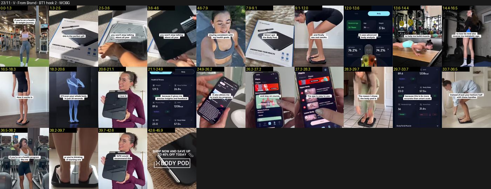

# 23/11 - V - From Brand - BT1 hook 2 - WOBG

Master: `23/11 - V - From Brand - BT1 hook 2 - WOBG` · 45.9s · 720x900

**Pacing:** 24 shots · avg 1.911s · median 1.534s · 5.02 cuts/10s · first cut 1.333s · 277.0 wpm · talk ratio 0.88 · cuts on word start 78.3% · cuts in speech gaps 60.9%
**Audio:** {'I_lufs': -14.1, 'LRA': 2.5, 'true_peak_db': -0.9} · BPM≈136.0 · music {'speech_rms_db': -18.2, 'pause_seconds': 3.3, 'pause_rms_db': -17.7, 'bed_minus_voice_db': 0.5, 'music_bed_likely': True} · cuts with SFX/transient 78.3%

**Captions:** 157 cards · 1 words/card (median) · y≈0.505 of frame height · text height≈0.0333 · colours {'white': 119, 'dark/other': 29, 'blue': 2, 'green': 4, 'red': 3} · cards crossing a cut: 2
Highlighted: Body, MetabolicAge, 26Years, Data, Standard, pwaymetricfocused, programs, TRYPREMIUM, Younger
**Headlines:** If you're on a health (0.0–1.0s, white) | or weight journey (0.0–1.0s, white) | HumeHealth (1.5–2.0s, white) | UNDERSTANDYOURHEALTH (1.5–2.0s, white) | NPOSITION CORPORELLECONNETEE (2.0–2.0s, white) | HumeHealth" (2.0–2.0s, white) | HumeHealth (8.0–8.0s, white) | UNDERSTANDYOURHEALTH (8.0–8.0s, white)

**Hook (0–3s) spoken:** If you're on a health or weight journey, this is the perfect gift you won't stop
**Hook on-screen:** ADVERTENCIA / HumeHealth / HumeHealth" / If you're on a health / NPOSITION CORPORELLECONNETEE / UNDERSTANDYOURHEALTH / aboutallyear / nontint / or weight journey / pupunGos / thisistheperfectgift / you won't stop talking
**CTA (last 5s):** 10 out of 10 would recommend this. · on-screen: 10/10would / SHOPNOWANDSAVEUP / TO40%OFFTODAY / XBODYPOD / XBQDY POD / recommendthis

## Beat sheet

| # | in–out (s) | dur | transition | spoken | on-screen text |
|---|---|---|---|---|---|
| 1 | 0.00–1.33 | 1.33 |  | If you're on a health or weight journey, | If you're on a health (HEADLINE) / or weight journey (HEADLINE) |
| 2 | 1.33–2.53 | 1.2 | cut | this is the perfect gift you | If you're on a health (HEADLINE) / or weight journey (HEADLINE) / HumeHealth (HEADLINE) / thisistheperfectgift / UNDERSTANDYOURHEALTH (HEADLINE) / NPOSITION CORPORELLECONNETEE (HEADLINE) |
| 3 | 2.53–3.60 | 1.07 | cut +SFX hit | won't stop talking about | nontint / you won't stop talking / pupunGos / aboutallyear / ADVERTENCIA / idKGndemfor |
| 4 | 3.60–4.63 | 1.03 | cut +SFX hit | all year. | you won't stop talking / aboutallyear / I've always had / such a hard time |
| 5 | 4.63–7.93 | 3.3 | cut +SFX hit | I've always had such a hard time staying consistent with my health goals. | I've always had / such a hard time / staying consistent with / myhealthgoals. |
| 6 | 7.93–9.07 | 1.13 | cut +SFX hit | But since I got the body pod, | HumeHealth (HEADLINE) / SinceIgot / theBodyPod, / UNDERSTANDYOURHEALTH (HEADLINE) / SMARTEODYCOMPOSITIONASALYZER (HEADLINE) / SALANCEDE COUFOSITION CORPORELLE CONNETEE (HEADLINE) |
| 7 | 9.07–11.97 | 2.9 | cut +SFX hit | I've been able to track my progress and finally see real results. | I've been able to / track my progress / andfinally / see real results. |
| 8 | 11.97–13.57 | 1.6 | cut +SFX hit | It uses advanced body analysis to | Insights (HEADLINE) / YourBodyFatHasDecreased (HEADLINE) / LeamMore (HEADLINE) / Congrats!Yourbodyfathasdropped2%inthepast4 (HEADLINE) / weeksthiscanbeattrinutedtoimprovedactivityand (HEADLINE) / nutrtionalbehavior,Continueonbehaviorand youwil |
| 9 | 13.57–14.43 | 0.87 | cut +SFX hit | help me build muscle | SVALYAS (HEADLINE) / HAMMERSTRENGTH / to help me build muscle |
| 10 | 14.43–16.53 | 2.1 | cut +SFX hit | to lose fat and also reverse your metabolic age. | SVALYAS (HEADLINE) / HAMMERSTRENGTH / to help me build muscle / tolosefatAndalso / reversemy metabolicage. |
| 11 | 16.53–18.30 | 1.77 | cut +SFX hit | How it works is you just step on and | How it works is / you just / step on and |
| 12 | 18.30–20.60 | 2.3 | cut | it'll scan your whole body in just 20 seconds. | you just / step on and / it'll scan your whole body / injust2o seconds. |
| 13 | 20.60–21.07 | 0.47 | cut +SFX hit | I love it | 136. (HEADLINE) / 132 (HEADLINE) / 21/09 (HEADLINE) / 22/09 (HEADLINE) / 23/09 (HEADLINE) / WeightBody (HEADLINE) |
| 14 | 21.07–24.87 | 3.8 | cut +SFX hit | because it gives me precise insights and feedback on which areas I need to work on. | 136. (HEADLINE) / 132 (HEADLINE) / 21/09 (HEADLINE) / 22/09 (HEADLINE) / 23/09 (HEADLINE) / WeightBody (HEADLINE) |
| 15 | 24.87–26.17 | 1.3 | cut +SFX hit | It allows me to track your progress and | 12:06 (HEADLINE) / 70 (HEADLINE) / 12M / Italsoallowsme / totrackmyprogress / Plans (HEADLINE) |
| 16 | 26.17–27.17 | 1.0 | cut | stay on course. | Plans (HEADLINE) / Classes (HEADLINE) / Programs (HEADLINE) / Try Humctorfree [red] (HEADLINE) / pwaymetricfocused [red] / programs [red] |
| 17 | 27.17–28.30 | 1.13 | cut +SFX hit | The app is easy to use. The | Plans (HEADLINE) / Classes (HEADLINE) / Programs (HEADLINE) / TRYPREMIUM [red] (HEADLINE) / UpperBody (HEADLINE) / UPPERBODY,CORE&CARDIO |
| 18 | 28.30–29.70 | 1.4 | cut +SFX hit | reason I chose the body pod is | Plans (HEADLINE) / Classes (HEADLINE) / Programs (HEADLINE) / TRYPREMIUM [red] (HEADLINE) / UpperBody (HEADLINE) / The app is easy to use. |
| 19 | 29.70–33.67 | 3.97 | cut | because this is six times more accurate than smart scale. It measures your full body instead | Health&Fitness (HEADLINE) / Weight (HEADLINE) / BodyFatRate (HEADLINE) / 129.5 (HEADLINE) / 26.8% (HEADLINE) / Good [green] (HEADLINE) |
| 20 | 33.67–36.47 | 2.8 | cut +SFX hit | of just your bottom half with these handles. | instead of justyourbottomhalf / withthesehandles |
| 21 | 36.47–38.23 | 1.77 | cut +SFX hit | If you are on a health program like me or | instead of justyourbottomhalf / withthesehandles / Ifyou're on ahealth program / likeme / or you're thinking / of starting one |
| 22 | 38.23–39.70 | 1.47 | cut +SFX hit | you're thinking of starting one, | or you're thinking / of starting one |
| 23 | 39.70–42.63 | 2.93 | cut +SFX hit | make sure to get the body pod. 10 out of 10 would recommend this. | Make sure to get / theBodyPod / 10/10would / recommendthis |
| 24 | 42.63–45.86 | 3.23 | cut |  | SHOPNOWANDSAVEUP / TO40%OFFTODAY / XBODYPOD (HEADLINE) / XBQDY POD (HEADLINE) |

## Full transcript

If you're on a health or weight journey, this is the perfect gift you won't stop talking about all year. I've always had such a hard time staying consistent with my health goals. But since I got the body pod, I've been able to track my progress and finally see real results. It uses advanced body analysis to help me build muscle to lose fat and also reverse your metabolic age. How it works is you just step on and it'll scan your whole body in just 20 seconds. I love it because it gives me precise insights and feedback on which areas I need to work on. It allows me to track your progress and stay on course. The app is easy to use. The reason I chose the body pod is because this is six times more accurate than smart scale. It measures your full body instead of just your bottom half with these handles. If you are on a health program like me or you're thinking of starting one, make sure to get the body pod. 10 out of 10 would recommend this.