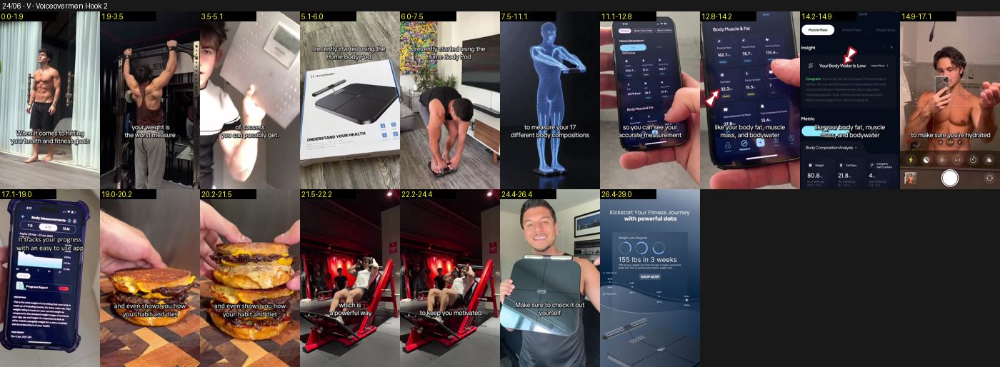

# 24/06 - V - Voiceovermen Hook 2

Master: `24/06 - V - Voiceovermen Hook 2` · 29.0s · 720x1280

**Pacing:** 17 shots · avg 1.706s · median 1.666s · 5.52 cuts/10s · first cut 1.9s · 283.0 wpm · talk ratio 0.85 · cuts on word start 87.5% · cuts in speech gaps 68.8%
**Audio:** {'I_lufs': -16.5, 'LRA': 2.9, 'true_peak_db': -0.2} · BPM≈117.5 · music {'speech_rms_db': -20.5, 'pause_seconds': 2.5, 'pause_rms_db': -22.4, 'bed_minus_voice_db': -1.9, 'music_bed_likely': True} · cuts with SFX/transient 25.0%

**Captions:** 95 cards · 1 words/card (median) · y≈0.636 of frame height · text height≈0.0281 · colours {'white': 70, 'blue': 2, 'dark/other': 17, 'red': 6} · cards crossing a cut: 5
Highlighted: to measure your 17, Measures, to make sure you're hydrated, andyouroverall health score., and even showsyou how, your habit and diet, is impacting, your health,
**Headlines:** Irecentlystartedusingthe (5.0–7.0s, white) | HumeBodyPod (5.0–7.0s, white) | 5:19 (11.0–11.0s, white) | Botly Fal Pere (11.0–11.0s, white) | BedyMassIndex (11.0–11.0s, white) | Weieh! (11.0–11.0s, white) | MetriesBreakdew (11.0–11.0s, white) | Fit FOBus (11.0–11.0s, white)

**Hook (0–3s) spoken:** When it comes to hitting your health and fitness goals, your weight is the worst measure
**Hook on-screen:** When it comes to hitting / the worstmeasure / your health and fitness goals / your weight is
**CTA (last 5s):** Make sure to check it out yourself and thank me later. · on-screen: %BodyFat (%) / 155lbsin3weeks / KickstartYourFitness Journey / Makesuretocheckitout / SHOPNOW / Weight Loss Progress / Welght (lb) / XHumeHealth / and thank me later. / journey. / through your fitness / withpowerful data

## Beat sheet

| # | in–out (s) | dur | transition | spoken | on-screen text |
|---|---|---|---|---|---|
| 1 | 0.00–1.90 | 1.9 |  | When it comes to hitting your health and fitness goals, | When it comes to hitting / your health and fitness goals |
| 2 | 1.90–3.47 | 1.57 | cut | your weight is the worst measure of | When it comes to hitting / your health and fitness goals / your weight is / the worstmeasure |
| 3 | 3.47–5.13 | 1.67 | cut +SFX hit | success you can possibly get. | your weight is / the worstmeasure / of success / you can possibly get. / Irecentlystartedusingthe (HEADLINE) / HumeBodyPod (HEADLINE) |
| 4 | 5.13–6.03 | 0.9 | cut | I recently started using | Irecentlystartedusingthe (HEADLINE) / HumeBodyPod (HEADLINE) / HumeHealth / UNDERSTANDYOURHEALTH / SMARTRODYCOMPOSITIONARACYTER / SALANCLDECONPOETIN DORPOREILE CONNFTRE |
| 5 | 6.03–7.47 | 1.43 | cut | the Hume Body Pod, | Irecentlystartedusingthe (HEADLINE) / HumeBodyPod (HEADLINE) |
| 6 | 7.47–11.10 | 3.63 | cut | which uses small electrical current to measure your 17 different body compositions. | Irecentlystartedusingthe (HEADLINE) / HumeBodyPod (HEADLINE) / whichusessmall / electrical current / to measure your 17 [blue] / different body compositions |
| 7 | 11.10–12.77 | 1.67 | cut +SFX hit | So you can see your accurate measurement, | 5:19 (HEADLINE) / Botly Fal Pere (HEADLINE) / BedyMassIndex (HEADLINE) / Weieh! (HEADLINE) / MetriesBreakdew (HEADLINE) / Fit FOBus (HEADLINE) |
| 8 | 12.77–14.17 | 1.4 | cut | like your body fat, muscle mass, | BodyFatRate / Fat Mass / BodyMuscle&Fat (HEADLINE) / FatFreeMass (HEADLINE) / MuscleRate (HEADLINE) / MuscleMass (HEADLINE) |
| 9 | 14.17–14.90 | 0.73 | cut +SFX hit | and body water to | Fat Mass / MuscleMass (HEADLINE) / mass,andbodywater / 132 (HEADLINE) / 21/09 (HEADLINE) / 22/09 (HEADLINE) |
| 10 | 14.90–17.07 | 2.17 | cut | make sure you're hydrated and your overall health score. | to make sure you're hydrated [red] / 1,5x / 4:3 / andyouroverall health score. [red] / BodyMeasurements (HEADLINE) / 7D (HEADLINE) |
| 11 | 17.07–18.97 | 1.9 | cut | It tracks your progress with an easy -to -use app and | BodyMeasurements (HEADLINE) / 7D (HEADLINE) / 4W (HEADLINE) / 12M (HEADLINE) / Avgfor25May-22Jun,2023 (HEADLINE) / 1273 (HEADLINE) |
| 12 | 18.97–20.20 | 1.23 | cut | it even shows you how your habit | and even showsyou how [red] / your habit and diet [red] |
| 13 | 20.20–21.50 | 1.3 | cut | and diet is impacting your health, | and even showsyou how [red] / your habit and diet [red] / is impacting [red] / your health, [red] |
| 14 | 21.50–22.17 | 0.67 | cut | which is a powerful | whichis / a powerful way |
| 15 | 22.17–24.37 | 2.2 | cut +SFX hit | way to keep you motivated through your finished journey. | whichis / a powerful way / tokeepyoumotivated / through your fitness / journey. |
| 16 | 24.37–26.37 | 2.0 | cut | Make sure to check it out yourself and thank me later. | through your fitness / journey. / Makesuretocheckitout / yourself / and thank me later. |
| 17 | 26.37–29.00 | 2.63 | cut |  | and thank me later. / KickstartYourFitness Journey (HEADLINE) / withpowerful data (HEADLINE) / Weight Loss Progress (HEADLINE) / 155lbsin3weeks / %BodyFat (%) |

## Full transcript

When it comes to hitting your health and fitness goals, your weight is the worst measure of success you can possibly get. I recently started using the Hume Body Pod, which uses small electrical current to measure your 17 different body compositions. So you can see your accurate measurement, like your body fat, muscle mass, and body water to make sure you're hydrated and your overall health score. It tracks your progress with an easy-to-use app and it even shows you how your habit and diet is impacting your health, which is a powerful way to keep you motivated through your finished journey. Make sure to check it out yourself and thank me later.