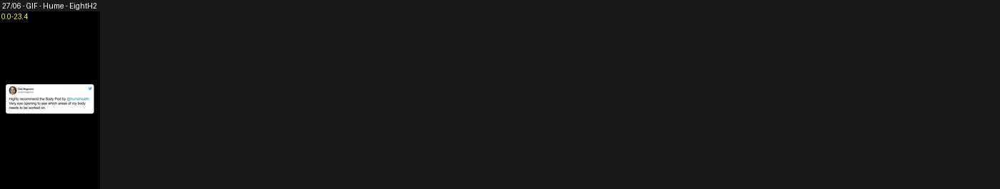

# 27/06 - GIF - Hume - EightH2

Master: `27/06 - GIF - Hume - EightH2` · 23.4s · 720x1280

**Pacing:** 1 shots · avg 23.423s · median 23.423s · 0.0 cuts/10s · first cut Nones · None wpm · talk ratio 0.0 · cuts on word start None% · cuts in speech gaps None%
**Audio:** {'I_lufs': -23.3, 'LRA': 6.2, 'true_peak_db': -7.9} · BPM≈99.4 · music None · cuts with SFX/transient None%

**Captions:** 50 cards · 1.0 words/card (median) · y≈0.485 of frame height · text height≈0.0222 · colours {'white': 45, 'dark/other': 4, 'blue': 1} · cards crossing a cut: 0
Highlighted: @BodyPodisagamechanger.
**Headlines:** Muscle (1.0–2.5s, white) | Water Weight (1.0–2.5s, white)

**Hook (0–3s) spoken:** 
**Hook on-screen:** 12/03 / 13 / 18 / 22 / 23 / 37 / 52 / 67 / 73 Points / Loss / Muscle / Water Weight / Weight
**CTA (last 5s):**  · on-screen: @EmilyWoods / I'veboughtin2024 / It'sreallybeenmysecrettokickstartingmyfitness / Ithought itwasanother pointless tech, until I started / Repluyingtoaskoboro / The@BodyPodHumeHealth isthebestthing / X HumeHealth / journey. / using it.

## Beat sheet

| # | in–out (s) | dur | transition | spoken | on-screen text |
|---|---|---|---|---|---|
| 1 | 0.00–23.42 | 23.42 |  |  | 12/03 / Weight / Loss / 22 / Muscle (HEADLINE) / Water Weight (HEADLINE) |

## Full transcript

