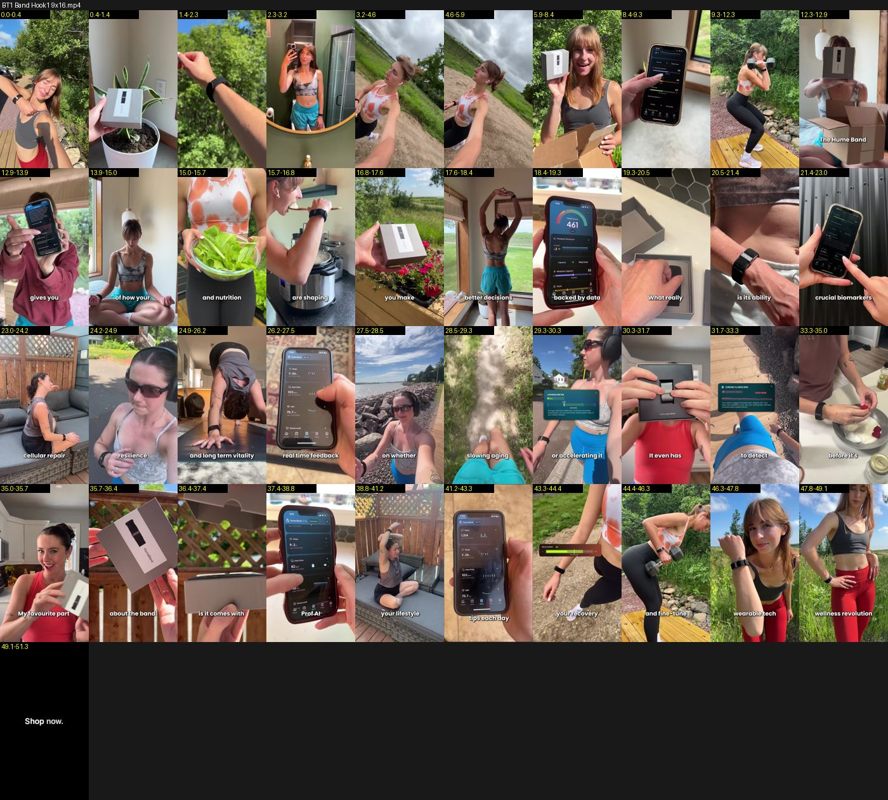

# BT1 Band Hook1 9x16.mp4

Master: `BT1 Band Hook1 9x16.mp4` · 51.3s · 720x1280

**Pacing:** 41 shots · avg 1.251s · median 1.166s · 7.8 cuts/10s · first cut 0.433s · 219.0 wpm · talk ratio 0.88 · cuts on word start 80.0% · cuts in speech gaps 52.5%
**Audio:** {'I_lufs': -14.3, 'LRA': 5.4, 'true_peak_db': -0.3} · BPM≈129.2 · music {'speech_rms_db': -18.2, 'pause_seconds': 3.3, 'pause_rms_db': -19.1, 'bed_minus_voice_db': -0.9, 'music_bed_likely': True} · cuts with SFX/transient 77.5%

**Captions:** 78 cards · 1.0 words/card (median) · y≈0.684 of frame height · text height≈0.0304 · colours {'dark/other': 13, 'red': 6, 'blue': 4, 'white': 53, 'yellow': 2} · cards crossing a cut: 0
Highlighted: gives you, of how your, slowing aging, oraccelerating it, the ability, HIGHRISK, chronicillness, My favourite part, 2ms, andfine-tune, your routine, wellnessrevolution
**Headlines:** Body Comp (9.0–9.0s, dark/other) | hMetaboicCapacity (9.0–9.0s, dark/other) | 4:50 (19.0–19.0s, blue) | HealthScore (19.0–19.0s, blue) | 461 (19.0–19.0s, blue) | 12:20 (22.0–22.0s, white) | sleep (26.0–26.0s, white) | 7n34m (26.0–27.0s, white)

**Hook (0–3s) spoken:** Hi, I think this is the best gift I've gotten all year. I've always struggled with
**Hook on-screen:** 
**CTA (last 5s):** It's not just wearable tech, it's a wellness revolution. · on-screen: BAND / Shop now. / wearabletech / wellnessrevolution

## Beat sheet

| # | in–out (s) | dur | transition | spoken | on-screen text |
|---|---|---|---|---|---|
| 1 | 0.00–0.43 | 0.43 |  | Hi, I |  |
| 2 | 0.43–1.40 | 0.97 | cut | think this is the best gift I've |  |
| 3 | 1.40–2.30 | 0.9 | cut +SFX hit | gotten all year. |  |
| 4 | 2.30–3.23 | 0.93 | cut +SFX hit | I've always struggled with |  |
| 5 | 3.23–4.57 | 1.33 | cut +SFX hit | maintaining my energy levels |  |
| 6 | 4.57–5.87 | 1.3 | cut | throughout the day. |  |
| 7 | 5.87–8.37 | 2.5 | cut +SFX hit | Since I got the Hume Longevity Band, I've been able to |  |
| 8 | 8.37–9.30 | 0.93 | cut +SFX hit | understand why, | Body Comp (HEADLINE) / hMetaboicCapacity (HEADLINE) / GStrain / viewMoreDetails→ / My Journey / SieepOvernview |
| 9 | 9.30–12.33 | 3.03 | cut | and I've been also able to reverse my metabolic age. Hume | Body Comp (HEADLINE) / hMetaboicCapacity (HEADLINE) / GStrain / viewMoreDetails→ / My Journey / SieepOvernview |
| 10 | 12.33–12.90 | 0.57 | cut +SFX hit | Band gives |  |
| 11 | 12.90–13.87 | 0.97 | cut +SFX hit | you a clear view of | gives you [red] |
| 12 | 13.87–15.00 | 1.13 | cut | how your daily habits and | of how your [blue] |
| 13 | 15.00–15.67 | 0.67 | cut +SFX hit | nutrition are | and nutrition |
| 14 | 15.67–16.83 | 1.17 | cut +SFX hit | shaping your health. | are shaping |
| 15 | 16.83–17.63 | 0.8 | cut +SFX hit | It helps you make better | you make |
| 16 | 17.63–18.43 | 0.8 | cut +SFX hit | decisions backed | betterdecisions |
| 17 | 18.43–19.33 | 0.9 | cut +SFX hit | by data. | betterdecisions / 4:50 [blue] (HEADLINE) / HealthScore [blue] (HEADLINE) / 461 [blue] (HEADLINE) / MetabolicMomentum / Capacity |
| 18 | 19.33–20.53 | 1.2 | cut +SFX hit | What really sets it apart is | 4:50 [blue] (HEADLINE) / HealthScore [blue] (HEADLINE) / 461 [blue] (HEADLINE) / MetabolicMomentum / Capacity / 53 |
| 19 | 20.53–21.40 | 0.87 | cut | its ability to | XHume / is its ability |
| 20 | 21.40–23.00 | 1.6 | cut +SFX hit | track crucial biomarkers tied | XHume / is its ability / 12:20 (HEADLINE) / 649 / 5,059/ / 1210 |
| 21 | 23.00–24.23 | 1.23 | cut +SFX hit | to cellular repair, | tied to / resilience |
| 22 | 24.23–24.87 | 0.63 | cut +SFX hit | resilience, | resilience |
| 23 | 24.87–26.17 | 1.3 | cut +SFX hit | and long -term vitality. | and long term vitality / sleep (HEADLINE) / 7n34m (HEADLINE) / 103bpm / 75.7ms / You'll get |
| 24 | 26.17–27.50 | 1.33 | cut +SFX hit | You'll get real -time feedback on | sleep (HEADLINE) / 7n34m (HEADLINE) / 103bpm / 75.7ms / You'll get / 心sleep (HEADLINE) |
| 25 | 27.50–28.47 | 0.97 | cut +SFX hit | whether your habit is | your habit is |
| 26 | 28.47–29.30 | 0.83 | cut | slowing aging or | your habit is / slowing aging [blue] |
| 27 | 29.30–30.30 | 1.0 | cut | accelerating it, | slowing aging [blue] / oraccelerating it [blue] |
| 28 | 30.30–31.67 | 1.37 | cut +SFX hit | it even has the ability to | oraccelerating it [blue] / LiveLonger.Better. / the ability [red] |
| 29 | 31.67–33.30 | 1.63 | cut +SFX hit | detect chronic illness before | todetect / HIGHRISK [red] / chronicillness [blue] |
| 30 | 33.30–34.97 | 1.67 | cut +SFX hit | it's too late. | HIGHRISK [red] / chronicillness [blue] / TURE (HEADLINE) / FOCU (HEADLINE) / THE (HEADLINE) / before it's |
| 31 | 34.97–35.70 | 0.73 | cut +SFX hit | My favorite part about | My favourite part [red] |
| 32 | 35.70–36.40 | 0.7 | cut +SFX hit | the band is | HumeBand (HEADLINE) / aboutthe band |
| 33 | 36.40–37.37 | 0.97 | cut +SFX hit | it comes with Prof | HumeBand (HEADLINE) / aboutthe band / isitcomeswith |
| 34 | 37.37–38.80 | 1.43 | cut +SFX hit | AI, which | isitcomeswith / HumeBand(47%) [blue] (HEADLINE) / Connected (HEADLINE) / Sleep / 9n2m / Last:10/07/2025 |
| 35 | 38.80–41.23 | 2.43 | cut +SFX hit | adapts to your lifestyle over time, | which adapts to / your lifestyle / Hume Band (HEADLINE) / 1,514 (HEADLINE) / La:13/07/2025 (HEADLINE) / 7h34m |
| 36 | 41.23–43.27 | 2.03 | cut +SFX hit | delivering personalized tips each day to | Hume Band (HEADLINE) / 1,514 (HEADLINE) / La:13/07/2025 (HEADLINE) / 7h34m / Last:13/07/2025 / HeartRate |
| 37 | 43.27–44.43 | 1.17 | cut +SFX hit | enhance your recovery and | Last:13/07/2025 / 103bpm / 75.7 ms / tips each day / 1,514 / 心sleep |
| 38 | 44.43–46.33 | 1.9 | cut | fine -tune your routine. | yourrecovery / andfine-tune [yellow] / your routine [yellow] |
| 39 | 46.33–47.77 | 1.43 | cut +SFX hit | It's not just wearable tech, | your routine [yellow] / wearabletech |
| 40 | 47.77–49.07 | 1.3 | cut +SFX hit | it's a wellness revolution. | wellnessrevolution [red] / BAND |
| 41 | 49.07–51.29 | 2.23 | cut |  | BAND / Shop now. |

## Full transcript

Hi, I think this is the best gift I've gotten all year. I've always struggled with maintaining my energy levels throughout the day. Since I got the Hume Longevity Band, I've been able to understand why, and I've been also able to reverse my metabolic age. Hume Band gives you a clear view of how your daily habits and nutrition are shaping your health. It helps you make better decisions backed by data. What really sets it apart is its ability to track crucial biomarkers tied to cellular repair, resilience, and long-term vitality. You'll get real-time feedback on whether your habit is slowing aging or accelerating it, it even has the ability to detect chronic illness before it's too late. My favorite part about the band is it comes with Prof AI, which adapts to your lifestyle over time, delivering personalized tips each day to enhance your recovery and fine-tune your routine. It's not just wearable tech, it's a wellness revolution.