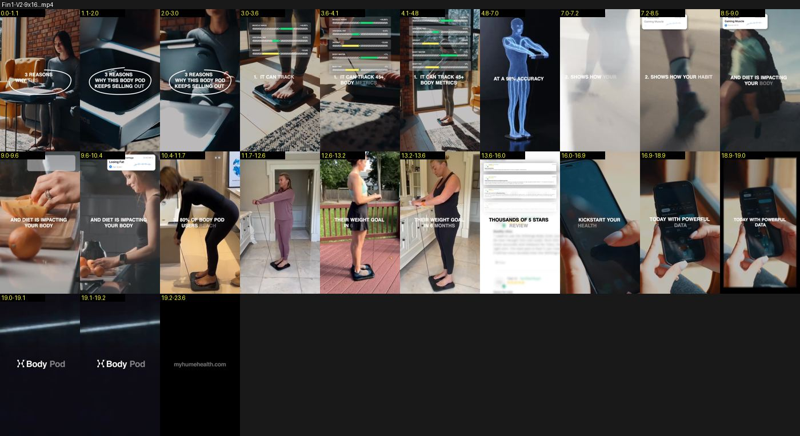

# Fin1-V2-9x16...mp4

Master: `Fin1-V2-9x16...mp4` · 23.6s · 720x1280

**Pacing:** 23 shots · avg 1.025s · median 0.84s · 9.33 cuts/10s · first cut 1.12s · 210.0 wpm · talk ratio 0.68 · cuts on word start 54.5% · cuts in speech gaps 45.5%
**Audio:** {'I_lufs': -13.4, 'LRA': 4.3, 'true_peak_db': -0.1} · BPM≈112.3 · music {'speech_rms_db': -15.1, 'pause_seconds': 6.0, 'pause_rms_db': -16.6, 'bed_minus_voice_db': -1.5, 'music_bed_likely': True} · cuts with SFX/transient 81.8%

**Captions:** 34 cards · 1.0 words/card (median) · y≈0.486 of frame height · text height≈0.0293 · colours {'white': 20, 'red': 3, 'blue': 3, 'dark/other': 8} · cards crossing a cut: 7
Highlighted: 3REASONS, WHYTHIS, CCURACY, ATA98%, ATA98%ACCURACY, YOURBODY
**Headlines:** MUSCLEMASS (3.0–3.5s, white) | -0.5% (3.0–3.0s, white) | WEIGHT (3.0–4.0s, white) | -12LBS (3.5–4.0s, white) | VISCERALFAT (4.0–4.0s, white) | 0.5% (4.0–4.5s, white) | GainingMuscle (8.0–8.0s, white) | BodyFatPercentage (10.0–10.0s, white)

**Hook (0–3s) spoken:** Three reasons why this body pod keeps selling out.
**Hook on-screen:** 3REASONS / KEEPSSELLING / KEEPSSELLINGOUT / WHYTHIS / WHYTHISBODYPOD / X Body Pod
**CTA (last 5s):**  · on-screen: XBody Pod / myhumehealth.com / shop now.

## Beat sheet

| # | in–out (s) | dur | transition | spoken | on-screen text |
|---|---|---|---|---|---|
| 1 | 0.00–1.12 | 1.12 |  | Three reasons why | X Body Pod / 3REASONS [red] / WHYTHIS [red] / WHYTHISBODYPOD / KEEPSSELLING |
| 2 | 1.12–2.00 | 0.88 | cut +SFX hit | this body pod keeps | 3REASONS [red] / WHYTHISBODYPOD / KEEPSSELLING / KEEPSSELLINGOUT |
| 3 | 2.00–3.00 | 1.0 | cut +SFX hit | selling out. | 3REASONS [red] / WHYTHISBODYPOD / KEEPSSELLINGOUT |
| 4 | 3.00–3.56 | 0.56 | cut +SFX hit | It can track 45 | MUSCLEMASS (HEADLINE) / -0.5% (HEADLINE) / WEIGHT (HEADLINE) / 1.ITCANTRACK / -12LBS (HEADLINE) / 1.ITCANTRACK45+ |
| 5 | 3.56–4.08 | 0.52 | cut +SFX hit | body | MUSCLEMASS (HEADLINE) / WEIGHT (HEADLINE) / -12LBS (HEADLINE) / 1.ITCANTRACK45+ / BODYMETRICS / VISCERALFAT (HEADLINE) |
| 6 | 4.08–4.84 | 0.76 | cut | metrics | WEIGHT (HEADLINE) / -12LBS (HEADLINE) / 1.ITCANTRACK45+ / BODYMETRICS / VISCERALFAT (HEADLINE) / 0.5% (HEADLINE) |
| 7 | 4.84–7.00 | 2.16 | cut +SFX hit | at a 98 % accuracy. Shows | 1.ITCANTRACK45+ / BODYMETRICS / 0.5% (HEADLINE) / CCURACY [blue] / ATA98% [blue] / ATA98%ACCURACY [blue] |
| 8 | 7.00–7.24 | 0.24 | cut +SFX hit |  | 2.SHOWSHOWYOUR |
| 9 | 7.24–8.52 | 1.28 | cut +SFX hit | how your habit and diet | 2.SHOWSHOWYOUR / GainingMuscle (HEADLINE) / AND DIETISIMPACTING |
| 10 | 8.52–8.96 | 0.44 | cut | is impacting | AND DIETISIMPACTING |
| 11 | 8.96–9.60 | 0.64 | cut +SFX hit | your body. | AND DIETISIMPACTING / YOURBODY [red] |
| 12 | 9.60–10.44 | 0.84 | cut +SFX hit | 80 | AND DIETISIMPACTING / YOURBODY [red] / BodyFatPercentage (HEADLINE) / Losing Fat (HEADLINE) |
| 13 | 10.44–11.68 | 1.24 | cut +SFX hit | % of body pod users | AND DIETISIMPACTING / YOURBODY [red] / BodyFatPercentage (HEADLINE) / Losing Fat (HEADLINE) / 80%OFBODYPOD / USERSREACH |
| 14 | 11.68–12.64 | 0.96 | cut | reach their weight |  |
| 15 | 12.64–13.20 | 0.56 | cut | goal in | THEIRWEIGHTGOAL / IN6 MONTHS |
| 16 | 13.20–13.60 | 0.4 | cut +SFX hit | 6 months, | THEIRWEIGHTGOAL / IN6 MONTHS |
| 17 | 13.60–15.96 | 2.36 | cut +SFX hit | thousands of 5 stars review. Kickstart | THOUSANDSOF5 / THOUSANDS OF5 STARS / REVIEW |
| 18 | 15.96–16.92 | 0.96 | cut +SFX hit | your health journey | KICKSTARTYOUR / HEALTH |
| 19 | 16.92–18.92 | 2.0 | cut +SFX hit | today with powerful data. | TODAY WITHPOWERFUL / MetricsBreakdown / 169 / 22 / 20 / 72.4% |
| 20 | 18.92–19.00 | 0.08 | cut +SFX hit |  |  |
| 21 | 19.00–19.08 | 0.08 | cut +SFX hit |  | XBody Pod (HEADLINE) |
| 22 | 19.08–19.16 | 0.08 | cut +SFX hit |  | XBody Pod (HEADLINE) |
| 23 | 19.16–23.57 | 4.41 | cut +SFX hit |  | XBody Pod (HEADLINE) / shop now. (HEADLINE) / myhumehealth.com |

## Full transcript

Three reasons why this body pod keeps selling out. It can track 45 body metrics at a 98% accuracy. Shows how your habit and diet is impacting your body. 80% of body pod users reach their weight goal in 6 months, thousands of 5 stars review. Kickstart your health journey today with powerful data.