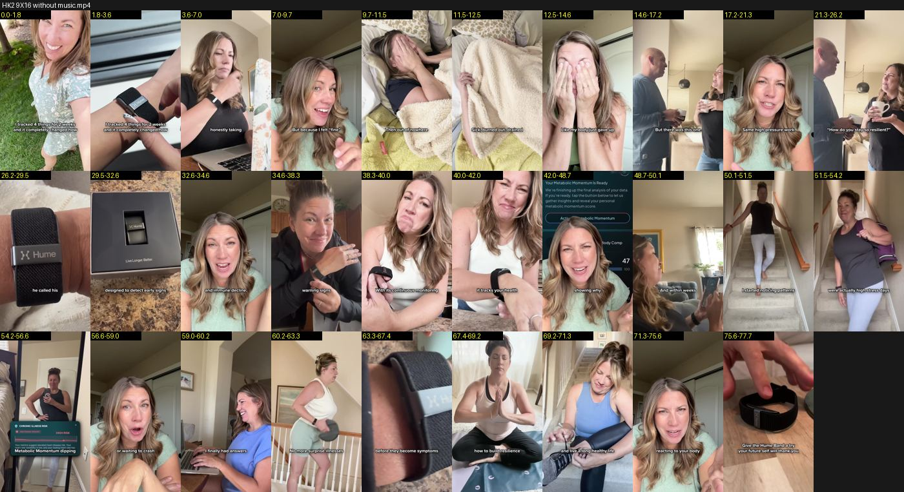

# HK2 9X16 without music.mp4

Master: `HK2 9X16 without music.mp4` · 77.7s · 720x1280

**Pacing:** 29 shots · avg 2.678s · median 2.334s · 3.6 cuts/10s · first cut 1.767s · 230.0 wpm · talk ratio 0.93 · cuts on word start 75.0% · cuts in speech gaps 82.1%
**Audio:** {'I_lufs': -19.3, 'LRA': 2.8, 'true_peak_db': -5.0} · BPM≈123.0 · music {'speech_rms_db': -24.0, 'pause_seconds': 0.8, 'pause_rms_db': -21.8, 'bed_minus_voice_db': 2.2, 'music_bed_likely': True} · cuts with SFX/transient 53.6%

**Captions:** 81 cards · 2 words/card (median) · y≈0.73 of frame height · text height≈0.0293 · colours {'white': 77, 'dark/other': 3, 'blue': 1} · cards crossing a cut: 4
Highlighted: Ifinallyhad answers
**Headlines:** XHume (26.0–28.0s, white) | XHume (30.0–30.0s, white) | XHume (32.0–32.0s, white) | CHumeBand (sesu (34.0–34.0s, blue) | HealthScore (42.0–43.0s, dark/other) | 479 (42.0–43.0s, white) | HumePlusExclusive (43.0–43.0s, dark/other) | ort by (43.0–43.0s, white)

**Hook (0–3s) spoken:** I tracked four things for two weeks and it completely changed how I
**Hook on-screen:** Hume / Itracked4thingsfor2weeks / anditcompletelychanged how
**CTA (last 5s):** your body after it breaks down, give this a try. Your future self will thank you for the heads up. · on-screen: Give the Hume Band a try / XHume / afteritbreaksdown / reacting to your body / your future self will thankyou

## Beat sheet

| # | in–out (s) | dur | transition | spoken | on-screen text |
|---|---|---|---|---|---|
| 1 | 0.00–1.77 | 1.77 |  | I tracked four things for two weeks and | Itracked4thingsfor2weeks / anditcompletelychanged how |
| 2 | 1.77–3.63 | 1.87 | cut +SFX hit | it completely changed how I see my health. | Itracked4thingsfor2weeks / anditcompletelychanged how / Hume / Iseemyhealth / My job's busy |
| 3 | 3.63–7.03 | 3.4 | cut | My job's busy and I was honestly taking a huge toll on my body. | My job's busy / and it was / honestly taking / a huge toll on my body / ButbecauseIfelt“fine" |
| 4 | 7.03–9.70 | 2.67 | cut | But because I felt fine, I never saw it coming. | ButbecauseIfelt“fine" / Ineversawitcoming |
| 5 | 9.70–11.53 | 1.83 | cut | Then out of nowhere, I'd crash. | Then out of nowhere / Id crash |
| 6 | 11.53–12.50 | 0.97 | cut | Sick. Burned out, | Sick, burned out, drained |
| 7 | 12.50–14.60 | 2.1 | cut | brained. Like my body just gave up. | Like my bodyjust gaveup |
| 8 | 14.60–17.20 | 2.6 | cut +SFX hit | But there was this one colleague older than me. | Butthere was thisone / colleague olderthanme / same brutal hours |
| 9 | 17.20–21.30 | 4.1 | cut +SFX hit | Same brutal hours, same high pressure work. And yet he never got sick. | same brutal hours / Same high-pressurework / andyethe never gotsick |
| 10 | 21.30–26.17 | 4.87 | cut +SFX hit | One day I finally asked him, how do you stay so resilient? That's when he showed me the human band. | andyethe never gotsick / One dayIfinallyaskedhim / "How do you stay so resilient?" / That'swhen heshowed me / XHume (HEADLINE) / A little longevity device |
| 11 | 26.17–29.47 | 3.3 | cut | A little longevity device he called his early warning system. He | XHume (HEADLINE) / A little longevity device / he called his / "early warning system" |
| 12 | 29.47–32.60 | 3.13 | cut +SFX hit | told me it's a health tracker designed to detect early signs of | "early warning system" / XHume (HEADLINE) / LiveLonger.Better. / Hetold meit's a health tracker / XHume / designed to detect early signs |
| 13 | 32.60–34.63 | 2.03 | cut | stress, inflammation, and immune decline, | ofstress,inflammation / CHumeBand (sesu [blue] (HEADLINE) / and immune decline, |
| 14 | 34.63–38.27 | 3.63 | cut | catching those hard to notice warning signs before they become real problems. | catching those hard-to-notice / warning signs / before they become real / problems |
| 15 | 38.27–39.97 | 1.7 | cut | With its continuous monitoring, | before they become real / problems / With its continuous monitoring |
| 16 | 39.97–42.00 | 2.03 | cut +SFX hit | it tracks your health trends at every level. | it tracks your health / trends at every level |
| 17 | 42.00–48.73 | 6.73 | cut | He pulled up his metabolic capacity score at lunch, showing why he has so much energy. I was hooked. So I got one. | HealthScore (HEADLINE) / 479 (HEADLINE) / nePlusExclusive / Hepullsup / HumePlusExclusive (HEADLINE) / ort by (HEADLINE) |
| 18 | 48.73–50.10 | 1.37 | cut +SFX hit | And within weeks, everything changed. | Andwithinweeks / Istarted noticing patterns |
| 19 | 50.10–51.47 | 1.37 | cut +SFX hit | I started noticing patterns. | Istarted noticing patterns |
| 20 | 51.47–54.23 | 2.77 | cut +SFX hit | The days I felt fine were actually high stress days. | Istarted noticing patterns / The days/felt"fine" / wereactuallyhighstress days / I could seemy |
| 21 | 54.23–56.57 | 2.33 | cut | I could see my metabolic momentum dipping. | I could seemy / MetabolicMomentumdipping |
| 22 | 56.57–58.97 | 2.4 | cut +SFX hit | And instead of guessing or waiting to crash, I | and instead of guessing / orwaiting to crash |
| 23 | 58.97–60.20 | 1.23 | cut +SFX hit | finally had answers. | Ifinallyhad answers [blue] / No more mystery fatigue |
| 24 | 60.20–63.30 | 3.1 | cut | No more mystery fatigue, no more surprise illnesses. | No more mystery fatigue / Nomoresurprise illnesses |
| 25 | 63.30–67.37 | 4.07 | cut +SFX hit | I catch these issues way before they become symptoms. The human doesn't just track health, | Nomoresurprise illnesses / I catch these issuesway / beforetheybecome symptoms / XHume (HEADLINE) / The Hume Band doesn't / XHume |
| 26 | 67.37–69.20 | 1.83 | cut +SFX hit | it teaches you how to build resilience and | XHume / justtrackhealth / how to build resilience / and livea long healthy life |
| 27 | 69.20–71.27 | 2.07 | cut +SFX hit | live a long healthy life day by day. | and livea long healthy life / day by day |
| 28 | 71.27–75.60 | 4.33 | cut | If you're tired of reacting to your body after it breaks down, give this a try. | day by day / reacting to your body / afteritbreaksdown / Give the Hume Band a try / your future self will thankyou |
| 29 | 75.60–77.67 | 2.07 | cut +SFX hit | Your future self will thank you for the heads up. | Give the Hume Band a try / your future self will thankyou / XHume (HEADLINE) |

## Full transcript

I tracked four things for two weeks and it completely changed how I see my health. My job's busy and I was honestly taking a huge toll on my body. But because I felt fine, I never saw it coming. Then out of nowhere, I'd crash. Sick. Burned out, brained. Like my body just gave up. But there was this one colleague older than me. Same brutal hours, same high pressure work. And yet he never got sick. One day I finally asked him, how do you stay so resilient? That's when he showed me the human band. A little longevity device he called his early warning system. He told me it's a health tracker designed to detect early signs of stress, inflammation, and immune decline, catching those hard to notice warning signs before they become real problems. With its continuous monitoring, it tracks your health trends at every level. He pulled up his metabolic capacity score at lunch, showing why he has so much energy. I was hooked. So I got one. And within weeks, everything changed. I started noticing patterns. The days I felt fine were actually high stress days. I could see my metabolic momentum dipping. And instead of guessing or waiting to crash, I finally had answers. No more mystery fatigue, no more surprise illnesses. I catch these issues way before they become symptoms. The human doesn't just track health, it teaches you how to build resilience and live a long healthy life day by day. If you're tired of reacting to your body after it breaks down, give this a try. Your future self will thank you for the heads up.