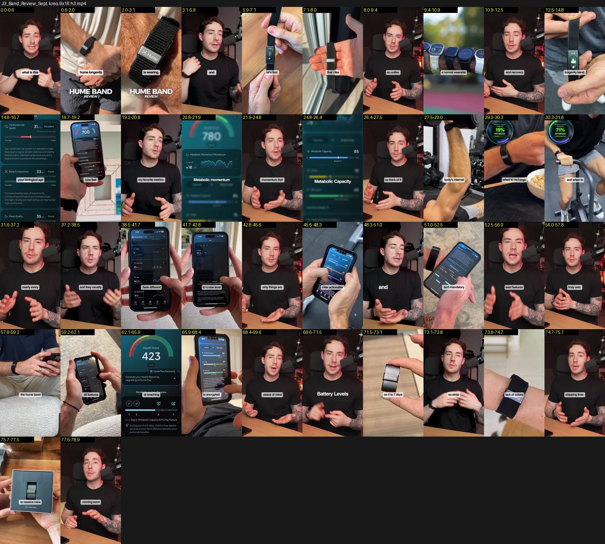

# J3_Band_Review_Sept, kreo, 9x16 h3.mp4

Master: `J3_Band_Review_Sept, kreo, 9x16 h3.mp4` · 78.9s · 720x1280

**Pacing:** 42 shots · avg 1.877s · median 1.55s · 5.2 cuts/10s · first cut 0.633s · 214.0 wpm · talk ratio 0.92 · cuts on word start 90.2% · cuts in speech gaps 75.6%
**Audio:** {'I_lufs': -14.2, 'LRA': 2.8, 'true_peak_db': -0.6} · BPM≈123.0 · music {'speech_rms_db': -17.9, 'pause_seconds': 0.0} · cuts with SFX/transient 70.7%

**Captions:** 226 cards · 1.0 words/card (median) · y≈0.593 of frame height · text height≈0.0281 · colours {'white': 182, 'blue': 10, 'green': 1, 'dark/other': 33} · cards crossing a cut: 2
Highlighted: 14:07:45, Good, MetabolcCapacity, BodyComp, GStrain, Baselre, 36, 100, ingoverbackfres-, ogress over time., -you'lactualy
**Headlines:** XHume (2.0–2.5s, white) | SHURE (9.0–9.0s, white) | SHURE (12.0–12.0s, white) | 33 yrs (15.0–15.0s, white) | YBodyComposition (15.0–15.0s, white) | Good (15.0–15.0s, green) | -12belowyourrealage (15.0–15.0s, dark/other) | Older (15.0–16.0s, white)

**Hook (0–3s) spoken:** What is this Hume longevity band that everyone is wearing?
**Hook on-screen:** HUME BAND / REVIEW / XHume / band / hume longevity / is wearing. / that everyone / what is this
**CTA (last 5s):** Lack of colors. Shipping time, it took me around 8 days to receive mine. Part 2 video coming soon. · on-screen: LiveLonger.Better / LiveLonger.Better. / RE / URE / XHume / aime / around8days / coming soon / lackof colors / shipping time / to receive mine

## Beat sheet

| # | in–out (s) | dur | transition | spoken | on-screen text |
|---|---|---|---|---|---|
| 1 | 0.00–0.63 | 0.63 |  | What is this | what is this / hume longevity / HUME BAND |
| 2 | 0.63–2.00 | 1.37 | cut | Hume longevity band that | hume longevity / HUME BAND / REVIEW / band |
| 3 | 2.00–3.10 | 1.1 | cut +SFX hit | everyone is wearing? | HUME BAND / REVIEW / XHume (HEADLINE) / that everyone / is wearing. / i decided |
| 4 | 3.10–5.90 | 2.8 | cut +SFX hit | I decided to purchase one myself and see how it works. | i decided / to purchase / one myself / and / see how / it works. |
| 5 | 5.90–7.07 | 1.17 | cut | Let's first start off with | it works. / let's first / with the things |
| 6 | 7.07–8.03 | 0.97 | cut +SFX hit | the things that I like, | with the things / the |
| 7 | 8.03–9.40 | 1.37 | cut +SFX hit | the data. So unlike a | the / SHURE (HEADLINE) / so unlike |
| 8 | 9.40–10.93 | 1.53 | cut | normal wearable that only tracks | SHURE (HEADLINE) / so unlike / 14:07:45 [blue] / a normal wearable |
| 9 | 10.93–12.50 | 1.57 | cut +SFX hit | sleep and recovery, | that only tracks / SHURE (HEADLINE) / and recovery |
| 10 | 12.50–14.80 | 2.3 | cut +SFX hit | the Hume longevity band goes much deeper. | longevity band / goes much deeper |
| 11 | 14.80–16.70 | 1.9 | cut +SFX hit | It measures your biological age and | 33 yrs (HEADLINE) / YBodyComposition (HEADLINE) / Good [green] (HEADLINE) / -12belowyourrealage (HEADLINE) / Older (HEADLINE) / Younger (HEADLINE) |
| 12 | 16.70–19.23 | 2.53 | cut +SFX hit | tracks how fast or slow that you're aging. | 700 (HEADLINE) / andtracks / HealthReport [blue] (HEADLINE) / 700+ (HEADLINE) / Heaith Score (HEADLINE) / YourCveratinealthscoreot700piacesyouinthe (HEADLINE) |
| 13 | 19.23–20.77 | 1.53 | cut +SFX hit | Two of my favorite metrics are metabolic | two of / my favorite metrics |
| 14 | 20.77–21.93 | 1.17 | cut | momentum. | 780 [blue] (HEADLINE) / WMetabolicMomentumMomentum / Overall / +18 / Metabolic momentum |
| 15 | 21.93–24.77 | 2.83 | cut +SFX hit | So the more momentum that you have, the slower you're aging and | HURE (HEADLINE) / so the more / URE (HEADLINE) / momentumthat / you're aging |
| 16 | 24.77–26.40 | 1.63 | cut +SFX hit | metabolic capacity. | 85 (HEADLINE) / MetabolicCapacity / 100 / Baseline / MetabolicCapacity (HEADLINE) |
| 17 | 26.40–27.47 | 1.07 | cut | So think of it like | 85 (HEADLINE) / MetabolicCapacity / 100 / Baseline / MetabolicCapacity (HEADLINE) / URE (HEADLINE) |
| 18 | 27.47–29.03 | 1.57 | cut | your body's internal battery, showing | URE (HEADLINE) / like your / body's internal / 1% [green] (HEADLINE) / OPTIMIZED (HEADLINE) / showingyou |
| 19 | 29.03–30.30 | 1.27 | cut +SFX hit | you when to recharge and | 1% [green] (HEADLINE) / OPTIMIZED (HEADLINE) / showingyou / 55% [green] (HEADLINE) / whento recharge |
| 20 | 30.30–31.60 | 1.3 | cut +SFX hit | when to push harder. | OPTIMIZED (HEADLINE) / 55% [green] (HEADLINE) / whento recharge / 79% [green] (HEADLINE) / pushharder |
| 21 | 31.60–37.17 | 5.57 | cut +SFX hit | The Proof AI Coaching. Now, I've tried nearly every wearable that claims to offer personalized insights, | The Proof Ai / i've tried / nearly every / claimsto offer / “personalized insights" / and they usually |
| 22 | 37.17–38.50 | 1.33 | cut +SFX hit | and they usually fall flat. | and they usually / fall flat |
| 23 | 38.50–41.67 | 3.17 | cut | The HumeBand's AI Coaching feels different. It takes personalization | 9:38 [blue] (HEADLINE) / g9 Steps (HEADLINE) / 12,218 (HEADLINE) / 心Sleep (HEADLINE) / 65bpm / 86. |
| 24 | 41.67–42.77 | 1.1 | cut | to a new level, | 9:38 [blue] (HEADLINE) / 86.0ms (HEADLINE) / toanewlevel / HRVmeasuresthetinyvariations intime between your / heartbeats.It'sasignofhowwellyourbodyadaptsto / stress andrecoversfromphysical activity. |
| 25 | 42.77–45.63 | 2.87 | cut | not only explaining why things are happening in my body, | explaining / SHURE (HEADLINE) / why things are / in my body |
| 26 | 45.63–48.30 | 2.67 | cut +SFX hit | but also giving me clear, actionable steps to improve. | 10-12 [blue] (HEADLINE) / Capacity [blue] (HEADLINE) / MetabolcCapacity [blue] / BodyComp [blue] / GStrain [blue] / Baselre [blue] |
| 27 | 48.30–51.00 | 2.7 | cut +SFX hit | It's simple, helpful, and actually makes sense. | 10:12 [blue] (HEADLINE) / -you'lactualy [blue] / tMities srcuedyourcapacity-push [blue] (HEADLINE) / at'sbetteristhatyourbandisst [blue] (HEADLINE) / rerttime / 10:12／M |
| 28 | 51.00–52.50 | 1.5 | cut +SFX hit | Subscription isn't mandatory. | 12PH / subscription / 6AM-12PM / 12pM / isn't mandatory |
| 29 | 52.50–55.97 | 3.47 | cut | Most wearables today lock their best features behind a subscription, | SHURE (HEADLINE) / most wearables / bestfeatures / behind a subscription |
| 30 | 55.97–57.80 | 1.83 | cut +SFX hit | and you don't truly own your data. With | and you don't / SHURE (HEADLINE) / truly own |
| 31 | 57.80–59.17 | 1.37 | cut +SFX hit | the HumeBand, you still get | the hume band / 10:43 [blue] (HEADLINE) / HumeBand(52%) [blue] (HEADLINE) / steps / 2,606 / 7.3m |
| 32 | 59.17–62.07 | 2.9 | cut +SFX hit | access to almost all features without paying extra. | 10:43 [blue] (HEADLINE) / HumeBand(52%) [blue] (HEADLINE) / steps / 2,606 / 7.3m / 65cm |
| 33 | 62.07–65.87 | 3.8 | cut +SFX hit | And if you want the advanced AI coaching, the subscription is optional, not required. | Learnmore→ (HEADLINE) / My Day (HEADLINE) / MyJourney (HEADLINE) / C SleepOverview (HEADLINE) / 6h 46m Standard (HEADLINE) / Youvehadlessthan8hoursof sleep-prioritize (HEADLINE) |
| 34 | 65.87–68.40 | 2.53 | cut | Plus all your data is encrypted and secure. Which | 82 / all your data / 2:44 [blue] (HEADLINE) / Capacity [blue] (HEADLINE) / BodyComp (HEADLINE) / 4yMetabolicCapacity [blue] (HEADLINE) |
| 35 | 68.40–69.60 | 1.2 | cut +SFX hit | gives me peace of mind. | 2:44 [blue] (HEADLINE) / allstrain-beneficialandnegativecombined. / makeless progressovertime. / 4MetabolicCapacity [blue] (HEADLINE) / CStrain [blue] (HEADLINE) / Recovery (HEADLINE) |
| 36 | 69.60–71.47 | 1.87 | cut +SFX hit | Things I don't like. Battery levels. | things idon't like / Battery Levels |
| 37 | 71.47–73.10 | 1.63 | cut +SFX hit | So 5 -7 days. | Battery Levels / XHume / so 5 to 7 days / sostrap |
| 38 | 73.10–73.83 | 0.73 | cut +SFX hit | So strap. | sostrap |
| 39 | 73.83–74.73 | 0.9 | cut | Lack of colors. | lackof colors / aime |
| 40 | 74.73–75.70 | 0.97 | cut +SFX hit | Shipping time, it took | RE (HEADLINE) / shipping time |
| 41 | 75.70–77.47 | 1.77 | cut +SFX hit | me around 8 days to receive mine. | XHume / around8days / LiveLonger.Better / to receive mine / LiveLonger.Better. |
| 42 | 77.47–78.85 | 1.39 | cut +SFX hit | Part 2 video coming soon. | XHume / to receive mine / LiveLonger.Better. / URE (HEADLINE) / coming soon |

## Full transcript

What is this Hume longevity band that everyone is wearing? I decided to purchase one myself and see how it works. Let's first start off with the things that I like, the data. So unlike a normal wearable that only tracks sleep and recovery, the Hume longevity band goes much deeper. It measures your biological age and tracks how fast or slow that you're aging. Two of my favorite metrics are metabolic momentum. So the more momentum that you have, the slower you're aging and metabolic capacity. So think of it like your body's internal battery, showing you when to recharge and when to push harder. The Proof AI Coaching. Now, I've tried nearly every wearable that claims to offer personalized insights, and they usually fall flat. The HumeBand's AI Coaching feels different. It takes personalization to a new level, not only explaining why things are happening in my body, but also giving me clear, actionable steps to improve. It's simple, helpful, and actually makes sense. Subscription isn't mandatory. Most wearables today lock their best features behind a subscription, and you don't truly own your data. With the HumeBand, you still get access to almost all features without paying extra. And if you want the advanced AI coaching, the subscription is optional, not required. Plus all your data is encrypted and secure. Which gives me peace of mind. Things I don't like. Battery levels. So 5-7 days. So strap. Lack of colors. Shipping time, it took me around 8 days to receive mine. Part 2 video coming soon.