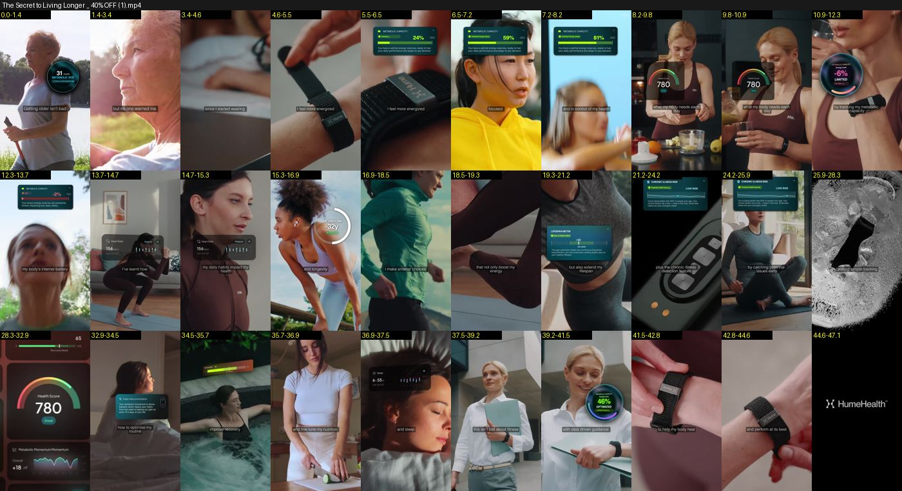

# The Secret to Living Longer _ 40% OFF (1).mp4

Master: `The Secret to Living Longer _ 40% OFF (1).mp4` · 47.1s · 720x1280

**Pacing:** 30 shots · avg 1.572s · median 1.433s · 6.15 cuts/10s · first cut 1.4s · 220.0 wpm · talk ratio 0.89 · cuts on word start 79.3% · cuts in speech gaps 55.2%
**Audio:** {'I_lufs': -14.2, 'LRA': 5.0, 'true_peak_db': -0.8} · BPM≈95.7 · music {'speech_rms_db': -18.2, 'pause_seconds': 3.1, 'pause_rms_db': -21.7, 'bed_minus_voice_db': -3.5, 'music_bed_likely': True} · cuts with SFX/transient 58.6%

**Captions:** 106 cards · 1.0 words/card (median) · y≈0.601 of frame height · text height≈0.0246 · colours {'white': 74, 'blue': 1, 'dark/other': 24, 'other-colour': 2, 'green': 5} · cards crossing a cut: 6
Highlighted: METABOLICAGE, -1%, -11%, Great, Good, 0%, 46%, 77%
**Headlines:** XHume (3.5–3.5s, dark/other) | XHume (5.0–5.0s, dark/other) | 100 (5.5–7.0s, dark/other) | Youhave a optimal energyreserves,ready tofuel (5.5–7.0s, dark/other) | 24% (6.0–6.0s, yellow) | METABOLICCAPACITY (7.0–7.0s, dark/other) | 74% (7.0–7.0s, yellow) | -2% (13.0–13.0s, red)

**Hook (0–3s) spoken:** Getting older isn't bad, but no one warned me how drained I'd feel.
**Hook on-screen:** 27 / 31 / 33 / Getting older isn't bad / METABOLICAGE / YEARS / but no one warned me / how drained I'd feel
**CTA (last 5s):** recharge and perform at its best. · on-screen: Hume / HumeHealth / Humehealth.com / X Hume / XHume / and perform at its best

## Beat sheet

| # | in–out (s) | dur | transition | spoken | on-screen text |
|---|---|---|---|---|---|
| 1 | 0.00–1.40 | 1.4 |  | Getting older isn't bad, but | 27 / YEARS / METABOLICAGE [blue] / Getting older isn't bad / 31 / 33 |
| 2 | 1.40–3.43 | 2.03 | cut +SFX hit | no one warned me how drained I'd feel. | METABOLICAGE [blue] / Getting older isn't bad / 33 / YEARS / but no one warned me / how drained I'd feel |
| 3 | 3.43–4.57 | 1.13 | cut | Since I started wearing the | how drained I'd feel / since I started wearing / XHume (HEADLINE) / the Hume Band |
| 4 | 4.57–5.53 | 0.97 | cut | Hume band, I feel | the Hume Band / Ifeel more energized / XHume (HEADLINE) / 100 (HEADLINE) / Youhave a optimal energyreserves,ready tofuel (HEADLINE) |
| 5 | 5.53–6.47 | 0.93 | cut | more energized, | Ifeel more energized / 100 (HEADLINE) / Youhave a optimal energyreserves,ready tofuel (HEADLINE) / 24% [yellow] (HEADLINE) |
| 6 | 6.47–7.20 | 0.73 | cut +SFX hit | focused and in | Ifeel more energized / 100 (HEADLINE) / Youhave a optimal energyreserves,ready tofuel (HEADLINE) / 24% [yellow] (HEADLINE) / METABOLICCAPACITY (HEADLINE) / 74% [yellow] (HEADLINE) |
| 7 | 7.20–8.17 | 0.97 | cut | control of my health, | 100 (HEADLINE) / Youhave a optimal energyreserves,ready tofuel (HEADLINE) / METABOLICCAPACITY (HEADLINE) / 74% [yellow] (HEADLINE) / and in control of myhealth / 780 |
| 8 | 8.17–9.83 | 1.67 | cut +SFX hit | because I know exactly what my body needs | 780 / Me. / becauseIknowexactly / what my body needs each / day |
| 9 | 9.83–10.87 | 1.03 | cut +SFX hit | each day. By tracking | 780 / what my body needs each / day / HealthScore / Me. |
| 10 | 10.87–12.33 | 1.47 | cut | my metabolic capacity, | METABOLICCAPACITY / Energy Level / -1% [other-colour] / LIMITED / by tracking my metabolic / capacity |
| 11 | 12.33–13.73 | 1.4 | cut | my body's internal battery, | LIMITED / by tracking my metabolic / capacity / -11% [other-colour] / -2% [red] (HEADLINE) / Yourbody's energy reserves are somewhat (HEADLINE) |
| 12 | 13.73–14.73 | 1.0 | cut | I've learnt how my daily | HeartRate / 156bpm / I've learnt how |
| 13 | 14.73–15.30 | 0.57 | cut +SFX hit | habits impact | 156bpm / Measure / Last:[Jun10] / my daily habits impact my / health |
| 14 | 15.30–16.87 | 1.57 | cut +SFX hit | my health and longevity. | 156bpm / Measure / Last:[Jun10] / my daily habits impact my / health / METABOLISM (HEADLINE) |
| 15 | 16.87–18.50 | 1.63 | cut +SFX hit | Now I make smarter choices that not | Imakesmarter choices |
| 16 | 18.50–19.30 | 0.8 | cut +SFX hit | only boost my energy, | that not only boost my / energy |
| 17 | 19.30–21.23 | 1.93 | cut +SFX hit | but also extend my lifespan. | that not only boost my / energy / Throughoptimizedhabitsandcontinuousbiomarker / your healthy lifespan. / but also extend my / lifespan |
| 18 | 21.23–24.20 | 2.97 | cut +SFX hit | Plus, the chronic illness detection feature gives me peace of mind | plusthechronicillness / detectionfeature / CHRONICILLNESSRISK (HEADLINE) / LOWRISK (HEADLINE) / Proactive Health Socurity [green] (HEADLINE) / gives me peace of mind |
| 19 | 24.20–25.87 | 1.67 | cut +SFX hit | by catching potential issues early. | gives me peace of mind / by catching potential / issuesearly |
| 20 | 25.87–28.30 | 2.43 | cut | The Hume band goes far beyond simple tracking. It | Hume (HEADLINE) / The Hume Band goes far / beyond simpletracking |
| 21 | 28.30–32.90 | 4.6 | cut | continuously learns from my habits and delivers personalised, actionable insights every morning. | beyond simpletracking / Recovery (HEADLINE) / RecoveryNeed (HEADLINE) / HealthScore / 780 (HEADLINE) / Great [green] |
| 22 | 32.90–34.47 | 1.57 | cut +SFX hit | How to optimise my routine, | routine / ,Today'sRecommendation / from lastweek is helpingyougainan / howtooptimisemy |
| 23 | 34.47–35.67 | 1.2 | cut | improve recovery and | routine / ,Today'sRecommendation / from lastweek is helpingyougainan / howtooptimisemy / RECOVERY (HEADLINE) / improverecovery |
| 24 | 35.67–36.93 | 1.27 | cut +SFX hit | fine -tune my nutrition and | and fine tune my nutrition |
| 25 | 36.93–37.50 | 0.57 | cut | sleep. This | Sleep (HEADLINE) / 6h55m (HEADLINE) / Last:[lun 10] (HEADLINE) / and sleep |
| 26 | 37.50–39.20 | 1.7 | cut +SFX hit | isn't just about fitness, it's about future | this isn't just about fitness / Energy Level / 0% [green] / OPTIMIZED / it's about future pro / myhealth |
| 27 | 39.20–41.50 | 2.3 | cut | -proofing my health, with data -driven guidance to | Energy Level / 0% [green] / OPTIMIZED / it's about future pro / myhealth / 46% [green] |
| 28 | 41.50–42.83 | 1.33 | cut +SFX hit | help my body heal, recharge and | tohelp mybodyheal |
| 29 | 42.83–44.60 | 1.77 | cut +SFX hit | perform at its best. | XHume (HEADLINE) / and perform at its best / Hume |
| 30 | 44.60–47.15 | 2.55 | cut +SFX hit |  | X Hume (HEADLINE) / HumeHealth / Humehealth.com |

## Full transcript

Getting older isn't bad, but no one warned me how drained I'd feel. Since I started wearing the Hume band, I feel more energized, focused and in control of my health, because I know exactly what my body needs each day. By tracking my metabolic capacity, my body's internal battery, I've learnt how my daily habits impact my health and longevity. Now I make smarter choices that not only boost my energy, but also extend my lifespan. Plus, the chronic illness detection feature gives me peace of mind by catching potential issues early. The Hume band goes far beyond simple tracking. It continuously learns from my habits and delivers personalised, actionable insights every morning. How to optimise my routine, improve recovery and fine-tune my nutrition and sleep. This isn't just about fitness, it's about future-proofing my health, with data-driven guidance to help my body heal, recharge and perform at its best.