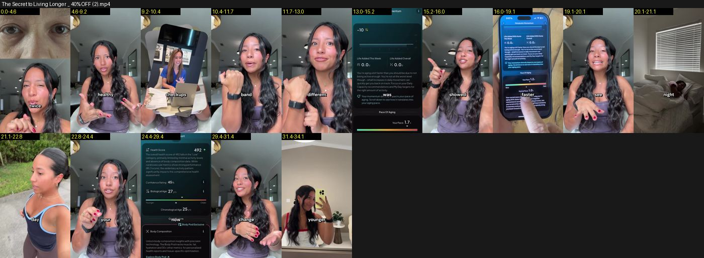

# The Secret to Living Longer _ 40% OFF (2).mp4

Master: `The Secret to Living Longer _ 40% OFF (2).mp4` · 34.1s · 720x1280

**Pacing:** 15 shots · avg 2.275s · median 1.7s · 4.1 cuts/10s · first cut 4.6s · 237.0 wpm · talk ratio 0.9 · cuts on word start 78.6% · cuts in speech gaps 78.6%
**Audio:** {'I_lufs': -14.3, 'LRA': 3.9, 'true_peak_db': -0.6} · BPM≈112.3 · music {'speech_rms_db': -20.4, 'pause_seconds': 0.6, 'pause_rms_db': -21.3, 'bed_minus_voice_db': -0.9, 'music_bed_likely': True} · cuts with SFX/transient 50.0%

**Captions:** 136 cards · 1.0 words/card (median) · y≈0.674 of frame height · text height≈0.0234 · colours {'white': 69, 'red': 7, 'dark/other': 45, 'blue': 15} · cards crossing a cut: 0
Highlighted: your, starts, fast, and, even, XO.0d, You'reagingabittasterthan you should be duetonot, being active enough.You're not at the worst level, though-small increases ln dailymovementcan, qulicklygetyouback ontrack.Focus onyourDally, CapacityrecommendationsandMyDaytargetsfor, CYourmomentumdirectilyimpactsyourpaceof, aging.Scrolldowntoseehowittranslatesinto, though-small increasesindallymovementcan, qulcklygetyoubackontrack.FocusonyourDally
**Headlines:** MetabolicMomentum (13.0–14.0s, white) | -105 (13.0–13.0s, white) | LifeAddedThisWeek (13.0–13.0s, white) | LifeAddedOverall (13.0–13.0s, white) | -10 (14.0–14.0s, white) | 3:270 (16.0–16.0s, blue) | 3:274 (18.0–18.0s, blue) | LifeAddedWithHume (18.0–18.0s, blue)

**Hook (0–3s) spoken:** So what actually happens when your body starts aging twice as fast and
**Hook on-screen:** actually / fast / starts / twice / your
**CTA (last 5s):** You can't change what you can't see. Humanity shows you how to live younger, longer. · on-screen: change / how / longer / see

## Beat sheet

| # | in–out (s) | dur | transition | spoken | on-screen text |
|---|---|---|---|---|---|
| 1 | 0.00–4.60 | 4.6 |  | So what actually happens when your body starts aging twice as fast and you can't even feel it yet? | actually / your [red] / starts [red] / twice / fast [red] / and [red] |
| 2 | 4.60–9.23 | 4.63 | cut | That's exactly what I was doing. I thought it was healthy, gym five times a week, clean diet, | that's / exactly / doing / thought / KHume / gym |
| 3 | 9.23–10.37 | 1.13 | cut +SFX hit | perfect checkups. | perfect / TONALIG / checkups |
| 4 | 10.37–11.73 | 1.37 | cut +SFX hit | But when I got the human, it | TONALIG / checkups / band |
| 5 | 11.73–12.97 | 1.23 | cut | told a different story. | different |
| 6 | 12.97–15.17 | 2.2 | cut +SFX hit | My metabolic momentum score was dropping. | MetabolicMomentum (HEADLINE) / -105 (HEADLINE) / LifeAddedThisWeek (HEADLINE) / LifeAddedOverall (HEADLINE) / You'reagingabitfasterthanyoushouldbeduetonot / beingactiveenough.You'renotattheworstlevel |
| 7 | 15.17–16.00 | 0.83 | cut +SFX hit | The AI showed my | the |
| 8 | 16.00–19.13 | 3.13 | cut +SFX hit | recovery and stress levels were aging me faster than I realized. | 3:270 [blue] (HEADLINE) / XO.0d [blue] / You'reagingabittasterthan you should be duetonot [blue] / being active enough.You're not at the worst level [blue] / though-small increases ln dailymovementcan [blue] / qulicklygetyouback ontrack.Focus onyourDally [blue] |
| 9 | 19.13–20.13 | 1.0 | cut | It made me see how every | every |
| 10 | 20.13–21.10 | 0.97 | cut | late night misrest, | every |
| 11 | 21.10–22.80 | 1.7 | cut | state, and stress for a week | stressful |
| 12 | 22.80–24.43 | 1.63 | cut | adds years to your body. | years / body |
| 13 | 24.43–29.40 | 4.97 | cut +SFX hit | So I started tracking and optimizing daily and now my biological age is actually going down. You | body / HealthReport (HEADLINE) / HealthScore (HEADLINE) / 492 (HEADLINE) / Low (HEADLINE) / 492+ (HEADLINE) |
| 14 | 29.40–31.40 | 2.0 | cut +SFX hit | can't change what you can't see. | HealthReport (HEADLINE) / BodyComposition / Unlockbodycompositioninsightswithprecision / 27 yrs (HEADLINE) / Biological Age (HEADLINE) / Older (HEADLINE) |
| 15 | 31.40–34.13 | 2.73 | cut | Humanity shows you how to live younger, longer. | see / how [red] / longer [red] |

## Full transcript

So what actually happens when your body starts aging twice as fast and you can't even feel it yet? That's exactly what I was doing. I thought it was healthy, gym five times a week, clean diet, perfect checkups. But when I got the human, it told a different story. My metabolic momentum score was dropping. The AI showed my recovery and stress levels were aging me faster than I realized. It made me see how every late night misrest, state, and stress for a week adds years to your body. So I started tracking and optimizing daily and now my biological age is actually going down. You can't change what you can't see. Humanity shows you how to live younger, longer.