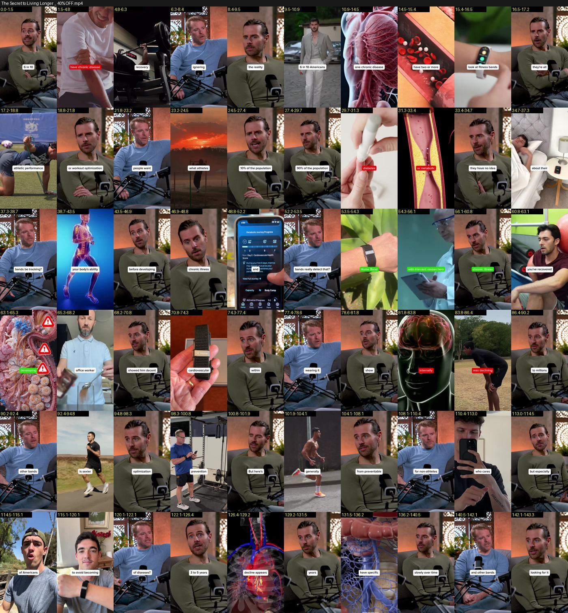

# The Secret to Living Longer _ 40% OFF.mp4

Master: `The Secret to Living Longer _ 40% OFF.mp4` · 169.1s · 720x1280

**Pacing:** 68 shots · avg 2.487s · median 2.267s · 3.96 cuts/10s · first cut 1.5s · 192.0 wpm · talk ratio 0.91 · cuts on word start 65.7% · cuts in speech gaps 67.2%
**Audio:** {'I_lufs': -14.6, 'LRA': 4.7, 'true_peak_db': 1.0} · BPM≈117.5 · music {'speech_rms_db': -19.5, 'pause_seconds': 6.7, 'pause_rms_db': -17.0, 'bed_minus_voice_db': 2.5, 'music_bed_likely': True} · cuts with SFX/transient 44.8%

**Captions:** 218 cards · 2.0 words/card (median) · y≈0.585 of frame height · text height≈0.0304 · colours {'white': 178, 'red': 14, 'dark/other': 10, 'blue': 5, 'green': 11} · cards crossing a cut: 0
Highlighted: havechronicdisease, diabetes, ormetabolic, dysfunction, is declining, Home, Capacity, During your first5daysmetrics, mayappearynusual asyour, personalbaseline:, does, withHarvard researchers, chronic illness, developing, diabetes
**Headlines:** 4:00 (49.0–51.0s, blue) | GenerateyourHealthReport (50.0–50.0s, blue) | byupgradingtoHumePlus (50.0–50.0s, blue) | MetabolicJourneyProgress (50.0–50.0s, blue) | XHume (74.0–74.0s, dark/other) | XXJ.IVXXI (111.0–111.0s, dark/other) | Pair (153.0–153.0s, blue) | NoDevicePaired (153.0–156.0s, blue)

**Hook (0–3s) spoken:** Six in ten Americans have chronic disease,
**Hook on-screen:** 6 in 10 / Americans / havechronicdisease
**CTA (last 5s):**  · on-screen: X HumeHealth

## Beat sheet

| # | in–out (s) | dur | transition | spoken | on-screen text |
|---|---|---|---|---|---|
| 1 | 0.00–1.50 | 1.5 |  | Six in ten Americans | 6 in 10 |
| 2 | 1.50–4.83 | 3.33 | cut | have chronic disease, but wearables? They're only | Americans / havechronicdisease [red] / TUE / But wearables / Stats / Workout |
| 3 | 4.83–6.27 | 1.43 | cut +SFX hit | tracking workout recovery. | reestyit / Hiking / they're only / tracking workout / recovery |
| 4 | 6.27–8.37 | 2.1 | cut +SFX hit | What do you mean, ignoring most Americans? | recovery / ignoring / most Americans? |
| 5 | 8.37–9.50 | 1.13 | cut +SFX hit | So here's the reality. | most Americans? / the reality |
| 6 | 9.50–10.90 | 1.4 | cut | Six in ten Americans have | 6 in 10 Americans |
| 7 | 10.90–14.53 | 3.63 | cut +SFX hit | at least one chronic disease, and four in ten have | have at least / onechronicdisease / and 4 in 10 |
| 8 | 14.53–15.43 | 0.9 | cut | two or more. But when | Both |
| 9 | 15.43–16.53 | 1.1 | cut | you look at fitness bands, | Both / look at fitness bands |
| 10 | 16.53–17.17 | 0.63 | cut +SFX hit | they're all focused | focused on |
| 11 | 17.17–18.83 | 1.67 | cut +SFX hit | on athletic performance. | focused on / athleticperformance |
| 12 | 18.83–21.77 | 2.93 | cut | You know, recovery scores or workout optimization. | recovery scores / or workout optimization |
| 13 | 21.77–23.20 | 1.43 | cut | But that's what people want, right? | people want / That's |
| 14 | 23.20–24.53 | 1.33 | cut +SFX hit | Well, that's what athletes want, | That's / want |
| 15 | 24.53–27.40 | 2.87 | cut | but there may be ten percent of the population. Meanwhile, | But they're maybe / 10% of the population |
| 16 | 27.40–29.67 | 2.27 | cut | the other 90 % of the population is | 10% of the population / the other / 90% of the population |
| 17 | 29.67–31.33 | 1.67 | cut | developing new diabetes. | is developing / diabetes [red] |
| 18 | 31.33–33.40 | 2.07 | cut +SFX hit | Heart disease or metabolic dysfunction, | diabetes [red] / ormetabolic [red] / dysfunction [red] |
| 19 | 33.40–34.73 | 1.33 | cut +SFX hit | they have no idea because their | dysfunction [red] / they have no idea |
| 20 | 34.73–37.33 | 2.6 | cut +SFX hit | band is telling them about their sleep score. | their band is / about their / sleep score |
| 21 | 37.33–38.73 | 1.4 | cut | So what should bands be tracking? | sleep score / bands be tracking? |
| 22 | 38.73–43.53 | 4.8 | cut +SFX hit | Metabolic capacity, for one, shows if your body's ability to create energy is declining. | Metabolic capacity / for one / your body's ability / to create energy / is declining [red] |
| 23 | 43.53–46.90 | 3.37 | cut +SFX hit | Happens years before developing chronic disease symptoms. | happens years / before developing / chronic disease |
| 24 | 46.90–48.80 | 1.9 | cut +SFX hit | Then there's chronic illness detection. | Then there's / detection |
| 25 | 48.80–52.23 | 3.43 | cut +SFX hit | Dat catches inflammation patterns and immune dysfunction early. Can bands | 4:00 [blue] (HEADLINE) / GenerateyoufHealthReport / Byupgradingt8HumePius / that catches / Next:Day2.CardiovascularHealth / Score |
| 26 | 52.23–53.47 | 1.23 | cut +SFX hit | really detect that? HumeBand | bands really detect that? |
| 27 | 53.47–54.30 | 0.83 | cut +SFX hit | does. | bands really detect that? / XHume / does [green] |
| 28 | 54.30–56.13 | 1.83 | cut | We partnered with Harvard researchers to | XHume / does [green] / withHarvard researchers [green] / to identify |
| 29 | 56.13–60.83 | 4.7 | cut | identify the exact patterns that predict chronic illness. So instead of telling you how, | to identify / patterns / chronic illness [green] / So instead / you how |
| 30 | 60.83–63.10 | 2.27 | cut | you know, well you've recovered from yesterday's run, | Well / from yesterday's / We're |
| 31 | 63.10–65.27 | 2.17 | cut +SFX hit | we're telling you if you're developing diabetes. | We're / developing [green] / diabetes [green] |
| 32 | 65.27–68.23 | 2.97 | cut +SFX hit | Look at this 46 -year -old office worker who thought he was healthy because | diabetes [green] / 46 year old / who thought / because |
| 33 | 68.23–70.83 | 2.6 | cut +SFX hit | his other band showed him decent activity levels. | because / showed him decent / activity levels |
| 34 | 70.83–74.30 | 3.47 | cut +SFX hit | But HumeBand caught early cardiovascular markers and | but Hume band [green] / XHume / that caught early / cardiovascular / XHume (HEADLINE) / markers |
| 35 | 74.30–77.43 | 3.13 | cut | they predicted heart problems within five years. | XHume (HEADLINE) / markers / heartproblems [red] / five years |
| 36 | 77.43–78.60 | 1.17 | cut | Just from wearing it? The | five years / wearing it |
| 37 | 78.60–81.77 | 3.17 | cut | metabolic momentum feature showed that his body was aging way | momentum feature [green] / show / was aging [red] |
| 38 | 81.77–83.80 | 2.03 | cut | faster internally than it should. | way faster [red] / than it showed |
| 39 | 83.80–86.37 | 2.57 | cut | His metabolic capacity was declining even though it | his metabolic / was declining [red] / even though [red] |
| 40 | 86.37–90.20 | 3.83 | cut +SFX hit | felt fine. And this is happening to millions of Americans right now. | even though [red] / and this / to millions / ofAmericans / right now |
| 41 | 90.20–92.37 | 2.17 | cut | Why doesn't other bands focus on this? | right now / otherbands / focus on this? |
| 42 | 92.37–94.80 | 2.43 | cut | Well because athletic performance is sexier to the market, | focus on this? / performance / to the market |
| 43 | 94.80–98.33 | 3.53 | cut | it's easier to sell recovery optimization to athletes than | It's easier / to sell recovery / optimization / to athletes |
| 44 | 98.33–100.80 | 2.47 | cut | chronic disease prevention to regular people. | to athletes / prevention / to regular |
| 45 | 100.80–101.87 | 1.07 | cut | But here's the thing, | But here's |
| 46 | 101.87–104.13 | 2.27 | cut | athletes are generally healthy. | athletes are / generally / It's the |
| 47 | 104.13–108.07 | 3.93 | cut | It's the regular Americans who are suffering from preventable diseases. So, | It's the / regular Americans / frompreventable / diseases / So Hume Band is |
| 48 | 108.07–110.40 | 2.33 | cut | Humeban is for non -athletes? | So Hume Band is / for non-athletes |
| 49 | 110.40–113.03 | 2.63 | cut | It's for anyone who cares about their long -term health. | for non-athletes / That's for anyone / XXJ.IVXXI (HEADLINE) / about their long / but especially |
| 50 | 113.03–114.53 | 1.5 | cut +SFX hit | But especially for the 90 % | but especially / for the 90% |
| 51 | 114.53–115.13 | 0.6 | cut +SFX hit | of Americans who | who aren't |
| 52 | 115.13–120.10 | 4.97 | cut +SFX hit | aren't training for marathons, they're just trying to avoid becoming another chronic disease statistic. | who aren't / for marathons / to avoid becoming / another / chronic disease / So what kind |
| 53 | 120.10–122.07 | 1.97 | cut +SFX hit | So what kind of diseases can it catch early? | So what kind / of diseases? / The patterns |
| 54 | 122.07–126.40 | 4.33 | cut | The patterns for diabetes show up three to five years before diagnosis. | The patterns / for diabetes / 3 to 5 years / before diagnosis |
| 55 | 126.40–129.23 | 2.83 | cut | Cardiovascular decline appears in metabolic capacity | before diagnosis / Cardiovascular / decline appears / years |
| 56 | 129.23–131.47 | 2.23 | cut | years before heart problems. | years / problems |
| 57 | 131.47–136.23 | 4.77 | cut | Autoimmune conditions have specific inflammation patterns that appear early. Basically, | problems / conditions / have specific / inflammation / patterns / basically |
| 58 | 136.23–140.50 | 4.27 | cut | anything that develops slowly over time, we can catch the early signals. | basically / anything / slowly over time / We can catch the / early signals |
| 59 | 140.50–142.13 | 1.63 | cut | And other bands miss this? | and other bands / They're not even |
| 60 | 142.13–143.33 | 1.2 | cut +SFX hit | They're not even looking for it. | They're not even / looking for it |
| 61 | 143.33–145.77 | 2.43 | cut | They're tracking if you're ready for today's workout, | looking for it / If you're ready / for today's |
| 62 | 145.77–149.13 | 3.37 | cut | while your body is developing tomorrow's chronic illness. | while / is developing [red] / tomorrow's [red] / It's like |
| 63 | 149.13–152.73 | 3.6 | cut | It's like monitoring your car's speed and ignoring the check engine light. | It's like / your car's / and ignoring / engine light [red] |
| 64 | 152.73–156.53 | 3.8 | cut +SFX hit | And if it doesn't reveal something important about your health trajectory, you get a full refund. | Pair [blue] (HEADLINE) / NoDevicePaired [blue] (HEADLINE) / Wantdeeperinsights into [blue] (HEADLINE) / your [blue] (HEADLINE) / progress?Generatea (HEADLINE) / Hume |
| 65 | 156.53–157.60 | 1.07 | cut +SFX hit | But honestly, most people | most people |
| 66 | 157.60–159.70 | 2.1 | cut +SFX hit | discover that they aren't as healthy as they thought. | they aren't / as they thought |
| 67 | 159.70–164.07 | 4.37 | cut +SFX hit | And early detection is the difference between prevention and a lifetime of medication. | and early detection [green] / is the difference / prevention [green] / and a lifetime of [red] / umeHea |
| 68 | 164.07–169.11 | 5.04 | cut |  | umeHea / X HumeHealth [blue] (HEADLINE) |

## Full transcript

Six in ten Americans have chronic disease, but wearables? They're only tracking workout recovery. What do you mean, ignoring most Americans? So here's the reality. Six in ten Americans have at least one chronic disease, and four in ten have two or more. But when you look at fitness bands, they're all focused on athletic performance. You know, recovery scores or workout optimization. But that's what people want, right? Well, that's what athletes want, but there may be ten percent of the population. Meanwhile, the other 90% of the population is developing new diabetes. Heart disease or metabolic dysfunction, they have no idea because their band is telling them about their sleep score. So what should bands be tracking? Metabolic capacity, for one, shows if your body's ability to create energy is declining. Happens years before developing chronic disease symptoms. Then there's chronic illness detection. Dat catches inflammation patterns and immune dysfunction early. Can bands really detect that? HumeBand does. We partnered with Harvard researchers to identify the exact patterns that predict chronic illness. So instead of telling you how, you know, well you've recovered from yesterday's run, we're telling you if you're developing diabetes. Look at this 46-year-old office worker who thought he was healthy because his other band showed him decent activity levels. But HumeBand caught early cardiovascular markers and they predicted heart problems within five years. Just from wearing it? The metabolic momentum feature showed that his body was aging way faster internally than it should. His metabolic capacity was declining even though it felt fine. And this is happening to millions of Americans right now. Why doesn't other bands focus on this? Well because athletic performance is sexier to the market, it's easier to sell recovery optimization to athletes than chronic disease prevention to regular people. But here's the thing, athletes are generally healthy. It's the regular Americans who are suffering from preventable diseases. So, Humeban is for non-athletes? It's for anyone who cares about their long-term health. But especially for the 90% of Americans who aren't training for marathons, they're just trying to avoid becoming another chronic disease statistic. So what kind of diseases can it catch early? The patterns for diabetes show up three to five years before diagnosis. Cardiovascular decline appears in metabolic capacity years before heart problems. Autoimmune conditions have specific inflammation patterns that appear early. Basically, anything that develops slowly over time, we can catch the early signals. And other bands miss this? They're not even looking for it. They're tracking if you're ready for today's workout, while your body is developing tomorrow's chronic illness. It's like monitoring your car's speed and ignoring the check engine light. And if it doesn't reveal something important about your health trajectory, you get a full refund. But honestly, most people discover that they aren't as healthy as they thought. And early detection is the difference between prevention and a lifetime of medication.