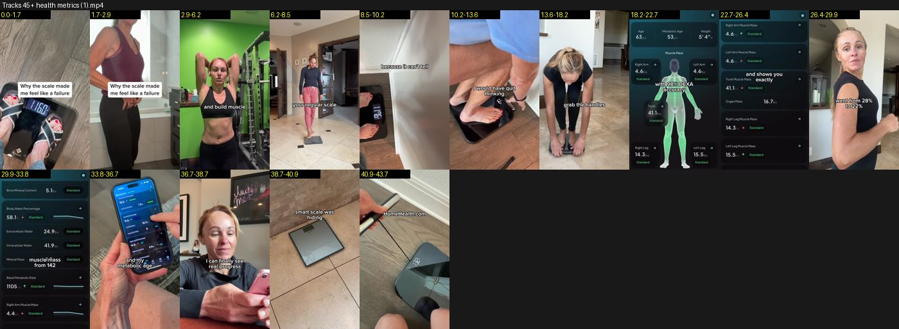

# Tracks 45+ health metrics (1).mp4

Master: `Tracks 45+ health metrics (1).mp4` · 43.7s · 720x1280

**Pacing:** 15 shots · avg 2.914s · median 2.92s · 3.2 cuts/10s · first cut 1.68s · 193.0 wpm · talk ratio 0.92 · cuts on word start 64.3% · cuts in speech gaps 78.6%
**Audio:** {'I_lufs': -14.4, 'LRA': 2.1, 'true_peak_db': -0.6} · BPM≈103.4 · music {'speech_rms_db': -19.4, 'pause_seconds': 0.3} · cuts with SFX/transient 42.9%

**Captions:** 138 cards · 1.0 words/card (median) · y≈0.566 of frame height · text height≈0.0293 · colours {'white': 107, 'red': 5, 'dark/other': 19, 'green': 1, 'blue': 6} · cards crossing a cut: 2
Highlighted: I would have quit, thinking, nothing was working, body, Muscle(lbs), Muscle(lbs), and my, metabolic age, TrunkPatHass, VscereiFetindex, Fighr Leg Fau Pereentsge, 14.5
**Headlines:** 598 (0.0–0.0s, dark/other) | 1160 (0.5–0.5s, dark/other) | Body Pod (18.0–22.0s, dark/other) | StepOnScale (18.0–22.0s, dark/other) | Standard (18.0–19.0s, dark/other) | Trunk (18.0–18.0s, white) | 41.1ibs (18.0–18.0s, white) | MuscleMass (19.0–20.0s, dark/other)

**Hook (0–3s) spoken:** Every morning that number went up and I blamed myself.
**Hook on-screen:** 1160 / 598 / ETEKCITY / PETEKCITY / Why the scale made / me feel like a failure
**CTA (last 5s):** my cheap smart scale was hiding. See your real numbers at humehealth .com. · on-screen: HumeHealth.com / See your real / TAYLOR. / hiding / numbers at / smartscale was / that my cheap

## Beat sheet

| # | in–out (s) | dur | transition | spoken | on-screen text |
|---|---|---|---|---|---|
| 1 | 0.00–1.68 | 1.68 |  | Every morning that number went up | Why the scale made / me feel like a failure / 598 (HEADLINE) / ETEKCITY / 1160 (HEADLINE) / PETEKCITY |
| 2 | 1.68–2.92 | 1.24 | cut +SFX hit | and I blamed myself. | Why the scale made / me feel like a failure |
| 3 | 2.92–6.16 | 3.24 | cut | If you're trying to lose fat and build muscle at the same time, | Why the scale made / me feel like a failure / If you're trying / tolosefat / and build muscle / atthesametime |
| 4 | 6.16–8.52 | 2.36 | cut | your regular scale is basically useless because | your regular scale / is basically useless |
| 5 | 8.52–10.20 | 1.68 | cut | it can't tell the difference. | because it can't tell / Withoutthe / Hume Health Pod |
| 6 | 10.20–13.64 | 3.44 | cut +SFX hit | Without the Hume Health Pod, I would have quit thinking nothing was working. | Withoutthe / Hume Health Pod / I would have quit [red] / thinking [red] / nothing was working [red] |
| 7 | 13.64–18.20 | 4.56 | cut +SFX hit | How it works is you step on, grab the handles, and six medical grade sensors scan | How it works is / you stepon / grab the handles / and 6 medical-grade / sensors / Body Pod (HEADLINE) |
| 8 | 18.20–22.68 | 4.48 | cut | your whole body in 30 seconds with 98 % dexa accuracy. | Body Pod (HEADLINE) / StepOnScale (HEADLINE) / Standard (HEADLINE) / Trunk (HEADLINE) / 41.1ibs (HEADLINE) / Standard |
| 9 | 22.68–26.44 | 3.76 | cut +SFX hit | It tracks 45 plus metrics and shows you exactly what's changing. | ChartMetric (HEADLINE) / BoneMineralContent (HEADLINE) / BodyWaterPercentage (HEADLINE) / ExtracellularWater / MineralMass / BasalMetabalicRate |
| 10 | 26.44–29.92 | 3.48 | cut | My body fat went from 28 % to 22%. | Body Pod (HEADLINE) / Connected (HEADLINE) / 4.6bs+ (HEADLINE) / Standard [green] (HEADLINE) / LeftArmMuscleMass (HEADLINE) / 4.6bs (HEADLINE) |
| 11 | 29.92–33.80 | 3.88 | cut | Muscle mass from 142 to 152 pounds, | Body Pod (HEADLINE) / StepOnScale (HEADLINE) / SubcutaneousFatMass (HEADLINE) / 19.5bs (HEADLINE) / Verylow (HEADLINE) / SubcutaneousFat (HEADLINE) |
| 12 | 33.80–36.72 | 2.92 | cut +SFX hit | and my metabolic age dropped six years. | 18.8* [blue] (HEADLINE) / 18.8 [blue] (HEADLINE) / 17.6s / 10.7m / and my [red] / metabolic age [red] |
| 13 | 36.72–38.72 | 2.0 | cut | I can finally see real progress that | rniton (HEADLINE) / Ican finally see / real progress / niton (HEADLINE) |
| 14 | 38.72–40.88 | 2.16 | cut | my cheap smart scale was hiding. | that my cheap (HEADLINE) / smartscale was (HEADLINE) / hiding (HEADLINE) / TAYLOR. |
| 15 | 40.88–43.71 | 2.83 | cut +SFX hit | See your real numbers at humehealth .com. | See your real (HEADLINE) / numbers at (HEADLINE) / HumeHealth.com (HEADLINE) |

## Full transcript

Every morning that number went up and I blamed myself. If you're trying to lose fat and build muscle at the same time, your regular scale is basically useless because it can't tell the difference. Without the Hume Health Pod, I would have quit thinking nothing was working. How it works is you step on, grab the handles, and six medical grade sensors scan your whole body in 30 seconds with 98% dexa accuracy. It tracks 45 plus metrics and shows you exactly what's changing. My body fat went from 28% to 22%. Muscle mass from 142 to 152 pounds, and my metabolic age dropped six years. I can finally see real progress that my cheap smart scale was hiding. See your real numbers at humehealth.com.