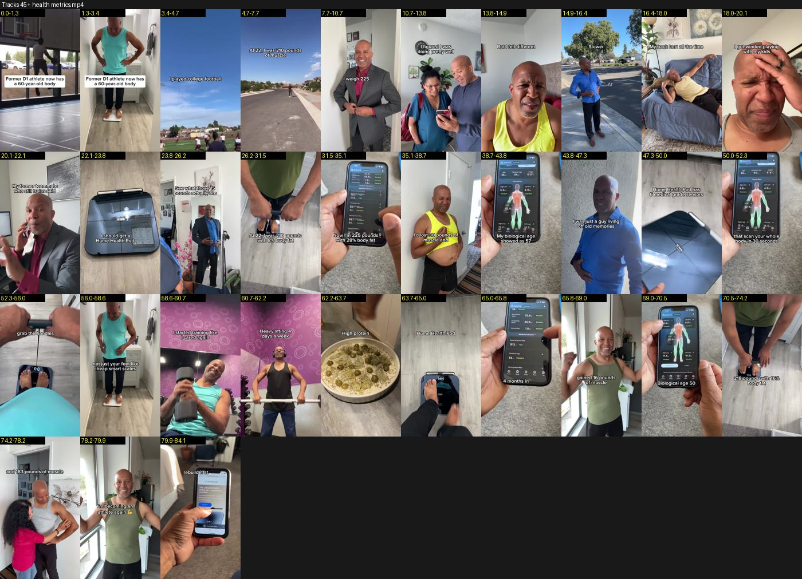

# Tracks 45+ health metrics.mp4

Master: `Tracks 45+ health metrics.mp4` · 84.1s · 720x1280

**Pacing:** 33 shots · avg 2.548s · median 2.369s · 3.81 cuts/10s · first cut 1.335s · 193.0 wpm · talk ratio 0.93 · cuts on word start 71.9% · cuts in speech gaps 90.6%
**Audio:** {'I_lufs': -14.1, 'LRA': 1.9, 'true_peak_db': -0.7} · BPM≈129.2 · music {'speech_rms_db': -18.6, 'pause_seconds': 1.4, 'pause_rms_db': -16.1, 'bed_minus_voice_db': 2.5, 'music_bed_likely': True} · cuts with SFX/transient 31.2%

**Captions:** 107 cards · 1 words/card (median) · y≈0.473 of frame height · text height≈0.0246 · colours {'white': 96, 'blue': 2, 'red': 2, 'yellow': 4, 'dark/other': 3} · cards crossing a cut: 2
Highlighted: I played college football, I'm47now, I weigh 225, I'd lost30poundsof, muscleand, gained 45 pounds of fat, Standard, Leam More
**Headlines:** At22,Iwas210pounds (4.5–7.0s, blue) | ofmuscle (4.5–7.0s, blue) | only15poundsheavier (11.0–11.0s, white) | I figured I was (12.0–13.0s, white) | doing pretty well (12.0–13.0s, white) | But I felt different (14.0–14.0s, white) | Weaker (15.0–15.0s, white) | RESPE (15.0–15.0s, white)

**Hook (0–3s) spoken:** I was a college athlete. Now I have the body of a 60 -year
**Hook on-screen:** FormerD1athletenowhas / a 60-year-old body
**CTA (last 5s):** athlete again. Don't live off past glory. Rebuild it at humehealth .com. · on-screen: 30-Oay Return Polcy / Don't live off past glory / Haessyourhealthdotatosowaging / Haness yourhealth datatoslowaging. / HumeHealth / Introducing the HumePod-Agotmn / Introducing the HumelongerityDand / Introducing tneHumelongovityband / Introducingthe Humelongevtyband / Leam More / Longevity isn'tluck.It's / Longevityisn'tluck.It's

## Beat sheet

| # | in–out (s) | dur | transition | spoken | on-screen text |
|---|---|---|---|---|---|
| 1 | 0.00–1.33 | 1.33 |  | I was a college athlete. | FormerD1athletenowhas / a 60-year-old body |
| 2 | 1.33–3.37 | 2.04 | cut | Now I have the body of a 60 -year -old. | FormerD1athletenowhas / a 60-year-old body |
| 3 | 3.37–4.74 | 1.37 | cut +SFX hit | I played college football. | FormerD1athletenowhas / a 60-year-old body / I played college football [blue] / At22,Iwas210pounds [blue] (HEADLINE) / ofmuscle [blue] (HEADLINE) |
| 4 | 4.74–7.67 | 2.94 | cut | At 22, I was 210 pounds of muscle. | At22,Iwas210pounds [blue] (HEADLINE) / ofmuscle [blue] (HEADLINE) |
| 5 | 7.67–10.71 | 3.04 | cut | I'm 47 now. I weigh 225, | I'm47now [red] / I weigh 225 [red] |
| 6 | 10.71–13.81 | 3.1 | cut | only 15 pounds heavier. I figured I was doing pretty well, | only15poundsheavier (HEADLINE) / I figured I was (HEADLINE) / doing pretty well (HEADLINE) |
| 7 | 13.81–14.95 | 1.13 | cut +SFX hit | but I felt different, | But I felt different (HEADLINE) |
| 8 | 14.95–16.45 | 1.5 | cut +SFX hit | weaker, slower. | Weaker (HEADLINE) / RESPE (HEADLINE) / ORLO (HEADLINE) / Slower (HEADLINE) / RESRE (HEADLINE) / ORLO |
| 9 | 16.45–18.02 | 1.57 | cut | My back hurt all the time. | Slower (HEADLINE) / RESRE (HEADLINE) / ORLO / My back hurt all thetime (HEADLINE) / I got winded playing [red] (HEADLINE) / withmykids [red] (HEADLINE) |
| 10 | 18.02–20.09 | 2.07 | cut | I got winded playing with my kids. | I got winded playing [red] (HEADLINE) / withmykids [red] (HEADLINE) / Myformerteammate (HEADLINE) / who still trains said (HEADLINE) |
| 11 | 20.09–22.12 | 2.04 | cut | My former teammate, who's still trained, said | Myformerteammate (HEADLINE) / who still trains said (HEADLINE) / Ishould geta / Hume Health Pod |
| 12 | 22.12–23.76 | 1.64 | cut | I should get a Hume Health Pod. | Ishould geta / Hume Health Pod / XMu |
| 13 | 23.76–26.19 | 2.44 | cut | See what those 15 pounds actually are. | Seewhatthose15 (HEADLINE) / poundsactuallyare (HEADLINE) / The scan devastated me |
| 14 | 26.19–31.46 | 5.27 | cut | The scan devastated me. At 22, I was 210 pounds with 8 % body fat. | The scan devastated me / At22,Iwas210pounds / with8%bodyfat |
| 15 | 31.46–35.13 | 3.67 | cut | Now I'm 225 pounds with 28 % body fat. | At22,Iwas210pounds / with8%bodyfat / MetabolicAge [blue] (HEADLINE) / 54m (HEADLINE) / Standard (HEADLINE) / Resting Heart Rate (HEADLINE) |
| 16 | 35.13–38.67 | 3.54 | cut | I'd lost 30 pounds of muscle and gained 45 pounds of fat. | I'd lost30poundsof [yellow] / muscleand [yellow] / gained 45 pounds of fat [yellow] |
| 17 | 38.67–43.81 | 5.14 | cut | My biological age showed as 57, 15 years older than my actual age. | Haight (HEADLINE) / 54yrs (HEADLINE) / RighiArm / 6:016s / 6.21bs / Standard |
| 18 | 43.81–47.28 | 3.47 | cut +SFX hit | I wasn't an athlete anymore, I was just a guy living off old memories. | Iwasn'tan athlete anymore / Iwas just a guy living / offold memories |
| 19 | 47.28–49.95 | 2.67 | cut | Hume Health Pod has six medical grade sensors that | Iwas just a guy living / offold memories / Hume Health Pod has (HEADLINE) / 6medical gradesensors (HEADLINE) |
| 20 | 49.95–52.32 | 2.37 | cut +SFX hit | scan your whole body in 30 seconds. | BodyPod [blue] (HEADLINE) / 54yrs (HEADLINE) / 56ys (HEADLINE) / 6.0ibs (HEADLINE) / 6.2ibs (HEADLINE) / 52.9ibs |
| 21 | 52.32–55.99 | 3.67 | cut | You step on, grab the handles, and it scans your whole body. not | 6.2ibs (HEADLINE) / 52.9ibs / Left Leg / 18.5ibs / that scan your whole / CBodyPod [blue] (HEADLINE) |
| 22 | 55.99–58.62 | 2.64 | cut +SFX hit | just your feet like cheap smart scales. | not just your feet like / cheap smart scales |
| 23 | 58.62–60.73 | 2.1 | cut | I started training like I cared again, | like (HEADLINE) / I started training (HEADLINE) / I cared again (HEADLINE) / 20 |
| 24 | 60.73–62.23 | 1.5 | cut | heavy lifting four days a week, | Heavy lifting 4 [other-colour] (HEADLINE) / days a week [other-colour] (HEADLINE) / High protein (HEADLINE) |
| 25 | 62.23–63.66 | 1.44 | cut +SFX hit | high protein, tracked with | High protein (HEADLINE) / Tracked with (HEADLINE) |
| 26 | 63.66–64.97 | 1.3 | cut +SFX hit | Hume Health Pod. | Hume Health Pod (HEADLINE) |
| 27 | 64.97–65.80 | 0.83 | cut +SFX hit | Four months in, | 32.60s (HEADLINE) / 54.9ibs (HEADLINE) / 1.8ibs (HEADLINE) / BasalMetabolic Rate (HEADLINE) / 1513cal / Metabolic Age |
| 28 | 65.80–69.00 | 3.2 | cut | gained 16 pounds of muscle, lost 11 pounds of fat, | gained 16 pounds / ofmuscle / lost11poundsof fat / CBody Pod [blue] (HEADLINE) / 6.0bs (HEADLINE) / 6.2Is (HEADLINE) |
| 29 | 69.00–70.47 | 1.47 | cut | biological age 50. | CBody Pod [blue] (HEADLINE) / 6.0bs (HEADLINE) / 6.2Is (HEADLINE) / 52.9bm (HEADLINE) / 18.5ibs / 19.4ibs |
| 30 | 70.47–74.21 | 3.74 | cut | Eight months later, 218 pounds with 16 % body fat | 18.5ibs / 19.4ibs / Biological age 50 / CgBody Pod [blue] (HEADLINE) / 6.0ibs (HEADLINE) / 6.2ibs (HEADLINE) |
| 31 | 74.21–78.25 | 4.04 | cut +SFX hit | and 183 pounds of muscle, biological age 45. | and183poundsofmuscle (HEADLINE) / refiure (HEADLINE) / Biological age 45 (HEADLINE) / I'm becoming an / athleteagain |
| 32 | 78.25–79.91 | 1.67 | cut | I'm becoming an athlete again. | I'm becoming an / athleteagain |
| 33 | 79.91–84.07 | 4.16 | cut | Don't live off past glory. Rebuild it at humehealth .com. | Don't live off past glory (HEADLINE) / humehealth.com (HEADLINE) / XHumeHealth (HEADLINE) / Longevity isn'tluck.It's / strategy. / Introducing the HumelongerityDand |

## Full transcript

I was a college athlete. Now I have the body of a 60-year-old. I played college football. At 22, I was 210 pounds of muscle. I'm 47 now. I weigh 225, only 15 pounds heavier. I figured I was doing pretty well, but I felt different, weaker, slower. My back hurt all the time. I got winded playing with my kids. My former teammate, who's still trained, said I should get a Hume Health Pod. See what those 15 pounds actually are. The scan devastated me. At 22, I was 210 pounds with 8% body fat. Now I'm 225 pounds with 28% body fat. I'd lost 30 pounds of muscle and gained 45 pounds of fat. My biological age showed as 57, 15 years older than my actual age. I wasn't an athlete anymore, I was just a guy living off old memories. Hume Health Pod has six medical grade sensors that scan your whole body in 30 seconds. You step on, grab the handles, and it scans your whole body. not just your feet like cheap smart scales. I started training like I cared again, heavy lifting four days a week, high protein, tracked with Hume Health Pod. Four months in, gained 16 pounds of muscle, lost 11 pounds of fat, biological age 50. Eight months later, 218 pounds with 16% body fat and 183 pounds of muscle, biological age 45. I'm becoming an athlete again. Don't live off past glory. Rebuild it at humehealth.com.