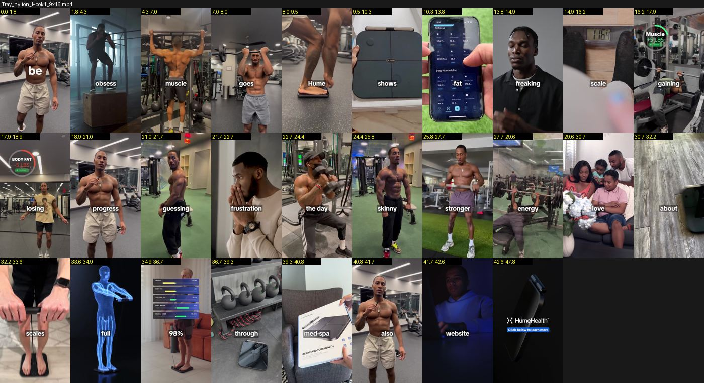

# Tray_hylton_Hook1_9x16.mp4

Master: `Tray_hylton_Hook1_9x16.mp4` · 47.8s · 720x1280

**Pacing:** 28 shots · avg 1.708s · median 1.452s · 5.65 cuts/10s · first cut 1.802s · 252.0 wpm · talk ratio 0.86 · cuts on word start 85.2% · cuts in speech gaps 66.7%
**Audio:** {'I_lufs': -17.6, 'LRA': 2.5, 'true_peak_db': -0.7} · BPM≈92.3 · music {'speech_rms_db': -21.0, 'pause_seconds': 4.2, 'pause_rms_db': -21.4, 'bed_minus_voice_db': -0.4, 'music_bed_likely': True} · cuts with SFX/transient 77.8%

**Captions:** 77 cards · 1 words/card (median) · y≈0.58 of frame height · text height≈0.0457 · colours {'white': 56, 'dark/other': 20, 'blue': 1} · cards crossing a cut: 0
Highlighted: Clickbelowto learnmore
**Headlines:** be (0.5–0.5s, white) | this (1.0–1.0s, white) | device (1.5–1.5s, red) | Lifer (4.5–4.5s, red) | Y360 (4.5–6.0s, dark/other) | thing (4.5–4.5s, white) | SY (5.5–5.5s, white) | SYI (6.0–6.0s, white)

**Hook (0–3s) spoken:** I will be reviewing this device. When we talk about health, most people
**Hook on-screen:** Most / about / be / device / this
**CTA (last 5s):** .com. · on-screen: Clickbelowto learnmore / HumeHealth / Humehealth / Humehealth.com / X BodyPod

## Beat sheet

| # | in–out (s) | dur | transition | spoken | on-screen text |
|---|---|---|---|---|---|
| 1 | 0.00–1.80 | 1.8 |  | I will be reviewing this device. | be (HEADLINE) / this (HEADLINE) / device [red] (HEADLINE) |
| 2 | 1.80–4.34 | 2.54 | cut | When we talk about health, most people obsess over losing weight, | device [red] (HEADLINE) / about / Most / obsess / losing / weight |
| 3 | 4.34–6.97 | 2.64 | cut +SFX hit | but here's the thing, gaining muscle can actually make you healthier, | weight / Lifer [red] (HEADLINE) / Y360 (HEADLINE) / thing (HEADLINE) / Gaining / SY (HEADLINE) |
| 4 | 6.97–8.04 | 1.07 | cut | even if the scale goes up. | if the / That's |
| 5 | 8.04–9.48 | 1.44 | cut | That's why I use the Hume Body Pod. | That's / BodyPod |
| 6 | 9.48–10.31 | 0.83 | cut | It shows me exactly | BodyPod / XHume / exactly |
| 7 | 10.31–13.81 | 3.5 | cut +SFX hit | how much of my body is muscle, fat, and everything in between. | XHume / exactly / 80.8% (HEADLINE) / 80.4% [blue] (HEADLINE) / Fit Focus (HEADLINE) / 1627 (HEADLINE) |
| 8 | 13.81–14.88 | 1.07 | cut +SFX hit | Instead of freaking out over | freaking |
| 9 | 14.88–16.22 | 1.33 | cut +SFX hit | a higher number on the scale, | number / Ican |
| 10 | 16.22–17.85 | 1.63 | cut +SFX hit | I can actually see if I'm gaining muscle | Ican / Muscle (HEADLINE) / +5LBS [green] (HEADLINE) / gaining |
| 11 | 17.85–18.85 | 1.0 | cut +SFX hit | or losing fat. | BODYFAT (HEADLINE) / -5LBS [red] (HEADLINE) / losing |
| 12 | 18.85–20.95 | 2.1 | cut +SFX hit | And trust me, that's the progress that matters. | me / that |
| 13 | 20.95–21.69 | 0.73 | cut +SFX hit | No more guessing, | guessing |
| 14 | 21.69–22.72 | 1.04 | cut +SFX hit | no more frustration, because | frustration |
| 15 | 22.72–24.39 | 1.67 | cut +SFX hit | at the end of the day, it's | at the / 20 / the day |
| 16 | 24.39–25.76 | 1.37 | cut +SFX hit | not about being skinny, it's | the day / EXIT [red] (HEADLINE) / skinny |
| 17 | 25.76–27.73 | 1.97 | cut +SFX hit | about feeling stronger, healthier, | feeling / healthier |
| 18 | 27.73–29.56 | 1.83 | cut +SFX hit | and having more energy for the things and | 6:46p [blue] (HEADLINE) / more / FREEMOTION / things |
| 19 | 29.56–30.70 | 1.13 | cut | people you love. | love |
| 20 | 30.70–32.23 | 1.54 | cut +SFX hit | What's great about the body pod, | about / Unlike |
| 21 | 32.23–33.60 | 1.37 | cut +SFX hit | unlike smart scales, it actually | Unlike / it |
| 22 | 33.60–34.87 | 1.27 | cut +SFX hit | measures your full body at | full |
| 23 | 34.87–36.74 | 1.87 | cut +SFX hit | an accuracy of 98%. It's | accuracy / 98% |
| 24 | 36.74–39.31 | 2.57 | cut +SFX hit | the only home device that has gone through lab testing. | home / through / I bought |
| 25 | 39.31–40.77 | 1.47 | cut +SFX hit | I bought this from a med spa, but | I bought / med-spa / UNDERSTANDYOURHEALTH (HEADLINE) |
| 26 | 40.77–41.74 | 0.97 | cut +SFX hit | you can also get them on | also |
| 27 | 41.74–42.58 | 0.83 | cut | their website at | website |
| 28 | 42.58–47.83 | 5.25 | cut +SFX hit | humehealth .com. | Humehealth (HEADLINE) / Humehealth.com / X BodyPod / HumeHealth / Clickbelowto learnmore [blue] / Humehealth.com |

## Full transcript

I will be reviewing this device. When we talk about health, most people obsess over losing weight, but here's the thing, gaining muscle can actually make you healthier, even if the scale goes up. That's why I use the Hume Body Pod. It shows me exactly how much of my body is muscle, fat, and everything in between. Instead of freaking out over a higher number on the scale, I can actually see if I'm gaining muscle or losing fat. And trust me, that's the progress that matters. No more guessing, no more frustration, because at the end of the day, it's not about being skinny, it's about feeling stronger, healthier, and having more energy for the things and people you love. What's great about the body pod, unlike smart scales, it actually measures your full body at an accuracy of 98%. It's the only home device that has gone through lab testing. I bought this from a med spa, but you can also get them on their website at humehealth.com.