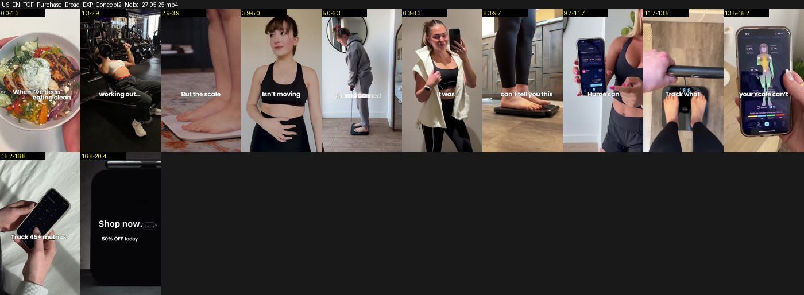

# US_EN_TOF_Purchase_Broad_EXP_Concept2_Neba_27.05.25.mp4

Master: `US_EN_TOF_Purchase_Broad_EXP_Concept2_Neba_27.05.25.mp4` · 20.4s · 720x1280

**Pacing:** 12 shots · avg 1.698s · median 1.583s · 5.4 cuts/10s · first cut 1.333s · None wpm · talk ratio 0.05 · cuts on word start 0.0% · cuts in speech gaps 100.0%
**Audio:** {'I_lufs': -14.7, 'LRA': 2.2, 'true_peak_db': -1.1} · BPM≈136.0 · music {'speech_rms_db': -22.0, 'pause_seconds': 19.0, 'pause_rms_db': -18.4, 'bed_minus_voice_db': 3.6, 'music_bed_likely': True} · cuts with SFX/transient 45.5%

**Captions:** 26 cards · 1.0 words/card (median) · y≈0.575 of frame height · text height≈0.0404 · colours {'red': 3, 'white': 21, 'dark/other': 2} · cards crossing a cut: 0
Highlighted: WhenI'vebeen, eatingclean, can't tell you this
**Headlines:** When (1.0–1.0s, white) | 0.00% (11.0–11.0s, white) | 6.9bs (11.0–11.0s, white) | Doheretostartanewlouny (11.0–11.0s, blue) | 3:17 (14.0–14.0s, white) | 17.1% (14.0–14.0s, white) | Standard (14.0–14.0s, white) | X Body Pod (17.0–17.0s, white)

**Hook (0–3s) spoken:** Yeah
**Hook on-screen:** When / WhenI'vebeen / Working out.. / aclean / eatingclean / working out...
**CTA (last 5s):**  · on-screen: 50% OFF today / Humehealth.com / Shop now / Track45+metrics / X Body Pod

## Beat sheet

| # | in–out (s) | dur | transition | spoken | on-screen text |
|---|---|---|---|---|---|
| 1 | 0.00–1.33 | 1.33 |  | Yeah | WhenI'vebeen [red] / eatingclean [red] / When (HEADLINE) / aclean |
| 2 | 1.33–2.93 | 1.6 | cut +SFX hit |  | When (HEADLINE) / aclean / Working out.. / working out... |
| 3 | 2.93–3.87 | 0.93 | cut |  | working out... / But the scale |
| 4 | 3.87–4.97 | 1.1 | cut |  | But the scale / Isn't moving |
| 5 | 4.97–6.33 | 1.37 | cut |  | Isn't moving / ThenIscanned / Thenscanned / and saw |
| 6 | 6.33–8.27 | 1.93 | cut +SFX hit |  | and saw / It was / justWaterweight |
| 7 | 8.27–9.73 | 1.47 | cut +SFX hit |  | justWaterweight / can't tell you this [red] |
| 8 | 9.73–11.70 | 1.97 | cut |  | Hume can / 0.00% (HEADLINE) / 6.9bs (HEADLINE) / Doheretostartanewlouny [blue] (HEADLINE) / stayontopafyour |
| 9 | 11.70–13.50 | 1.8 | cut +SFX hit |  | Track what / XHume |
| 10 | 13.50–15.20 | 1.7 | cut +SFX hit |  | 3:17 (HEADLINE) / 17.1% (HEADLINE) / Standard (HEADLINE) / 15.2% / your'scalecan't / OMuscle |
| 11 | 15.20–16.77 | 1.57 | cut |  | Track45+metrics. / Track45+metrics |
| 12 | 16.77–20.37 | 3.61 | cut |  | X Body Pod (HEADLINE) / Shop now / 50% OFF today / Humehealth.com |

## Full transcript

Yeah