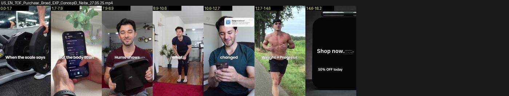

# US_EN_TOF_Purchase_Broad_EXP_Concept3_Neba_27.05.25.mp4

Master: `US_EN_TOF_Purchase_Broad_EXP_Concept3_Neba_27.05.25.mp4` · 18.2s · 720x1280

**Pacing:** 7 shots · avg 2.596s · median 1.834s · 3.3 cuts/10s · first cut 1.7s · None wpm · talk ratio 0.0 · cuts on word start 0.0% · cuts in speech gaps 100.0%
**Audio:** {'I_lufs': -16.6, 'LRA': 2.8, 'true_peak_db': -4.3} · BPM≈99.4 · music None · cuts with SFX/transient 50.0%

**Captions:** 65 cards · 1 words/card (median) · y≈0.547 of frame height · text height≈0.0269 · colours {'white': 53, 'dark/other': 11, 'blue': 1} · cards crossing a cut: 0
Highlighted: High
**Headlines:** 132.0Ibs... again? (2.5–3.5s, white) | BodyPod (4.5–6.0s, white) | 10:59 (5.0–6.0s, white) | Steponthescaletoweighin (5.0–5.0s, dark/other) | BodyWater (5.0–5.0s, white) | Sieponthescaletoweighin (5.5–5.5s, dark/other) | Standard (5.5–6.0s, dark/other) | 34.0m (5.5–5.5s, white)

**Hook (0–3s) spoken:** 
**Hook on-screen:** 132.0Ibs... again? / When the scale says / nothing'schanged
**CTA (last 5s):**  · on-screen: 50% OFF today / Humehealth.com / Shop now. / WeightProgress / X Body Pod

## Beat sheet

| # | in–out (s) | dur | transition | spoken | on-screen text |
|---|---|---|---|---|---|
| 1 | 0.00–1.70 | 1.7 |  |  | When the scale says / nothing'schanged |
| 2 | 1.70–7.87 | 6.17 | cut +SFX hit |  | nothing'schanged / 132.0Ibs... again? (HEADLINE) / Body Pod / Daly Heath / BHR(BasHetaboleRsta) / 1731eal |
| 3 | 7.87–8.87 | 1.0 | cut |  | Hume shows |
| 4 | 8.87–10.63 | 1.77 | cut +SFX hit |  | what / actually |
| 5 | 10.63–12.73 | 2.1 | cut |  | Congratulations! (HEADLINE) / changed |
| 6 | 12.73–14.57 | 1.83 | cut +SFX hit |  | WeightProgress |
| 7 | 14.57–18.18 | 3.61 | cut |  | X Body Pod (HEADLINE) / 50% OFF today / Shop now. / Humehealth.com |

## Full transcript

