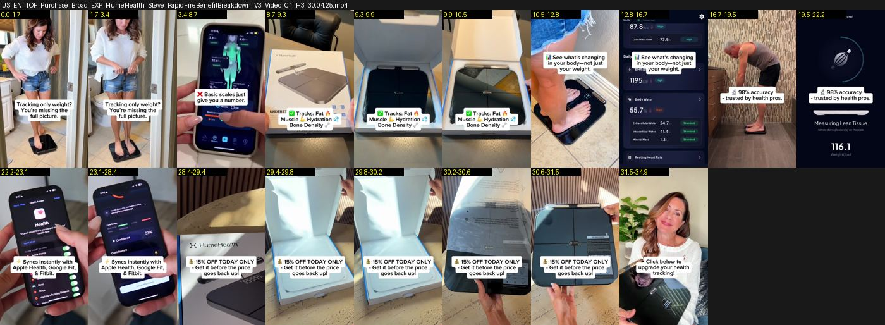

# US_EN_TOF_Purchase_Broad_EXP_HumeHealth_Steve_RapidFireBenefitBreakdown_V3_Video_C1_H3_30.04.25.mp4

Master: `US_EN_TOF_Purchase_Broad_EXP_HumeHealth_Steve_RapidFireBenefitBreakdown_V3_Video_C1_H3_30.04.25.mp4` · 34.9s · 720x1280

**Pacing:** 18 shots · avg 1.939s · median 1.317s · 4.87 cuts/10s · first cut 1.667s · None wpm · talk ratio 0.0 · cuts on word start 0.0% · cuts in speech gaps 100.0%
**Audio:** {'I_lufs': -14.4, 'LRA': 0.9, 'true_peak_db': -1.9} · BPM≈89.1 · music None · cuts with SFX/transient 100.0%

**Captions:** 116 cards · 1.0 words/card (median) · y≈0.621 of frame height · text height≈0.0293 · colours {'white': 71, 'dark/other': 31, 'blue': 9, 'red': 1, 'other-colour': 1, 'yellow': 2, 'green': 1} · cards crossing a cut: 16
Highlighted: Meatures, Resultsare Eomparedte Humeusersi, Meatues, ResultsarecomparedtoHurmeusers flkeyou., Measures, Measres, Measures, Meaures, LHydration, bHydration, High, Standard, Excellent, TurmOn All
**Headlines:** 12:29 (3.5–5.0s, dark/other) | RontamMiacls (4.0–4.0s, dark/other) | 3.8bm (4.5–4.5s, dark/other) | 4.01bs (4.5–4.5s, dark/other) | Standard (4.5–4.5s, blue) | trunkMuacie Mass (4.5–4.5s, dark/other) | 35.6ibs (4.5–4.5s, dark/other) | Mans (5.0–5.0s, dark/other)

**Hook (0–3s) spoken:** 
**Hook on-screen:** Tracking only weight? / You're missing the / full picture.
**CTA (last 5s):**  · on-screen: - Get it before the price / 15%OFFTODAY ONLY / Click below to / WARNING / XHume / een Droso Taocheiifkoln Sohitzou / goes back up! / tracking! / upgrade yourhealth

## Beat sheet

| # | in–out (s) | dur | transition | spoken | on-screen text |
|---|---|---|---|---|---|
| 1 | 0.00–1.67 | 1.67 |  |  | Tracking only weight? / You're missing the / full picture. |
| 2 | 1.67–3.40 | 1.73 | cut +SFX hit |  | Tracking only weight? / You're missing the / full picture. |
| 3 | 3.40–8.67 | 5.27 | cut +SFX hit |  | Tracking only weight? / You're missing the / full picture. / 12:29 (HEADLINE) / Basic scales just / give you a number. |
| 4 | 8.67–9.27 | 0.6 | cut +SFX hit |  | Tracks: Fat / Muscle / Bone Density / XHumeHealth (HEADLINE) / UNDERS7 / Hydration |
| 5 | 9.27–9.93 | 0.67 | cut +SFX hit |  | Tracks: Fat / Muscle / Bone Density / XHumeHealth (HEADLINE) / UNDERS7 / Hydration |
| 6 | 9.93–10.50 | 0.57 | cut +SFX hit |  | Tracks: Fat / Muscle / Bone Density / Hydration |
| 7 | 10.50–12.83 | 2.33 | cut +SFX hit |  | See what's changing (HEADLINE) / in your body-not just (HEADLINE) / your weight. |
| 8 | 12.83–16.73 | 3.9 | cut +SFX hit |  | See what's changing (HEADLINE) / in your body-not just (HEADLINE) / your weight. / BodyPod (HEADLINE) / BMI(BodyMass (HEADLINE) / 21.9 (HEADLINE) |
| 9 | 16.73–19.50 | 2.77 | cut +SFX hit |  | 98% accuracy / - trusted by health pros. |
| 10 | 19.50–22.23 | 2.73 | cut +SFX hit |  | 98% accuracy / - trusted by health pros. / Measurement (HEADLINE) / Measuring Adipose Tissue / Almostdone.pleasestayonthescale / 116.1 |
| 11 | 22.23–23.13 | 0.9 | cut +SFX hit |  | 9:420 (HEADLINE) / HealthAccess (HEADLINE) / Don'tAllow [blue] (HEADLINE) / Health / Healthdata. / TurmOn All [blue] |
| 12 | 23.13–28.40 | 5.27 | cut +SFX hit |  | Syncs instantly with / Apple Health, Google Fit, / & Fitbit. / 9:42 (HEADLINE) / Combining YourMetrics [blue] (HEADLINE) / We'reanalyzingyourBodyCompositionandcombining [blue] (HEADLINE) |
| 13 | 28.40–29.37 | 0.97 | cut +SFX hit |  | 2:21 (HEADLINE) / 15%OFFTODAY ONLY / goes back up! / humehealth.com (HEADLINE) / 8,954Reviews (HEADLINE) / ntaintheirhealthgoals (HEADLINE) |
| 14 | 29.37–29.77 | 0.4 | cut +SFX hit |  | 15%OFFTODAY ONLY / goes back up! / - Get it before the price / HumeHealth |
| 15 | 29.77–30.20 | 0.43 | cut +SFX hit |  | 15%OFFTODAY ONLY / goes back up! / - Get it before the price / een Droso Taocheiifkoln Sohitzou (HEADLINE) / WARNING / XHume |
| 16 | 30.20–30.63 | 0.43 | cut +SFX hit |  | 15%OFFTODAY ONLY / goes back up! / - Get it before the price / een Droso Taocheiifkoln Sohitzou (HEADLINE) / WARNING / XHume |
| 17 | 30.63–31.50 | 0.87 | cut +SFX hit |  | 15%OFFTODAY ONLY / goes back up! / - Get it before the price |
| 18 | 31.50–34.90 | 3.4 | cut +SFX hit |  | Click below to / upgrade yourhealth / tracking! |

## Full transcript

