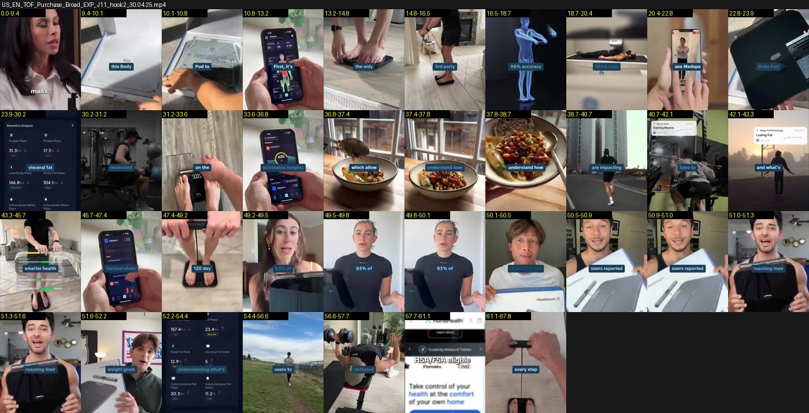

# US_EN_TOF_Purchase_Broad_EXP_J11_hook2_30.04.25.mp4

Master: `US_EN_TOF_Purchase_Broad_EXP_J11_hook2_30.04.25.mp4` · 67.8s · 360x450

**Pacing:** 37 shots · avg 1.832s · median 1.4s · 5.31 cuts/10s · first cut 9.367s · 220.0 wpm · talk ratio 0.87 · cuts on word start 83.3% · cuts in speech gaps 55.6%
**Audio:** {'I_lufs': -11.4, 'LRA': 4.1, 'true_peak_db': 1.1} · BPM≈129.2 · music {'speech_rms_db': -15.3, 'pause_seconds': 4.9, 'pause_rms_db': -15.6, 'bed_minus_voice_db': -0.3, 'music_bed_likely': True} · cuts with SFX/transient 58.3%

**Captions:** 132 cards · 1.0 words/card (median) · y≈0.549 of frame height · text height≈0.04 · colours {'white': 74, 'dark/other': 58} · cards crossing a cut: 0
**Headlines:** The higher (0.0–0.5s, white) | the healthy (3.5–3.5s, white) | the greater (5.0–5.0s, white) | your survivability (6.0–6.0s, white) | UNDERSTANDYOURHEALTH (9.0–9.0s, dark/other) | KHumoHealth (9.0–9.0s, white) | BodyPod (12.0–12.0s, white) | MuscleRate (24.0–24.0s, dark/other)

**Hook (0–3s) spoken:** the higher the amount of skeletal muscle mass you have,
**Hook on-screen:** The higher / massyou have, / the amount / toskeletal muscle
**CTA (last 5s):** fitness progress at every step. · on-screen: Humehealth.com / Shop now. / X Body Pod / every step

## Beat sheet

| # | in–out (s) | dur | transition | spoken | on-screen text |
|---|---|---|---|---|---|
| 1 | 0.00–9.37 | 9.37 |  | the higher the amount of skeletal muscle mass you have, the healthy skeletal muscle mass, the greater your survivability against nearly any kind of disease. Here's why I trust this | The higher (HEADLINE) / the amount / toskeletal muscle / massyou have, / the healthy (HEADLINE) / skeletal muscle |
| 2 | 9.37–10.07 | 0.7 | cut +SFX hit | body pod to | Itrust / UNDERSTANDYOURHEALTH (HEADLINE) / KHumoHealth (HEADLINE) / Pod to |
| 3 | 10.07–10.83 | 0.77 | cut +SFX hit | track my muscle in | Pod to |
| 4 | 10.83–13.17 | 2.33 | cut | progress. First, it's accuracy. | progress. / BodyPod (HEADLINE) / 5'10- / 28 / 23 / First, it's |
| 5 | 13.17–14.83 | 1.67 | cut | The body pod is the only body analyzer | The Body / the only |
| 6 | 14.83–16.53 | 1.7 | cut | that is third party tested and | tested |
| 7 | 16.53–18.73 | 2.2 | cut | it has a 98 % accuracy when | 98% accuracy |
| 8 | 18.73–20.40 | 1.67 | cut +SFX hit | compared to a DEXA scan, | when compared / DEXA scan |
| 9 | 20.40–22.83 | 2.43 | cut +SFX hit | which is why you'll see Med Spa and weight loss clinics using | DEXA scan / see Medspa / and weight |
| 10 | 22.83–23.93 | 1.1 | cut | the body pod. It | Body Pod |
| 11 | 23.93–30.17 | 6.23 | cut | tracks your muscle gain, fat loss, and even visceral fat, which allow you to understand which areas need working on. | MuscleRate (HEADLINE) / MuscleMass (HEADLINE) / 146.8bs (HEADLINE) / 81.2% (HEADLINE) / Excellent (HEADLINE) / Fat FreeMass |
| 12 | 30.17–31.23 | 1.07 | cut +SFX hit | You'll feel motivated even | you'll feel |
| 13 | 31.23–33.57 | 2.33 | cut | when the number on the scale isn't changing. | on the / 5806. (HEADLINE) / changing |
| 14 | 33.57–36.77 | 3.2 | cut +SFX hit | Second, it comes with weekly actionable insights and feedback, | 10:59 (HEADLINE) / 2925 (HEADLINE) / 184133 / itcomes / Goals / Milestonel |
| 15 | 36.77–37.40 | 0.63 | cut +SFX hit | which allow you | whichallow |
| 16 | 37.40–37.77 | 0.37 | cut +SFX hit | to understand | whichallow |
| 17 | 37.77–38.70 | 0.93 | cut +SFX hit | how your diet and | understand how |
| 18 | 38.70–40.67 | 1.97 | cut | habits are impacting your body, | and habits |
| 19 | 40.67–42.07 | 1.4 | cut | so you never have to guess what's | MuscleMass (HEADLINE) / 6.25AM (HEADLINE) / GainingMuscle (HEADLINE) / haveto / BodyFat Percentage (HEADLINE) / 12:42AM> (HEADLINE) |
| 20 | 42.07–43.33 | 1.27 | cut +SFX hit | working and what's not, | BodyFat Percentage (HEADLINE) / 12:42AM> (HEADLINE) / LosingFat (HEADLINE) / Fat: 12,4% (HEADLINE) / what's working / ★BodyFatPercentage (HEADLINE) |
| 21 | 43.33–45.73 | 2.4 | cut +SFX hit | allowing you to make smarter health choices. | 12:42AM> (HEADLINE) / LosingFat (HEADLINE) / Fat: 12,4% (HEADLINE) / ★BodyFatPercentage (HEADLINE) / MUSCLEMASS / to make |
| 22 | 45.73–47.40 | 1.67 | cut +SFX hit | Third, it has a backed study. | 10:59 (HEADLINE) / Goalk (HEADLINE) / Mllestone1 / Third it / 0.00% / 13.0185 |
| 23 | 47.40–49.17 | 1.77 | cut +SFX hit | In a 120 -day trial, | 0.69% (HEADLINE) / backed study / 2400.0 / 120 day / 83%of |
| 24 | 49.17–49.47 | 0.3 | cut +SFX hit | 83 | 83%of |
| 25 | 49.47–49.83 | 0.37 | cut +SFX hit | % | 83%of |
| 26 | 49.83–50.13 | 0.3 | cut +SFX hit | of |  |
| 27 | 50.13–50.50 | 0.37 | cut +SFX hit | users reported |  |
| 28 | 50.50–50.87 | 0.37 | cut |  |  |
| 29 | 50.87–50.97 | 0.1 | cut | reaching |  |
| 30 | 50.97–51.30 | 0.33 | cut | their | reaching their |
| 31 | 51.30–51.60 | 0.3 | cut +SFX hit | weight | reaching their |
| 32 | 51.60–52.20 | 0.6 | cut | goals. | DayTiusciexFal (HEADLINE) / MuscleMass (HEADLINE) / MuscleRate (HEADLINE) / 146.8ibs (HEADLINE) / 81.2% (HEADLINE) / Excellent (HEADLINE) |
| 33 | 52.20–54.37 | 2.17 | cut | By tracking, understanding what's working, It | DayTiusciexFal (HEADLINE) / MuscleMass (HEADLINE) / MuscleRate (HEADLINE) / 146.8ibs (HEADLINE) / 81.2% (HEADLINE) / Excellent (HEADLINE) |
| 34 | 54.37–56.57 | 2.2 | cut +SFX hit | allows users to keep on with their program without | Rates / Subcutaners / sFat / working / usersto / program |
| 35 | 56.57–57.67 | 1.1 | cut +SFX hit | feeling defeated. | defeated |
| 36 | 57.67–61.07 | 3.4 | cut +SFX hit | It also happened to be HSA FSA eligible. | HSA/FSAe [red] (HEADLINE) / HSA/FSAeligble (HEADLINE) / Take control of your (HEADLINE) / healthatthe comfort (HEADLINE) / ofyourown home (HEADLINE) / that's why |
| 37 | 61.07–67.80 | 6.73 | cut | That's why I trust the body pod to track my fitness progress at every step. | that's why / 00 / Pod to / every step / X Body Pod (HEADLINE) / Shop now. (HEADLINE) |

## Full transcript

the higher the amount of skeletal muscle mass you have, the healthy skeletal muscle mass, the greater your survivability against nearly any kind of disease. Here's why I trust this body pod to track my muscle in progress. First, it's accuracy. The body pod is the only body analyzer that is third party tested and it has a 98% accuracy when compared to a DEXA scan, which is why you'll see Med Spa and weight loss clinics using the body pod. It tracks your muscle gain, fat loss, and even visceral fat, which allow you to understand which areas need working on. You'll feel motivated even when the number on the scale isn't changing. Second, it comes with weekly actionable insights and feedback, which allow you to understand how your diet and habits are impacting your body, so you never have to guess what's working and what's not, allowing you to make smarter health choices. Third, it has a backed study. In a 120-day trial, 83% of users reported reaching their weight goals. By tracking, understanding what's working, It allows users to keep on with their program without feeling defeated. It also happened to be HSA FSA eligible. That's why I trust the body pod to track my fitness progress at every step.