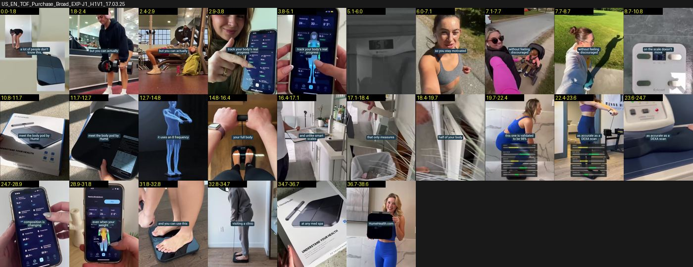

# US_EN_TOF_Purchase_Broad_EXP-J1_H1V1_17.03.25

Master: `US_EN_TOF_Purchase_Broad_EXP-J1_H1V1_17.03.25` · 38.6s · 720x900

**Pacing:** 26 shots · avg 1.483s · median 1.2s · 6.48 cuts/10s · first cut 1.8s · 197.0 wpm · talk ratio 0.97 · cuts on word start 60.0% · cuts in speech gaps 44.0%
**Audio:** {'I_lufs': -14.1, 'LRA': 1.6, 'true_peak_db': -4.5} · BPM≈129.2 · music {'speech_rms_db': -17.9, 'pause_seconds': 0.0} · cuts with SFX/transient 72.0%

**Captions:** 163 cards · 1 words/card (median) · y≈0.538 of frame height · text height≈0.0333 · colours {'white': 124, 'green': 3, 'blue': 11, 'dark/other': 23, 'red': 2} · cards crossing a cut: 16
Highlighted: Standard, 6.0tbs, Susrdard, LotArmFat, Suandd, FTrunkFatMass, 12.3bs, Plans, Low, Meaures, Measres, High, LoW, Verylow, High
**Headlines:** 12:27 (4.0–4.0s, dark/other) | 5G (4.0–4.5s, dark/other) | MetaboieAge (4.0–4.0s, dark/other) | Helght (4.0–4.0s, dark/other) | 24 (4.0–4.0s, dark/other) | 5'3", (4.0–4.0s, dark/other) | RightAemFitMate (4.0–4.0s, dark/other) | LoftAmFatRate (4.0–4.0s, dark/other)

**Hook (0–3s) spoken:** A lot of people don't know this, but you can actually track
**Hook on-screen:** a lot of people don't / but you can actually / knowthis,
**CTA (last 5s):** a clinic. You can buy this at any Med Spa or check out humehealth .com. · on-screen: BALANCE DE COMPOSITION CORPORELLE CONNETEE / BODY / HumeHealth.com / SMART / SMARTE / SMARTE KORPERANALYSE-WAAGE / UNDERSTAND YOURHEALTH / XHumeHealth / YCOMPOSITIONANALYZER / at any med spa / eHealth / visiting a clinic

## Beat sheet

| # | in–out (s) | dur | transition | spoken | on-screen text |
|---|---|---|---|---|---|
| 1 | 0.00–1.80 | 1.8 |  | A lot of people don't know this, | a lot of people don't / knowthis, |
| 2 | 1.80–2.40 | 0.6 | cut | but you can actually | but you can actually |
| 3 | 2.40–2.90 | 0.5 | cut +SFX hit | track | but you can actually |
| 4 | 2.90–3.80 | 0.9 | cut +SFX hit | your body's real | but you can actually / HeartRate / 23.1bs / Standard [green] / track your body's real / progress |
| 5 | 3.80–5.07 | 1.27 | cut +SFX hit | progress. Not | track your body's real / progress / 1.5bs / Left ArmFat / LeftArm / BodyBreakdowm |
| 6 | 5.07–6.03 | 0.97 | cut | just weight, so you | not just weight / so you stay motivated |
| 7 | 6.03–7.07 | 1.03 | cut +SFX hit | stay motivated without | so you stay motivated / without feeling / discouraged |
| 8 | 7.07–7.73 | 0.67 | cut +SFX hit | feeling discouraged | without feeling / discouraged |
| 9 | 7.73–8.70 | 0.97 | cut +SFX hit | when the | without feeling / discouraged |
| 10 | 8.70–10.77 | 2.07 | cut +SFX hit | number on the scale doesn't move. | when the number / 657 / 651 (HEADLINE) / on the scale doesn't / move / 222 |
| 11 | 10.77–11.73 | 0.97 | cut +SFX hit | Meet the body pod | HumeHealth (HEADLINE) / meetthe body pod by / Hume / NDERSTAND YOURHEALTH (HEADLINE) / HumeHeaith (HEADLINE) |
| 12 | 11.73–12.70 | 0.97 | cut | by Hume. It | meetthe body pod by / Hume / OETTINGSTARTCE |
| 13 | 12.70–14.83 | 2.13 | cut +SFX hit | uses an 8 frequency sensor to measure | it uses an 8 frequency / sensorto measure |
| 14 | 14.83–16.40 | 1.57 | cut +SFX hit | your full body, and unlike | your full body / and unlike smart / scales / 8085 |
| 15 | 16.40–17.10 | 0.7 | cut +SFX hit | smart scales | and unlike smart / scales / 8085 / TYLOR (HEADLINE) |
| 16 | 17.10–18.43 | 1.33 | cut +SFX hit | that only measures | and unlike smart / scales / TYLOR (HEADLINE) / that only measures |
| 17 | 18.43–19.70 | 1.27 | cut +SFX hit | half of your body, | that only measures / half of your body |
| 18 | 19.70–22.43 | 2.73 | cut | this one is validated to be 98 % | thisoneis validated / to be 98% / WEIGHT / BODY FAT / MUSCLEMASS / BODYWATER |
| 19 | 22.43–23.57 | 1.13 | cut +SFX hit | as accurate as | thisoneis validated / to be 98% / WEIGHT / BODY FAT / BODYWATER / +4LBS% |
| 20 | 23.57–24.70 | 1.13 | cut | a DEXA scan, | as accurateasa / DEXA scan |
| 21 | 24.70–28.87 | 4.17 | cut | so you can see exactly how your body composition is changing. It keeps | 5:19 (HEADLINE) / BodyWater (HEADLINE) / 61.1% (HEADLINE) / 23.5 (HEADLINE) / Standard (HEADLINE) / Standard |
| 22 | 28.87–31.80 | 2.93 | cut +SFX hit | you on track even when your weight stays the same and | Measures / Standard / 4:31 (HEADLINE) / $BodyWaterLow (HEADLINE) / At499%BodyWateryoutFat Losspotentialsbeing (HEADLINE) / reducedby35.7% (HEADLINE) |
| 23 | 31.80–32.80 | 1.0 | cut +SFX hit | you can use this at | and you can use this |
| 24 | 32.80–34.73 | 1.93 | cut | home without visiting a clinic. You can | at home without / visiting a clinic |
| 25 | 34.73–36.67 | 1.93 | cut +SFX hit | buy this at any Med Spa or | XHumeHealth (HEADLINE) / you can buythis / UNDERSTAND YOURHEALTH (HEADLINE) / BALANCE DE COMPOSITION CORPORELLE CONNETEE (HEADLINE) / YCOMPOSITIONANALYZER (HEADLINE) / SMARTE KORPERANALYSE-WAAGE (HEADLINE) |
| 26 | 36.67–38.57 | 1.9 | cut +SFX hit | check out humehealth .com. | HumeHealth.com |

## Full transcript

A lot of people don't know this, but you can actually track your body's real progress. Not just weight, so you stay motivated without feeling discouraged when the number on the scale doesn't move. Meet the body pod by Hume. It uses an 8 frequency sensor to measure your full body, and unlike smart scales that only measures half of your body, this one is validated to be 98% as accurate as a DEXA scan, so you can see exactly how your body composition is changing. It keeps you on track even when your weight stays the same and you can use this at home without visiting a clinic. You can buy this at any Med Spa or check out humehealth.com.