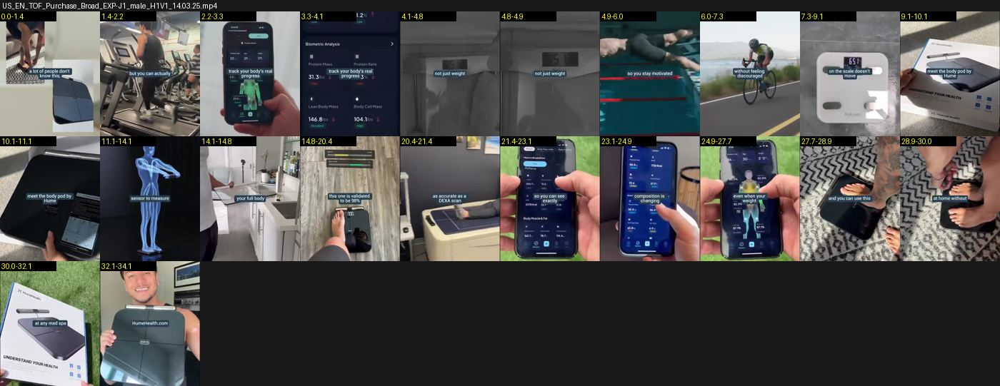

# US_EN_TOF_Purchase_Broad_EXP-J1_male_H1V1_14.03.25.mp4

Master: `US_EN_TOF_Purchase_Broad_EXP-J1_male_H1V1_14.03.25.mp4` · 34.1s · 360x450

**Pacing:** 22 shots · avg 1.552s · median 1.15s · 6.15 cuts/10s · first cut 1.4s · 226.0 wpm · talk ratio 0.96 · cuts on word start 100.0% · cuts in speech gaps 71.4%
**Audio:** {'I_lufs': -21.2, 'LRA': 5.5, 'true_peak_db': -3.8} · BPM≈123.0 · music {'speech_rms_db': -26.6, 'pause_seconds': 0.5, 'pause_rms_db': -25.5, 'bed_minus_voice_db': 1.1, 'music_bed_likely': True} · cuts with SFX/transient 57.1%

**Captions:** 90 cards · 1.0 words/card (median) · y≈0.497 of frame height · text height≈0.035 · colours {'white': 69, 'dark/other': 7, 'blue': 14} · cards crossing a cut: 6
Highlighted: 58.5m, 1726Keal, 22.6, 67.9, 58.5g, 86.4m, 67.9%, Bodyk, MuacieMass, 58.5kg, 86.4, FatFreeMoss, 62.8g, 6.9.9
**Headlines:** Metricsititealkdowm (2.0–2.0s, white) | 10:00a (2.5–3.0s, white) | 29 (3.0–3.0s, white) | 23 (3.0–3.0s, white) | 20.3bs (3.5–3.5s, white) | 11.2% (3.5–3.5s, white) | Low (3.5–3.5s, dark/other) | BiometricAnalysis (3.5–3.5s, white)

**Hook (0–3s) spoken:** A lot of people don't know this, but you can actually track your body's
**Hook on-screen:** 10:00a / 23 / 27.00 / 29 / 3.2 / Metricsititealkdowm / alotofpeopledon't / but you can actually / knowthis, / progress / track your body's real
**CTA (last 5s):** a clinic. you can buy this at any med spa or check out humehealth .com. · on-screen: HumeHealth.com / UNDERSTANDYOURHEALTH / XHumeHealth / atanymed spa / or check out / you canbuythis

## Beat sheet

| # | in–out (s) | dur | transition | spoken | on-screen text |
|---|---|---|---|---|---|
| 1 | 0.00–1.40 | 1.4 |  | A lot of people don't know this, | alotofpeopledon't / knowthis, |
| 2 | 1.40–2.20 | 0.8 | cut +SFX hit | but you can actually track | alotofpeopledon't / knowthis, / but you can actually / Metricsititealkdowm (HEADLINE) / 3.2 |
| 3 | 2.20–3.30 | 1.1 | cut +SFX hit | your body's real | but you can actually / Metricsititealkdowm (HEADLINE) / 3.2 / 10:00a (HEADLINE) / 23 / 29 |
| 4 | 3.30–4.13 | 0.83 | cut +SFX hit | progress, not | 10:00a (HEADLINE) / track your body's real / progress / 29 (HEADLINE) / 23 (HEADLINE) / 27.0 |
| 5 | 4.13–4.83 | 0.7 | cut +SFX hit | just weight, so | not just weight |
| 6 | 4.83–4.93 | 0.1 | cut +SFX hit | you | not just weight |
| 7 | 4.93–5.97 | 1.03 | cut | stay motivated without | not just weight / so you stay motivated |
| 8 | 5.97–7.27 | 1.3 | cut +SFX hit | feeling discouraged when the | so you stay motivated / without feeling / discouraged / when the number |
| 9 | 7.27–9.10 | 1.83 | cut +SFX hit | number on the scale doesn't move. | when the number / 651 (HEADLINE) / onthescaledoesn't / move / llykvan |
| 10 | 9.10–10.07 | 0.97 | cut +SFX hit | Meet the Body Pod | onthescaledoesn't / move / meet the body pod by / Hume |
| 11 | 10.07–11.10 | 1.03 | cut | by Hume. It | meet the body pod by / Hume / it uses an 8 frequency |
| 12 | 11.10–14.07 | 2.97 | cut | uses an 8 frequency sensor to measure your full body, | it uses an 8 frequency / sensortomeasure / your full body |
| 13 | 14.07–14.80 | 0.73 | cut +SFX hit | and unlike smart | your full body |
| 14 | 14.80–20.43 | 5.63 | cut | scales that only measures half of your body, this one is validated to be 98 % as accurate as a | and unlike smart / scales / half of your body / this oneisvalidated / to be 98% / 2075 |
| 15 | 20.43–21.43 | 1.0 | cut | DEXA scan, so | MUSCLEMASS (HEADLINE) / BOCYWATER (HEADLINE) / BOOYFAT (HEADLINE) / VISCERALFAT / asaccurateas a / DEXAscan |
| 16 | 21.43–23.13 | 1.7 | cut | you can see exactly how your body | asaccurateas a / DEXAscan / 5:30 (HEADLINE) / Weignt (HEADLINE) / BodyMassIndex (HEADLINE) / Body.FstPerc (HEADLINE) |
| 17 | 23.13–24.93 | 1.8 | cut +SFX hit | composition is changing. It keeps | 67.8 [blue] (HEADLINE) / 10.2% [blue] (HEADLINE) / 58.5m [blue] / 1726Keal [blue] / how your body / 22.6 [blue] |
| 18 | 24.93–27.73 | 2.8 | cut +SFX hit | you on track, even when your weight stays the same, and you can | 5130 (HEADLINE) / MetricsBreakdown (HEADLINE) / itkeeps you on track / 82.3% / 5'11" (HEADLINE) / 30 (HEADLINE) |
| 19 | 27.73–28.93 | 1.2 | cut | use this at home without | andyou can usethis |
| 20 | 28.93–30.03 | 1.1 | cut +SFX hit | visiting a clinic. you can | at home without / you canbuythis / UNDERSTANDYOURHEALTH (HEADLINE) |
| 21 | 30.03–32.07 | 2.03 | cut | buy this at any med spa or check | you canbuythis / UNDERSTANDYOURHEALTH (HEADLINE) / XHumeHealth (HEADLINE) / atanymed spa / or check out |
| 22 | 32.07–34.13 | 2.07 | cut | out humehealth .com. | or check out / HumeHealth.com |

## Full transcript

A lot of people don't know this, but you can actually track your body's real progress, not just weight, so you stay motivated without feeling discouraged when the number on the scale doesn't move. Meet the Body Pod by Hume. It uses an 8 frequency sensor to measure your full body, and unlike smart scales that only measures half of your body, this one is validated to be 98% as accurate as a DEXA scan, so you can see exactly how your body composition is changing. It keeps you on track, even when your weight stays the same, and you can use this at home without visiting a clinic. you can buy this at any med spa or check out humehealth.com.