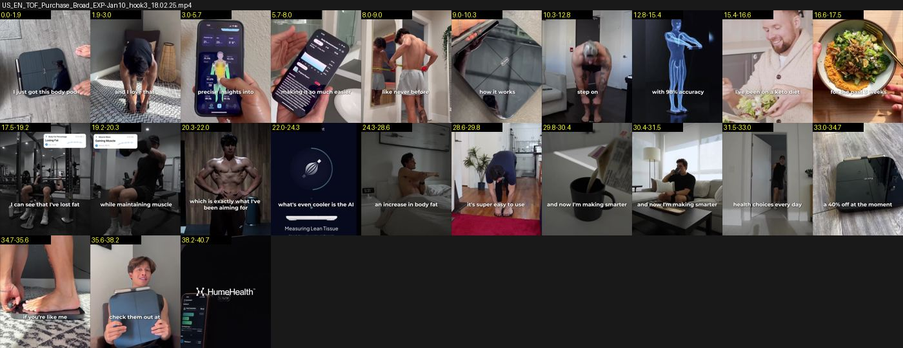

# US_EN_TOF_Purchase_Broad_EXP-Jan10_hook3_18.02.25.mp4

Master: `US_EN_TOF_Purchase_Broad_EXP-Jan10_hook3_18.02.25.mp4` · 40.7s · 720x900

**Pacing:** 23 shots · avg 1.769s · median 1.7s · 5.41 cuts/10s · first cut 1.867s · 265.0 wpm · talk ratio 0.88 · cuts on word start 77.3% · cuts in speech gaps 77.3%
**Audio:** {'I_lufs': -18.5, 'LRA': 4.7, 'true_peak_db': -4.3} · BPM≈117.5 · music {'speech_rms_db': -24.1, 'pause_seconds': 2.6, 'pause_rms_db': -25.6, 'bed_minus_voice_db': -1.6, 'music_bed_likely': True} · cuts with SFX/transient 40.9%

**Captions:** 67 cards · 1 words/card (median) · y≈0.703 of frame height · text height≈0.0433 · colours {'white': 50, 'dark/other': 13, 'yellow': 1, 'blue': 2, 'red': 1} · cards crossing a cut: 2
Highlighted: it gives me real time, Mesuris, with98%accuracy, forthepast3weeks
**Headlines:** 1:25 (3.0–5.0s, white) | 26/07 (3.0–3.0s, white) | 28/07 (3.0–3.0s, white) | MuncleMass (3.0–3.0s, white) | MetricsBreakdown (3.0–3.5s, white) | Data (3.0–3.0s, dark/other) | Body (3.5–3.5s, dark/other) | Heigt (3.5–3.5s, dark/other)

**Hook (0–3s) spoken:** I just got this body pod from Hume, and I love that it gives me real
**Hook on-screen:** Ijust got this body pod / and Ilovethat / from Hume / givesmerealtime
**CTA (last 5s):** want to check them out at humehealth .com. · on-screen: 79.0 / HumeHealth / XHumeHealth / humhealth.com / stone1 / you'll want to

## Beat sheet

| # | in–out (s) | dur | transition | spoken | on-screen text |
|---|---|---|---|---|---|
| 1 | 0.00–1.87 | 1.87 |  | I just got this body pod from Hume, | Ijust got this body pod / from Hume |
| 2 | 1.87–3.00 | 1.13 | cut +SFX hit | and I love that it gives me real | from Hume / and Ilovethat / givesmerealtime |
| 3 | 3.00–5.73 | 2.73 | cut | time, precise insights into my body composition, | 1:25 (HEADLINE) / 26/07 (HEADLINE) / 28/07 (HEADLINE) / MuncleMass (HEADLINE) / MetricsBreakdown (HEADLINE) / Data (HEADLINE) |
| 4 | 5.73–8.00 | 2.27 | cut | making it so much easier to track my progress like | mybody composition / 135ep.2023 (HEADLINE) / 12M / wmaking itsomucheasier / 99.0 1bs (HEADLINE) / 13.5ep.2023 (HEADLINE) |
| 5 | 8.00–9.03 | 1.03 | cut +SFX hit | never before. | likeneverbefore / let me showyou |
| 6 | 9.03–10.27 | 1.23 | cut | Let me show you how it works. | let me showyou / how it works |
| 7 | 10.27–12.80 | 2.53 | cut | All you have to do is step on, hold the handle, | how it works / all you have to do is / holdthe handle |
| 8 | 12.80–15.40 | 2.6 | cut | and it scans your body with 98 % accuracy. | and it scans your body / with98%accuracy [blue] |
| 9 | 15.40–16.57 | 1.17 | cut +SFX hit | I've been on a keto diet for | with98%accuracy [blue] / I've been ona keto diet |
| 10 | 16.57–17.50 | 0.93 | cut | the past three weeks, | forthepast3weeks [red] |
| 11 | 17.50–19.20 | 1.7 | cut | and now I can see that I've lost fat | BodyFatPercentage (HEADLINE) / 12:42AM > (HEADLINE) / LosingFat (HEADLINE) / Fat: 12,4% (HEADLINE) / I can see that I've lostfat / MuscleMass (HEADLINE) |
| 12 | 19.20–20.27 | 1.07 | cut | while maintaining muscle, | MuscleMass (HEADLINE) / 6:25 AM (HEADLINE) / Gaining Muscle (HEADLINE) / Muscle: 85.1% (HEADLINE) / while maintaining muscle / 0100 (HEADLINE) |
| 13 | 20.27–21.97 | 1.7 | cut +SFX hit | which is exactly what I've been aiming for. | MuscleMass (HEADLINE) / 6:25 AM (HEADLINE) / Gaining Muscle (HEADLINE) / Muscle: 85.1% (HEADLINE) / while maintaining muscle / 0100 (HEADLINE) |
| 14 | 21.97–24.33 | 2.37 | cut +SFX hit | What's even cooler is the AI coaching. It pointed out | Measurement (HEADLINE) / what's even cooler is the Al / MeasuringAdiposeTissue / MeasuringLeanTissue / coaching pointed out / Measuring BoneMass |
| 15 | 24.33–28.57 | 4.23 | cut | that my sleep patterns are contributing to an increase in body fat, which I wouldn't have noticed otherwise. It's | Measurement (HEADLINE) / coaching pointed out / Measuring BoneMass / 5:31 / that my sleep patterns / an increase in body fat |
| 16 | 28.57–29.80 | 1.23 | cut | super easy to use, | it's super easyto use |
| 17 | 29.80–30.43 | 0.63 | cut | and now I'm | and now I'm making smarter |
| 18 | 30.43–31.53 | 1.1 | cut +SFX hit | making smarter, more informed | and now I'm making smarter |
| 19 | 31.53–33.00 | 1.47 | cut | health choices every day. | health choices every day |
| 20 | 33.00–34.70 | 1.7 | cut +SFX hit | They're running a 40 % off at the moment. | they're running / a 40% offat the moment |
| 21 | 34.70–35.60 | 0.9 | cut +SFX hit | If you're like me, | if you're likeme |
| 22 | 35.60–38.17 | 2.57 | cut +SFX hit | you'll want to check them out at humehealth .com. | you'll want to / humhealth.com / 79.0 / stone1 |
| 23 | 38.17–40.68 | 2.51 | cut |  | 79.0 / stone1 / XHumeHealth (HEADLINE) / HumeHealth |

## Full transcript

I just got this body pod from Hume, and I love that it gives me real time, precise insights into my body composition, making it so much easier to track my progress like never before. Let me show you how it works. All you have to do is step on, hold the handle, and it scans your body with 98% accuracy. I've been on a keto diet for the past three weeks, and now I can see that I've lost fat while maintaining muscle, which is exactly what I've been aiming for. What's even cooler is the AI coaching. It pointed out that my sleep patterns are contributing to an increase in body fat, which I wouldn't have noticed otherwise. It's super easy to use, and now I'm making smarter, more informed health choices every day. They're running a 40% off at the moment. If you're like me, you'll want to check them out at humehealth.com.