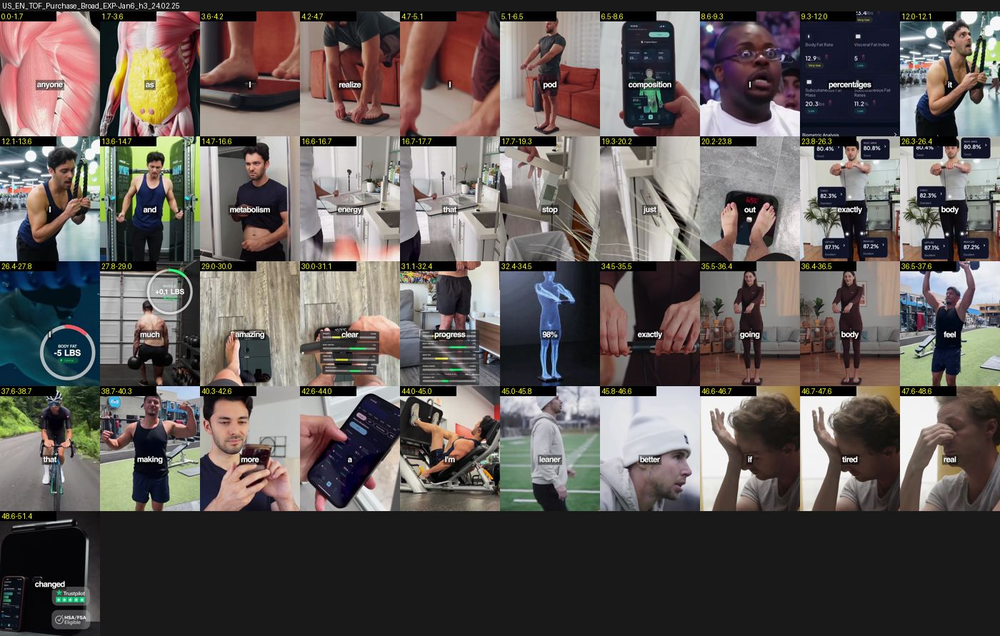

# US_EN_TOF_Purchase_Broad_EXP-Jan6_h3_24.02.25

Master: `US_EN_TOF_Purchase_Broad_EXP-Jan6_h3_24.02.25` · 51.4s · 720x900

**Pacing:** 41 shots · avg 1.254s · median 1.1s · 7.78 cuts/10s · first cut 1.7s · 274.0 wpm · talk ratio 0.92 · cuts on word start 82.5% · cuts in speech gaps 75.0%
**Audio:** {'I_lufs': -14.6, 'LRA': 1.5, 'true_peak_db': -0.6} · BPM≈129.2 · music {'speech_rms_db': -17.2, 'pause_seconds': 0.2} · cuts with SFX/transient 72.5%

**Captions:** 81 cards · 1 words/card (median) · y≈0.562 of frame height · text height≈0.0417 · colours {'white': 69, 'dark/other': 11, 'blue': 1} · cards crossing a cut: 3
Highlighted: Low
**Headlines:** why (0.0–0.0s, white) | that (1.0–1.0s, white) | gain (1.5–1.5s, yellow) | just (2.0–2.0s, white) | body (5.0–5.0s, white) | pod (5.5–5.5s, white) | first (6.0–6.0s, white) | 10:004 (7.0–7.0s, white)

**Hook (0–3s) spoken:** Why didn't anyone teach me that muscle gain is just as important as losing
**Hook on-screen:** anyone / as / gain / just / that / why
**CTA (last 5s):** If you're tired of guessing and want real results, get the body pod. It's changed everything for me. · on-screen: Eligible / HSA/FSA / Trustpilot / body / changed / real / tired

## Beat sheet

| # | in–out (s) | dur | transition | spoken | on-screen text |
|---|---|---|---|---|---|
| 1 | 0.00–1.70 | 1.7 |  | Why didn't anyone teach me that muscle gain | why (HEADLINE) / anyone / that (HEADLINE) / gain [yellow] (HEADLINE) |
| 2 | 1.70–3.63 | 1.93 | cut +SFX hit | is just as important as losing fat? | gain [yellow] (HEADLINE) / just (HEADLINE) / as / fat |
| 3 | 3.63–4.20 | 0.57 | cut +SFX hit | I didn't realize | realize |
| 4 | 4.20–4.67 | 0.47 | cut | until I | realize |
| 5 | 4.67–5.13 | 0.47 | cut | tried the body | body (HEADLINE) |
| 6 | 5.13–6.53 | 1.4 | cut +SFX hit | pod for the first time. | body (HEADLINE) / pod (HEADLINE) / first (HEADLINE) |
| 7 | 6.53–8.60 | 2.07 | cut +SFX hit | When I saw my body composition results, | 10:004 (HEADLINE) / BFP (HEADLINE) / Lean Mass (HEADLINE) / BMR (Basa (HEADLINE) / wight (HEADLINE) / MetricsBreakdown (HEADLINE) |
| 8 | 8.60–9.33 | 0.73 | cut +SFX hit | I was shocked. | shocked |
| 9 | 9.33–12.00 | 2.67 | cut +SFX hit | My muscle and fat percentages were nothing like I expected. | shocked / FatFreeMass (HEADLINE) / FatMass (HEADLINE) / 23.4ibs (HEADLINE) / 157.4lbs (HEADLINE) / High (HEADLINE) |
| 10 | 12.00–12.10 | 0.1 | cut |  | it |
| 11 | 12.10–13.57 | 1.47 | cut +SFX hit | It turns out I was losing muscle, not | it / muscle |
| 12 | 13.57–14.73 | 1.17 | cut +SFX hit | fat, and that was slowing | PRECOR (HEADLINE) / and (HEADLINE) |
| 13 | 14.73–16.63 | 1.9 | cut +SFX hit | down my metabolism and draining my energy. | my (HEADLINE) / draining (HEADLINE) |
| 14 | 16.63–16.73 | 0.1 | cut +SFX hit |  |  |
| 15 | 16.73–17.73 | 1.0 | cut | And that was the wake -up call | that |
| 16 | 17.73–19.30 | 1.57 | cut +SFX hit | I needed to stop relying on | needed |
| 17 | 19.30–20.20 | 0.9 | cut | just the scale. | 6335 [red] (HEADLINE) / scale |
| 18 | 20.20–23.80 | 3.6 | cut +SFX hit | I was so focused on the number, but it turns out that's only a small part of the story. | 6335 [red] (HEADLINE) / scale / 62053 [red] (HEADLINE) / on / 62553 (HEADLINE) / out |
| 19 | 23.80–26.30 | 2.5 | cut +SFX hit | The body pod showed me exactly what was happening in my body, | Body (HEADLINE) / RIGHT.ARMS (HEADLINE) / LEFTARMS (HEADLINE) / 80.8% (HEADLINE) / 80.4% (HEADLINE) / Good (HEADLINE) |
| 20 | 26.30–26.40 | 0.1 | cut +SFX hit |  | RIGHT.ARMS (HEADLINE) / LEFTARMS (HEADLINE) / 80.8% (HEADLINE) / 80.4% (HEADLINE) / Good (HEADLINE) / TORSO |
| 21 | 26.40–27.77 | 1.37 | cut | how much fat I was losing, | RIGHT.ARMS (HEADLINE) / LEFTARMS (HEADLINE) / 80.8% (HEADLINE) / 80.4% (HEADLINE) / Good (HEADLINE) / TORSO |
| 22 | 27.77–29.03 | 1.27 | cut +SFX hit | and how much muscle I was gaining. It's | MUSCLE (HEADLINE) / +0,1 LBS (HEADLINE) / much / gaining (HEADLINE) |
| 23 | 29.03–30.00 | 0.97 | cut +SFX hit | amazing. | gaining (HEADLINE) |
| 24 | 30.00–31.07 | 1.07 | cut +SFX hit | It gives me a clear picture of | 'gives (HEADLINE) / WEIGHT / -12LBS / BODYWATER / my / +7% |
| 25 | 31.07–32.43 | 1.37 | cut +SFX hit | my progress, like nothing else. | WEIGHT / -12LBS / BODYWATER / my / +7% / BODYFAT |
| 26 | 32.43–34.50 | 2.07 | cut +SFX hit | Using its 98 % accuracy rate, | WEIGHT / BODYWATER / BODYFAT / MUSCLEMASS / +4LBS% / VISCERALFAT |
| 27 | 34.50–35.53 | 1.03 | cut | I know exactly what's going | exactly (HEADLINE) |
| 28 | 35.53–36.43 | 0.9 | cut +SFX hit | on with my body. | body (HEADLINE) |
| 29 | 36.43–36.53 | 0.1 | cut |  | body (HEADLINE) |
| 30 | 36.53–37.63 | 1.1 | cut +SFX hit | Now, I feel confident | feel |
| 31 | 37.63–38.73 | 1.1 | cut | knowing that every workout | that |
| 32 | 38.73–40.33 | 1.6 | cut +SFX hit | is actually making a difference. | actually / difference |
| 33 | 40.33–42.63 | 2.3 | cut +SFX hit | My progress is more visible, and I know it's real. | difference / more / know |
| 34 | 42.63–44.00 | 1.37 | cut | Not just a number on the scale, | 14:58吨 (HEADLINE) / 13/08 (HEADLINE) / Metrics Breakdown [blue] (HEADLINE) / Dats [blue] (HEADLINE) / FtFocus / 13.1 |
| 35 | 44.00–44.97 | 0.97 | cut +SFX hit | I'm getting stronger and | I'm (HEADLINE) |
| 36 | 44.97–45.83 | 0.87 | cut +SFX hit | leaner, and I feel | leaner |
| 37 | 45.83–46.60 | 0.77 | cut +SFX hit | better than ever. | better |
| 38 | 46.60–46.70 | 0.1 | cut |  |  |
| 39 | 46.70–47.60 | 0.9 | cut +SFX hit | If you're tired of guessing | tired (HEADLINE) |
| 40 | 47.60–48.60 | 1.0 | cut +SFX hit | and want real results, | real |
| 41 | 48.60–51.43 | 2.83 | cut +SFX hit | get the body pod. It's changed everything for me. | body (HEADLINE) / Trustpilot / HSA/FSA / Eligible / changed |

## Full transcript

Why didn't anyone teach me that muscle gain is just as important as losing fat? I didn't realize until I tried the body pod for the first time. When I saw my body composition results, I was shocked. My muscle and fat percentages were nothing like I expected. It turns out I was losing muscle, not fat, and that was slowing down my metabolism and draining my energy. And that was the wake-up call I needed to stop relying on just the scale. I was so focused on the number, but it turns out that's only a small part of the story. The body pod showed me exactly what was happening in my body, how much fat I was losing, and how much muscle I was gaining. It's amazing. It gives me a clear picture of my progress, like nothing else. Using its 98% accuracy rate, I know exactly what's going on with my body. Now, I feel confident knowing that every workout is actually making a difference. My progress is more visible, and I know it's real. Not just a number on the scale, I'm getting stronger and leaner, and I feel better than ever. If you're tired of guessing and want real results, get the body pod. It's changed everything for me.