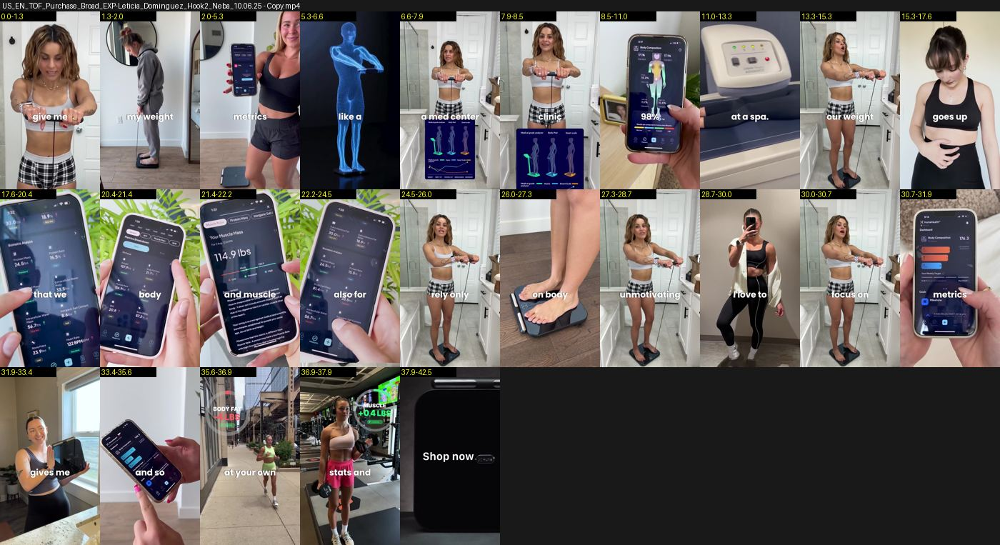

# US_EN_TOF_Purchase_Broad_EXP-Leticia_Dominguez_Hook2_Neba_10.06.25 - Copy.mp4

Master: `US_EN_TOF_Purchase_Broad_EXP-Leticia_Dominguez_Hook2_Neba_10.06.25 - Copy.mp4` · 42.5s · 720x1280

**Pacing:** 25 shots · avg 1.698s · median 1.366s · 5.65 cuts/10s · first cut 1.3s · 220.0 wpm · talk ratio 0.87 · cuts on word start 66.7% · cuts in speech gaps 58.3%
**Audio:** {'I_lufs': -18.6, 'LRA': 2.4, 'true_peak_db': -4.2} · BPM≈112.3 · music {'speech_rms_db': -22.6, 'pause_seconds': 4.2, 'pause_rms_db': -23.7, 'bed_minus_voice_db': -1.1, 'music_bed_likely': True} · cuts with SFX/transient 16.7%

**Captions:** 137 cards · 1 words/card (median) · y≈0.568 of frame height · text height≈0.0422 · colours {'white': 103, 'red': 5, 'blue': 4, 'dark/other': 25} · cards crossing a cut: 3
Highlighted: This is, likea, spa, 33.5ibs, tandard, BodyPod, gives me, stats and, needed
**Headlines:** my'weight (1.5–1.5s, white) | 15.2% (9.0–9.0s, white) | BodyComposition (10.0–10.0s, white) | LeftAm (10.0–10.0s, white) | RigitArm (10.0–10.0s, white) | 17.1% (10.0–10.0s, white) | Standard (10.0–10.0s, white) | 1:32 (18.0–20.0s, white)

**Hook (0–3s) spoken:** And not only does it give me my weight, but it gives me so
**Hook on-screen:** Not only / but / give me / my'weight / somany
**CTA (last 5s):** progress when needed. · on-screen: Humehealth.com / Shop now / X Body Pod / needed

## Beat sheet

| # | in–out (s) | dur | transition | spoken | on-screen text |
|---|---|---|---|---|---|
| 1 | 0.00–1.30 | 1.3 |  | And not only does it give me my | Not only / give me |
| 2 | 1.30–2.03 | 0.73 | cut | weight, | give me / my'weight (HEADLINE) / but |
| 3 | 2.03–5.30 | 3.27 | cut | but it gives me so many other metrics. This is something that | but / somany / other / metrics / This is [red] / that you |
| 4 | 5.30–6.60 | 1.3 | cut | you would use a spa or | that you / likea [blue] / spa [blue] |
| 5 | 6.60–7.90 | 1.3 | cut +SFX hit | a med center clinic. | amedcenter |
| 6 | 7.90–8.47 | 0.57 | cut |  | clinic |
| 7 | 8.47–11.00 | 2.53 | cut +SFX hit | And it is a 98 % accurate | clinic / 15.2% (HEADLINE) / 11.1% / 10.6% / Standard / OMuscle |
| 8 | 11.00–13.33 | 2.33 | cut | compared to those add a spa. | compared / at a spa. |
| 9 | 13.33–15.33 | 2.0 | cut +SFX hit | A lot of times our weight won't buy us | at a spa. / our weight / wontbudge |
| 10 | 15.33–17.60 | 2.27 | cut | or sometimes it even goes up a little. | wontbudge / goes up / a little. |
| 11 | 17.60–20.43 | 2.83 | cut | There's so many other metrics that we can focus on like body | 1:32 (HEADLINE) / Higih (HEADLINE) / FatMass (HEADLINE) / 34.2ibs (HEADLINE) / Fat Free Mass (HEADLINE) / 123.5bs (HEADLINE) |
| 12 | 20.43–21.43 | 1.0 | cut | fat percent, | 1:32 (HEADLINE) / Standard / Protein Mass / Plans / 24.5ibs / High |
| 13 | 21.43–22.20 | 0.77 | cut | the muscle range, | High / Verylow / BodyFatPercentage (HEADLINE) / MuscleRate (HEADLINE) / Your BFP (HEADLINE) / Bodyw (HEADLINE) |
| 14 | 22.20–24.50 | 2.3 | cut | water weight, use also for progress and | Verylow / 21.7% (HEADLINE) / 1:28 (HEADLINE) / BodyFatRate (HEADLINE) / Visceral Fat Index (HEADLINE) / Verylow (HEADLINE) |
| 15 | 24.50–25.97 | 1.47 | cut | not rely only | rely only |
| 16 | 25.97–27.33 | 1.37 | cut | on body weight. | rely only / weight |
| 17 | 27.33–28.67 | 1.33 | cut | I can be unbonivated. So | weight / unmotivating |
| 18 | 28.67–30.03 | 1.37 | cut | that's why I love to focus on | Ilove to / focuson |
| 19 | 30.03–30.73 | 0.7 | cut | all | focuson |
| 20 | 30.73–31.87 | 1.13 | cut | the other metrics that | HumeHealth (HEADLINE) / BodyComposition (HEADLINE) / 176.3 (HEADLINE) / metrics |
| 21 | 31.87–33.43 | 1.57 | cut | this body pod gives me. Makes | BodyPod [red] / gives me [red] |
| 22 | 33.43–35.57 | 2.13 | cut +SFX hit | tracking our progress is so much easier because | gives me [red] / Goals / 0.00% / our progress / 146.9 / much easier |
| 23 | 35.57–36.93 | 1.37 | cut | you can look at your own stats and | BODYFAT (HEADLINE) / -4LBS [red] (HEADLINE) / atyourown |
| 24 | 36.93–37.93 | 1.0 | cut | see your progress | MUSCLE [green] (HEADLINE) / +0.4LBS [green] (HEADLINE) / stats and [red] |
| 25 | 37.93–42.45 | 4.52 | cut | when needed. | needed [red] / X Body Pod (HEADLINE) / Shop now / Humehealth.com |

## Full transcript

And not only does it give me my weight, but it gives me so many other metrics. This is something that you would use a spa or a med center clinic. And it is a 98% accurate compared to those add a spa. A lot of times our weight won't buy us or sometimes it even goes up a little. There's so many other metrics that we can focus on like body fat percent, the muscle range, water weight, use also for progress and not rely only on body weight. I can be unbonivated. So that's why I love to focus on all the other metrics that this body pod gives me. Makes tracking our progress is so much easier because you can look at your own stats and see your progress when needed.