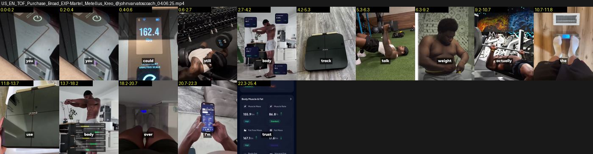

# US_EN_TOF_Purchase_Broad_EXP-Martel_Metellus_Kreo_@johnvarvatoscoach_04.06.25.mp4

Master: `US_EN_TOF_Purchase_Broad_EXP-Martel_Metellus_Kreo_@johnvarvatoscoach_04.06.25.mp4` · 25.4s · 720x900

**Pacing:** 15 shots · avg 1.693s · median 1.5s · 5.51 cuts/10s · first cut 0.233s · 266.0 wpm · talk ratio 0.92 · cuts on word start 92.9% · cuts in speech gaps 92.9%
**Audio:** {'I_lufs': -15.5, 'LRA': 2.6, 'true_peak_db': 0.2} · BPM≈117.5 · music {'speech_rms_db': -20.9, 'pause_seconds': 0.0} · cuts with SFX/transient 50.0%

**Captions:** 71 cards · 1 words/card (median) · y≈0.707 of frame height · text height≈0.04 · colours {'white': 60, 'dark/other': 5, 'blue': 3, 'red': 1, 'green': 2} · cards crossing a cut: 0
Highlighted: ANALYSISSCALE, lbs, High, Standard, Low, Standard
**Headlines:** 162.4 (0.5–0.5s, blue) | 162.6 (1.0–1.0s, blue) | 45 (2.0–2.0s, white) | BodyWater (3.0–3.0s, white) | 61.8% (3.0–3.5s, white) | Muscle Mass (3.0–3.5s, dark/other) | 162.7 (3.0–3.5s, white) | body (3.0–3.0s, white)

**Hook (0–3s) spoken:** Did you know you could be gaining weight but still getting healthier? It's all about
**Hook on-screen:** 162.4 / 162.6 / 45 / ANALYSISSCALE / LIGENT / Matt / could / healthier / it's / lbs / still / weight / you
**CTA (last 5s):** I can actually see if I'm gaining muscle or losing fat. And trust me, that's the progress that matters. · on-screen: 110.5lbs / 155.9bs / 155.9ibs / 167.1ibs / 17.6lbs / 18.5% / 2007cal / 33.3lbs / 45.4ibs / 5.4% / 68.3% / 86.8%

## Beat sheet

| # | in–out (s) | dur | transition | spoken | on-screen text |
|---|---|---|---|---|---|
| 1 | 0.00–0.23 | 0.23 |  | Did you | you |
| 2 | 0.23–0.40 | 0.17 | cut | know | you |
| 3 | 0.40–0.63 | 0.23 | cut +SFX hit | you could | you / 162.4 [blue] (HEADLINE) / could / LIGENT / ANALYSISSCALE [blue] |
| 4 | 0.63–2.67 | 2.03 | cut +SFX hit | be gaining weight but still getting healthier? | 162.4 [blue] (HEADLINE) / could / LIGENT / ANALYSISSCALE [blue] / 162.6 [blue] (HEADLINE) / lbs [blue] |
| 5 | 2.67–4.17 | 1.5 | cut | It's all about body composition. | it's / BodyWater (HEADLINE) / 61.8% (HEADLINE) / Muscle Mass (HEADLINE) / 162.7 (HEADLINE) / Weight |
| 6 | 4.17–5.30 | 1.13 | cut | Here's how I track mine. | here's / track / mine |
| 7 | 5.30–6.30 | 1.0 | cut | When we talk about health, most | mine / talk / most |
| 8 | 6.30–9.17 | 2.87 | cut +SFX hit | people obsess over losing weight. But here's the thing, gaining muscle | most / over / here's / muscle |
| 9 | 9.17–10.67 | 1.5 | cut | can actually make you healthier, | muscle / healthier |
| 10 | 10.67–11.83 | 1.17 | cut +SFX hit | even if the scale goes up. | the |
| 11 | 11.83–13.73 | 1.9 | cut +SFX hit | That's why I use the Hume Body Pod. | XHume / why (HEADLINE) / Body (HEADLINE) |
| 12 | 13.73–18.20 | 4.47 | cut | It shows me exactly how much of my body is muscle, fat, and everything in between. | WEIGHT / shows / BODYWATER / much / BODYFAT / +4LBS% |
| 13 | 18.20–20.70 | 2.5 | cut +SFX hit | Instead of freaking out over a higher number on the scale, | instead / over / the |
| 14 | 20.70–22.30 | 1.6 | cut +SFX hit | I can actually see if I'm gaining muscle or | actually / muscle |
| 15 | 22.30–25.40 | 3.1 | cut | losing fat. And trust me, that's the progress that matters. | muscle / 2007cal (HEADLINE) / 155.9ibs (HEADLINE) / High [blue] (HEADLINE) / BMI (HEADLINE) / BodyWater (HEADLINE) |

## Full transcript

Did you know you could be gaining weight but still getting healthier? It's all about body composition. Here's how I track mine. When we talk about health, most people obsess over losing weight. But here's the thing, gaining muscle can actually make you healthier, even if the scale goes up. That's why I use the Hume Body Pod. It shows me exactly how much of my body is muscle, fat, and everything in between. Instead of freaking out over a higher number on the scale, I can actually see if I'm gaining muscle or losing fat. And trust me, that's the progress that matters.