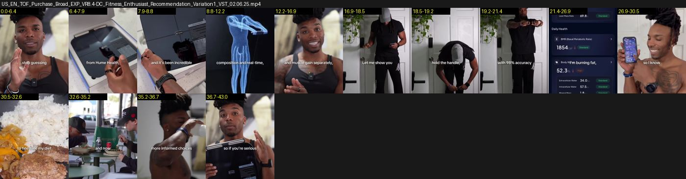

# US_EN_TOF_Purchase_Broad_EXP_VR8.4-DC_Fitness_Enthusiast_Recommendation_Variation1_VST_02.06.25.mp4

Master: `US_EN_TOF_Purchase_Broad_EXP_VR8.4-DC_Fitness_Enthusiast_Recommendation_Variation1_VST_02.06.25.mp4` · 43.0s · 720x900

**Pacing:** 14 shots · avg 3.075s · median 2.35s · 3.02 cuts/10s · first cut 6.4s · 236.0 wpm · talk ratio 0.95 · cuts on word start 92.3% · cuts in speech gaps 84.6%
**Audio:** {'I_lufs': -22.7, 'LRA': 0.8, 'true_peak_db': -7.5} · BPM≈136.0 · music {'speech_rms_db': -25.0, 'pause_seconds': 0.0} · cuts with SFX/transient 69.2%

**Captions:** 74 cards · 1.0 words/card (median) · y≈0.62 of frame height · text height≈0.045 · colours {'white': 60, 'blue': 3, 'green': 1, 'dark/other': 8, 'red': 2} · cards crossing a cut: 0
Highlighted: for tracking my body, composition and real-time,, preciseinsights, Standard, DEAAJENKINS, to fine tune my diet
**Headlines:** OTTNDEZAOTED (8.0–8.0s, dark/other) | XHume (8.0–8.0s, dark/other) | BodyFatPercentage (22.0–22.0s, white) | 16.2%灸 (22.0–22.0s, white) | Low (22.0–23.0s, dark/other) | 28.4ibs (22.0–22.0s, white) | BodyFatMass (22.0–23.0s, white) | Lean Maonly showweight, (22.0–22.0s, white)

**Hook (0–3s) spoken:** If your goal is to hit 15 % body fat, stop guessing.
**Hook on-screen:** 15% body fat, / If your goal is to hit / stopguessing
**CTA (last 5s):** off so if you're serious about tracking your progress check them out at humahealth .com · on-screen: GETISNGSTARTED / OCITNOSTARTID / XHume / XHume) / about tracking / checkthemoutat / humehealth.com / so if you're serious

## Beat sheet

| # | in–out (s) | dur | transition | spoken | on-screen text |
|---|---|---|---|---|---|
| 1 | 0.00–6.40 | 6.4 |  | If your goal is to hit 15 % body fat, stop guessing. The body plus shows you exactly what's happening inside your body. | If your goal is to hit / 15% body fat, / stopguessing / TheBodyPod showsyou / exactlywhat'shappening / XHumeHealth |
| 2 | 6.40–7.90 | 1.5 | cut +SFX hit | I just got mine from Hume Health, | XHumeHealth / inside your body / from HumeHealth |
| 3 | 7.90–8.80 | 0.9 | cut +SFX hit | and it's been incredible | OTTNDEZAOTED (HEADLINE) / XHume (HEADLINE) / andit'sbeenincredible |
| 4 | 8.80–12.20 | 3.4 | cut | for tracking my body composition and real -time precise insights. | for tracking my body [blue] / composition and real-time, [blue] / preciseinsights [blue] / Unlike regular scales, |
| 5 | 12.20–16.87 | 4.67 | cut +SFX hit | Unlike regular scales, it tracks fat loss and muscle gain separately, so I know exactly what's changing. | Unlike regular scales, / it tracksfat loss / and musclegain separately, / SoIknow exactly |
| 6 | 16.87–18.53 | 1.67 | cut +SFX hit | Let me show you. Just step on, | Letme show you / just step on, |
| 7 | 18.53–19.20 | 0.67 | cut | hold the handle, | and it scans your body |
| 8 | 19.20–21.37 | 2.17 | cut +SFX hit | and it scans your body with 98 % accuracy. | and it scans your body / with98%accuracy |
| 9 | 21.37–26.93 | 5.57 | cut +SFX hit | Most scales only show weight, but this, it tells me if I'm burning fat, maintaining muscle, and even staying hydrated. It | with98%accuracy / BodyFatPercentage (HEADLINE) / 16.2%灸 (HEADLINE) / Low (HEADLINE) / 28.4ibs (HEADLINE) / BodyFatMass (HEADLINE) |
| 10 | 26.93–30.50 | 3.57 | cut +SFX hit | even measures metabolic rates so I know how many calories I burn at rest making | Itevenmeasures / DEAAJENKINS [red] / metabolicrate, / howmanycalories / I burn at rest, |
| 11 | 30.50–32.63 | 2.13 | cut | it easier to find two in my diet. | makingit easier / to fine tune my diet [red] |
| 12 | 32.63–35.17 | 2.53 | cut +SFX hit | It's super easy to use and now I'm making smarter, | veetgreen / It'ssupereasytouse / GL (HEADLINE) / veetgre / andnow / moreinformed choices |
| 13 | 35.17–36.70 | 1.53 | cut | more informed choices every day. | moreinformed choices / every day |
| 14 | 36.70–43.05 | 6.35 | cut +SFX hit | Right now they're running 40 % off so if you're serious about tracking your progress check them out at humahealth .com | Right now / XHume / they're running 40% off / so if you're serious / XHume) / about tracking |

## Full transcript

If your goal is to hit 15% body fat, stop guessing. The body plus shows you exactly what's happening inside your body. I just got mine from Hume Health, and it's been incredible for tracking my body composition and real-time precise insights. Unlike regular scales, it tracks fat loss and muscle gain separately, so I know exactly what's changing. Let me show you. Just step on, hold the handle, and it scans your body with 98% accuracy. Most scales only show weight, but this, it tells me if I'm burning fat, maintaining muscle, and even staying hydrated. It even measures metabolic rates so I know how many calories I burn at rest making it easier to find two in my diet. It's super easy to use and now I'm making smarter, more informed choices every day. Right now they're running 40% off so if you're serious about tracking your progress check them out at humahealth.com