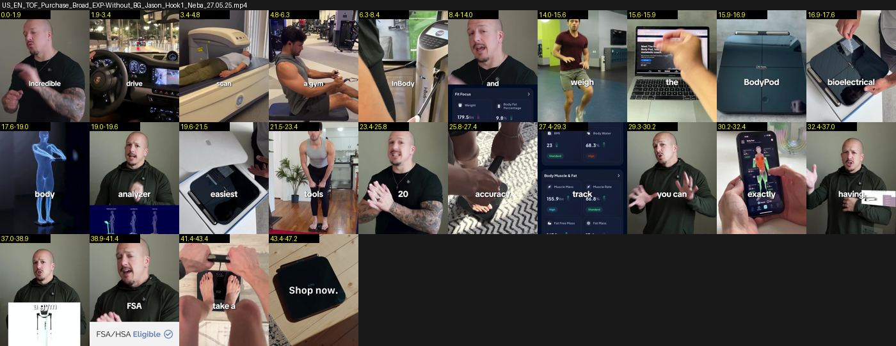

# US_EN_TOF_Purchase_Broad_EXP-Without_BG_Jason_Hook1_Neba_27.05.25.mp4

Master: `US_EN_TOF_Purchase_Broad_EXP-Without_BG_Jason_Hook1_Neba_27.05.25.mp4` · 47.2s · 720x900

**Pacing:** 24 shots · avg 1.967s · median 1.877s · 4.87 cuts/10s · first cut 1.919s · 215.0 wpm · talk ratio 0.88 · cuts on word start 52.2% · cuts in speech gaps 47.8%
**Audio:** {'I_lufs': -26.5, 'LRA': 3.2, 'true_peak_db': -9.4} · BPM≈99.4 · music {'speech_rms_db': -32.7, 'pause_seconds': 4.4, 'pause_rms_db': -33.2, 'bed_minus_voice_db': -0.5, 'music_bed_likely': True} · cuts with SFX/transient 60.9%

**Captions:** 80 cards · 1.0 words/card (median) · y≈0.649 of frame height · text height≈0.035 · colours {'white': 70, 'red': 1, 'blue': 3, 'green': 1, 'dark/other': 5} · cards crossing a cut: 0
Highlighted: IcanTake, High, Standard, High, Low
**Headlines:** simple (1.0–1.0s, white) | CARLO (3.0–3.0s, white) | geta (3.5–3.5s, white) | agym (5.5–5.5s, red) | InBody (7.0–7.0s, white) | InBodys (7.0–7.0s, white) | InBody570 (8.0–8.0s, white) | track (13.0–13.0s, white)

**Hook (0–3s) spoken:** And it's incredibly simple to use. I don't have to drive
**Hook on-screen:** Incredible / It's / don't have / drive / simple / use
**CTA (last 5s):** take a look at it. · on-screen: Humehealth.com / Shop now. / X Body Pod / at it

## Beat sheet

| # | in–out (s) | dur | transition | spoken | on-screen text |
|---|---|---|---|---|---|
| 1 | 0.00–1.92 | 1.92 |  | And it's incredibly simple to use. | It's / Incredible / simple (HEADLINE) / use |
| 2 | 1.92–3.38 | 1.46 | cut +SFX hit | I don't have to drive and | use / don't have / drive / CARLO (HEADLINE) |
| 3 | 3.38–4.75 | 1.38 | cut +SFX hit | spend to get a DEXA scan. | drive / CARLO (HEADLINE) / geta (HEADLINE) / scan |
| 4 | 4.75–6.30 | 1.54 | cut | I don't have to get a gym membership in | scan / don't have / agym [red] (HEADLINE) |
| 5 | 6.30–8.43 | 2.13 | cut +SFX hit | order to use their in -body. I can take | InBody (HEADLINE) / InBodys (HEADLINE) / IcanTake [red] / InBody570 (HEADLINE) |
| 6 | 8.43–14.01 | 5.59 | cut | my measurements, track it, graph it and make sure that I'm staying on track for my goals. | IcanTake [red] / InBody570 (HEADLINE) / measurements / and / Fit Focus / Body Fat |
| 7 | 14.01–15.64 | 1.63 | cut | It's time to waste smarter with | time (HEADLINE) / smarter |
| 8 | 15.64–15.93 | 0.29 | cut | the human |  |
| 9 | 15.93–16.93 | 1.0 | cut +SFX hit | body pod, | BodyPod (HEADLINE) |
| 10 | 16.93–17.64 | 0.71 | cut +SFX hit | bioelectrical impedance, | bioelectrical |
| 11 | 17.64–18.98 | 1.33 | cut | body segmental | body [blue] (HEADLINE) |
| 12 | 18.98–19.64 | 0.67 | cut +SFX hit | analyzer. | analyzer |
| 13 | 19.64–21.52 | 1.88 | cut +SFX hit | This is one of the easiest, most comprehensive | of the (HEADLINE) / comprehensive (HEADLINE) |
| 14 | 21.52–23.40 | 1.88 | cut +SFX hit | tools that I have used in | tools / used |
| 15 | 23.40–25.78 | 2.38 | cut | my 20 years in the fitness industry. | used / fitness (HEADLINE) |
| 16 | 25.78–27.44 | 1.67 | cut | 99 % accuracy that you | 99% (HEADLINE) / that (HEADLINE) |
| 17 | 27.44–29.32 | 1.88 | cut +SFX hit | can track on your phone. Now, | that (HEADLINE) / BMI (HEADLINE) / BodyWater (HEADLINE) / 68.3% (HEADLINE) / 23 (HEADLINE) / High [red] (HEADLINE) |
| 18 | 29.32–30.20 | 0.88 | cut +SFX hit | you can keep | High [red] (HEADLINE) / Standard [green] (HEADLINE) / High [blue] / Fat Mass / FatFreeMass / oayMuscie&Fat (HEADLINE) |
| 19 | 30.20–32.37 | 2.17 | cut +SFX hit | track of exactly what you're doing, all | 10:59 (HEADLINE) / BodyPod (HEADLINE) / Heigt (HEADLINE) / HetabolcAoe (HEADLINE) / 5'10 (HEADLINE) / 23 (HEADLINE) |
| 20 | 32.37–36.99 | 4.63 | cut +SFX hit | from the comfort of your home, without having to go spend $150 on a DEXA scan or | 10:59 (HEADLINE) / BodyPod (HEADLINE) / 57.0ibs / Muscle / 6.7ibs (HEADLINE) / 6.9bs (HEADLINE) |
| 21 | 36.99–38.91 | 1.92 | cut +SFX hit | finding a gym that hasn't in -bought. | or / that / InBody 270 (HEADLINE) |
| 22 | 38.91–41.38 | 2.46 | cut +SFX hit | It's HSA and FSA eligible. | HSA (HEADLINE) / FSA/HSA Eligible / FSA / FSA/HSA Eligible (HEADLINE) / eligible (HEADLINE) |
| 23 | 41.38–43.42 | 2.04 | cut | Go check it out and take a look at it. | FSA/HSA Eligible (HEADLINE) / eligible (HEADLINE) / 1596 / take a / at it (HEADLINE) |
| 24 | 43.42–47.21 | 3.79 | cut |  | at it (HEADLINE) / X Body Pod (HEADLINE) / Shop now. (HEADLINE) / Humehealth.com |

## Full transcript

And it's incredibly simple to use. I don't have to drive and spend to get a DEXA scan. I don't have to get a gym membership in order to use their in-body. I can take my measurements, track it, graph it and make sure that I'm staying on track for my goals. It's time to waste smarter with the human body pod, bioelectrical impedance, body segmental analyzer. This is one of the easiest, most comprehensive tools that I have used in my 20 years in the fitness industry. 99% accuracy that you can track on your phone. Now, you can keep track of exactly what you're doing, all from the comfort of your home, without having to go spend $150 on a DEXA scan or finding a gym that hasn't in-bought. It's HSA and FSA eligible. Go check it out and take a look at it.