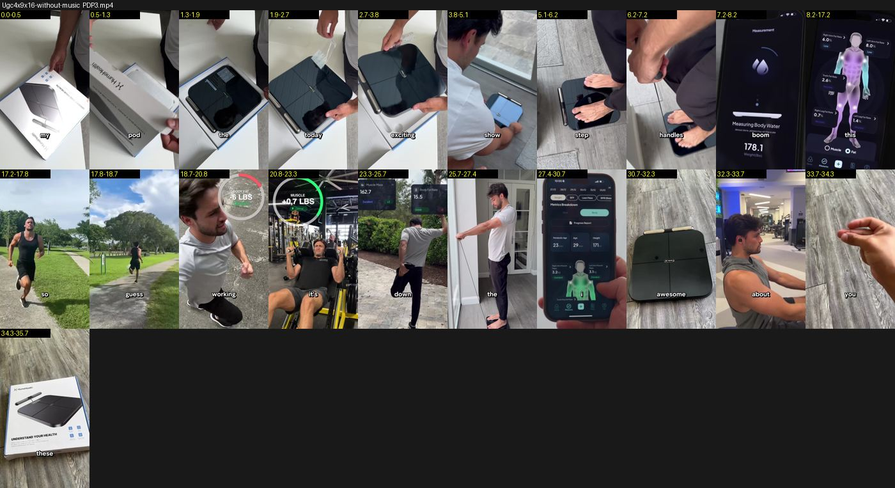

# Ugc4x9x16-without-music  PDP3.mp4

Master: `Ugc4x9x16-without-music  PDP3.mp4` · 35.7s · 720x1280

**Pacing:** 21 shots · avg 1.702s · median 1.1s · 5.6 cuts/10s · first cut 0.5s · 230.0 wpm · talk ratio 0.88 · cuts on word start 70.0% · cuts in speech gaps 55.0%
**Audio:** {'I_lufs': -18.7, 'LRA': 4.1, 'true_peak_db': -3.0} · BPM≈107.7 · music {'speech_rms_db': -24.1, 'pause_seconds': 0.8, 'pause_rms_db': -21.4, 'bed_minus_voice_db': 2.7, 'music_bed_likely': True} · cuts with SFX/transient 65.0%

**Captions:** 135 cards · 1 words/card (median) · y≈0.699 of frame height · text height≈0.0351 · colours {'white': 99, 'dark/other': 30, 'blue': 2, 'red': 3, 'green': 1} · cards crossing a cut: 0
Highlighted: using, bioelectricity, just, it's, Good, about
**Headlines:** UNDERSTAND YOURHEALTH (0.0–0.0s, white) | HumeHealth" (0.0–0.0s, white) | 13:134 (7.0–7.0s, white) | Measurement (7.0–7.0s, white) | 15:19 (10.0–12.0s, white) | Weight (10.0–10.0s, white) | BFP (10.0–10.0s, white) | MuscleMass (10.0–10.0s, white)

**Hook (0–3s) spoken:** My body pod just arrived in the mail today. This is so
**Hook on-screen:** HumeHealth" / UNDERSTAND YOURHEALTH / arrived / pod / the / this / today
**CTA (last 5s):** This is awesome, you guys. If you're serious about your fitness, you need one of these. · on-screen: HumeHeaith / SALANCEOF COUTOSITIONCORPORELLE CONNETEE / SMARTEKORPERANALYSE-WAAOE / SUARTBODYCOMPOSITIONANALYZER / UNDERSTANDYOURHEALTH / XHume / about / awesome / guys / these / you

## Beat sheet

| # | in–out (s) | dur | transition | spoken | on-screen text |
|---|---|---|---|---|---|
| 1 | 0.00–0.50 | 0.5 |  | My body | UNDERSTAND YOURHEALTH (HEADLINE) / HumeHealth" (HEADLINE) |
| 2 | 0.50–1.33 | 0.83 | cut | pod just arrived | pod / arrived |
| 3 | 1.33–1.87 | 0.53 | cut +SFX hit | in the mail | arrived / the |
| 4 | 1.87–2.70 | 0.83 | cut +SFX hit | today. This | the / today / this |
| 5 | 2.70–3.80 | 1.1 | cut +SFX hit | is so exciting. | this / exciting |
| 6 | 3.80–5.10 | 1.3 | cut +SFX hit | Let me show you how it works. | exciting / show / works |
| 7 | 5.10–6.17 | 1.07 | cut +SFX hit | So I step on, hold | step / hold |
| 8 | 6.17–7.23 | 1.07 | cut +SFX hit | the handles and | hold / 13:134 (HEADLINE) / Measurement (HEADLINE) / MeasuringBodyWater / Almostdone.pleasestayonchescale / and |
| 9 | 7.23–8.23 | 1.0 | cut +SFX hit | boom. It's using | 13:134 (HEADLINE) / Measurement (HEADLINE) / MeasuringBodyWater / Almostdone.pleasestayonchescale / and / 178.1 |
| 10 | 8.23–17.17 | 8.93 | cut +SFX hit | advanced bioelectricity to measure my body composition in seconds. See this? It tells me my muscle mass, body fat percentage, even my metabolic rate. | using [blue] / bioelectricity [blue] / 15:19 (HEADLINE) / Weight (HEADLINE) / BFP (HEADLINE) / MuscleMass (HEADLINE) |
| 11 | 17.17–17.80 | 0.63 | cut | So I never have |  |
| 12 | 17.80–18.70 | 0.9 | cut +SFX hit | to guess if my workout | guess |
| 13 | 18.70–20.77 | 2.07 | cut +SFX hit | program is working or not, because health | BODYFAT (HEADLINE) / -3LBS (HEADLINE) / program / 9LBS (HEADLINE) / not |
| 14 | 20.77–23.33 | 2.57 | cut | isn't just about weight, it's about balance. | MUSCLE (HEADLINE) / +0,3 LBS (HEADLINE) / just [red] / +0.7 LBS (HEADLINE) / it's [red] / +0,8 LBS (HEADLINE) |
| 15 | 23.33–25.73 | 2.4 | cut | Muscle up, fat down, that's the goal. | MUSCLE (HEADLINE) / +0,8 LBS (HEADLINE) / balance / MuscleMass (HEADLINE) / BodyFatRate (HEADLINE) / 162.7 (HEADLINE) |
| 16 | 25.73–27.40 | 1.67 | cut +SFX hit | This is why I got the body pod. Real | why / pod |
| 17 | 27.40–30.73 | 3.33 | cut | data, real progress, and I can track everything from my phone. | pod / Good [green] (HEADLINE) / Very low (HEADLINE) / MuscleMass (HEADLINE) / BMR (HEADLINE) / 146.8bs (HEADLINE) |
| 18 | 30.73–32.30 | 1.57 | cut | This is awesome, you guys. | XHume / awesome / guys |
| 19 | 32.30–33.73 | 1.43 | cut | If you're serious about your fitness, | XHume / guys / about [red] |
| 20 | 33.73–34.33 | 0.6 | cut +SFX hit | you need | you |
| 21 | 34.33–35.73 | 1.4 | cut +SFX hit | one of these. | you / HumeHeaith / UNDERSTANDYOURHEALTH / SUARTBODYCOMPOSITIONANALYZER / SALANCEOF COUTOSITIONCORPORELLE CONNETEE / SMARTEKORPERANALYSE-WAAOE |

## Full transcript

My body pod just arrived in the mail today. This is so exciting. Let me show you how it works. So I step on, hold the handles and boom. It's using advanced bioelectricity to measure my body composition in seconds. See this? It tells me my muscle mass, body fat percentage, even my metabolic rate. So I never have to guess if my workout program is working or not, because health isn't just about weight, it's about balance. Muscle up, fat down, that's the goal. This is why I got the body pod. Real data, real progress, and I can track everything from my phone. This is awesome, you guys. If you're serious about your fitness, you need one of these.