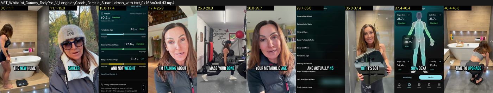

# VST_Whitelist_Cammy_BodyPod_V_LongevityCoach_Female_SusanHobson_with text_9x16Am0viLd3.mp4

Master: `VST_Whitelist_Cammy_BodyPod_V_LongevityCoach_Female_SusanHobson_with text_9x16Am0viLd3.mp4` · 45.3s · 720x1280

**Pacing:** 10 shots · avg 4.525s · median 3.466s · 1.99 cuts/10s · first cut 11.067s · 166.0 wpm · talk ratio 0.91 · cuts on word start 77.8% · cuts in speech gaps 55.6%
**Audio:** {'I_lufs': -14.4, 'LRA': 8.0, 'true_peak_db': -0.5} · BPM≈117.5 · music {'speech_rms_db': -22.8, 'pause_seconds': 5.7, 'pause_rms_db': -25.2, 'bed_minus_voice_db': -2.4, 'music_bed_likely': True} · cuts with SFX/transient 88.9%

**Captions:** 97 cards · 1 words/card (median) · y≈0.693 of frame height · text height≈0.0269 · colours {'blue': 35, 'dark/other': 4, 'white': 57, 'green': 1} · cards crossing a cut: 1
Highlighted: IF YOU'VE GOT, SCALES LIKE THIS, AT HOME, TIME FOR AN, UPGRADE, BECAUSETHISIS, THE NEW HUME, HEALTH POD, AT HOME BODY, COMPOSITION ANALYZER, AND IT'S THE, MARKET, I'M A LONGEVITY, CAREER, WOMEN TO FOCUS
**Headlines:** Weight (15.0–17.0s, white) | WeeklyTargets:2/4 (15.0–17.0s, dark/other) | 60.2kg (15.0–17.0s, white) | Standard (15.0–17.0s, green) | Updated:Wed03 (15.0–17.0s, dark/other) | 45 yrs (15.0–17.0s, white) | Good (15.0–17.0s, green) | MetabolicAge (15.0–17.0s, white)

**Hook (0–3s) spoken:** If you've got skills like this at home, time for
**Hook on-screen:** AT HOME / IF YOU'VE GOT / RENPHD / RENPHO / SCALES LIKE THIS / TIME FOR AN
**CTA (last 5s):** Time to upgrade. · on-screen: TIME TO UPGRADE

## Beat sheet

| # | in–out (s) | dur | transition | spoken | on-screen text |
|---|---|---|---|---|---|
| 1 | 0.00–11.07 | 11.07 |  | If you've got skills like this at home, time for an upgrade because this is a new human health pod at Home Body Composition Analyzer and it's the best on the market. I'm | IF YOU'VE GOT [blue] / RENPHD / SCALES LIKE THIS [blue] / AT HOME [blue] / RENPHO / TIME FOR AN [blue] |
| 2 | 11.07–15.00 | 3.93 | cut +SFX hit | a longevity coach and I spend my entire career trying to get women to focus on body composition | I'M A LONGEVITY [blue] / COACH AND I / CAREER [blue] / WOMEN TO FOCUS [blue] |
| 3 | 15.00–17.40 | 2.4 | cut +SFX hit | and not weight. And I'm | Weight (HEADLINE) / WeeklyTargets:2/4 (HEADLINE) / 60.2kg (HEADLINE) / Standard [green] (HEADLINE) / Updated:Wed03 (HEADLINE) / 45 yrs (HEADLINE) |
| 4 | 17.40–25.90 | 8.5 | cut +SFX hit | also a pair of menopausal woman age 53, so I know what I'm talking about. Far more important than the weight on the scale is your | Weight (HEADLINE) / WeeklyTargets:2/4 (HEADLINE) / 60.2kg (HEADLINE) / Standard [green] (HEADLINE) / Updated:Wed03 (HEADLINE) / 45 yrs (HEADLINE) |
| 5 | 25.90–28.77 | 2.87 | cut +SFX hit | muscle mass, your bone density, your metabolic | ronger (HEADLINE) / ISYOUR MUSCLE [blue] / MASS YOUR BONE [blue] / YOUR METABOLIC AGE [blue] |
| 6 | 28.77–29.73 | 0.97 | cut +SFX hit | age. | YOUR METABOLIC AGE [blue] |
| 7 | 29.73–35.83 | 6.1 | cut +SFX hit | Hume Health Pod includes these and actually 45 different body metrics. Here's | ChartMetric (HEADLINE) / BodyFatPercentage (HEADLINE) / BodyFatMass (HEADLINE) / SubcutaneousFatMass (HEADLINE) / SubcutaneousFatPercentage / LeanMass |
| 8 | 35.83–37.43 | 1.6 | cut | the best fit. It's got | BITIT'S GOT [blue] |
| 9 | 37.43–40.43 | 3.0 | cut +SFX hit | 98 % dexa accuracy. | BITIT'S GOT [blue] / Fat Percentage (HEADLINE) / RightArm (HEADLINE) / LeftArm (HEADLINE) / 21.7% (HEADLINE) / Standard [green] (HEADLINE) |
| 10 | 40.43–45.25 | 4.82 | cut +SFX hit | Time to upgrade. | Fat Percentage (HEADLINE) / RightArm (HEADLINE) / LeftArm (HEADLINE) / 21.7% (HEADLINE) / Standard [green] (HEADLINE) / Trunk |

## Full transcript

If you've got skills like this at home, time for an upgrade because this is a new human health pod at Home Body Composition Analyzer and it's the best on the market. I'm a longevity coach and I spend my entire career trying to get women to focus on body composition and not weight. And I'm also a pair of menopausal woman age 53, so I know what I'm talking about. Far more important than the weight on the scale is your muscle mass, your bone density, your metabolic age. Hume Health Pod includes these and actually 45 different body metrics. Here's the best fit. It's got 98% dexa accuracy. Time to upgrade.