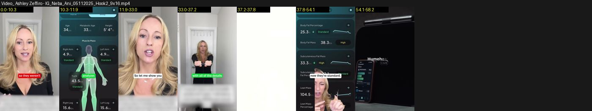

# Video_ Ashley Zeffiro - IG_Neba_Ani_05112025_Hook2_9x16.mp4

Master: `Video_ Ashley Zeffiro - IG_Neba_Ani_05112025_Hook2_9x16.mp4` · 58.2s · 720x1280

**Pacing:** 7 shots · avg 8.308s · median 4.233s · 1.03 cuts/10s · first cut 10.267s · 246.0 wpm · talk ratio 0.9 · cuts on word start 66.7% · cuts in speech gaps 66.7%
**Audio:** {'I_lufs': -14.4, 'LRA': 5.3, 'true_peak_db': -0.6} · BPM≈112.3 · music {'speech_rms_db': -19.3, 'pause_seconds': 4.1, 'pause_rms_db': -23.1, 'bed_minus_voice_db': -3.8, 'music_bed_likely': True} · cuts with SFX/transient 66.7%

**Captions:** 163 cards · 1 words/card (median) · y≈0.648 of frame height · text height≈0.0293 · colours {'white': 130, 'red': 7, 'green': 18, 'blue': 1, 'dark/other': 7} · cards crossing a cut: 1
Highlighted: but they only were able, to do the lower, half of your body, so they weren't, overlyaccurate., It is not just a, The Hume Body Pod, Standard, analyzer., Body fat percentage, it has these handles, a full body scan., with all of the details, that you want., Standard
**Headlines:** Body Pod (11.0–11.0s, white) | Connected (11.0–11.0s, green) | Age (11.0–11.0s, white) | Height (11.0–11.0s, white) | MetabolicAge (11.0–11.0s, white) | 34yrs (11.0–11.0s, white) | 33yrs (11.0–11.0s, white) | 5'4"ft (11.0–11.0s, white)

**Hook (0–3s) spoken:** I had plenty of like smart scales that did body weight and stuff, but they
**Hook on-screen:** I have / That did body / plenty of, like, / smartscales. / weight and stuff
**CTA (last 5s):** your own app. · on-screen: Humehea / Humehealth.com / Sho / X Body

## Beat sheet

| # | in–out (s) | dur | transition | spoken | on-screen text |
|---|---|---|---|---|---|
| 1 | 0.00–10.27 | 10.27 |  | I had plenty of like smart scales that did body weight and stuff, but they only were able to do the lower half of your body so they weren't overly accurate. It is not just a scale, it's actually the Hume body pad. | I have / plenty of, like, / smartscales. / That did body / weight and stuff / but they only were able [red] |
| 2 | 10.27–11.93 | 1.67 | cut +SFX hit | It is a full body analyzer. | The Hume Body Pod [green] / Body Pod (HEADLINE) / Connected [green] (HEADLINE) / Age (HEADLINE) / Height (HEADLINE) / MetabolicAge (HEADLINE) |
| 3 | 11.93–33.00 | 21.07 | cut +SFX hit | I really love the data of seeing like border weight and muscle mass and body fat percentage and what makes it different is it has these handles that have sensors on it so it's able to do a full body scan. So let me show you how it works. So I just set it down on the floor and then when you step on it, you're grab the handle and you're just gonna stand here until it takes to your phone and | I really love / the data of seeing like / Water weight [blue] (HEADLINE) / Body fat percentage [blue] / And what makes it / different is |
| 4 | 33.00–37.23 | 4.23 | cut +SFX hit | then it will show up on the app on your phone with all of the details that you want. | and then it will show up / ontheapponyourphone / with all of the details [green] / that you want. [green] |
| 5 | 37.23–37.77 | 0.53 | cut +SFX hit |  | that you want. [green] |
| 6 | 37.77–54.07 | 16.3 | cut | Okay so this is like a little humanoid they call it so it just kind of gives you like a full body analysis and then obviously you see the other numbers you can see now they're standard they're low high we're all over the place but we've improved and everything's personalized to you and like I said you can see this in your own app. | BodyPod (HEADLINE) / Connected [green] (HEADLINE) / Body (HEADLINE) / Hume (HEADLINE) / Age (HEADLINE) / Metabolic Age (HEADLINE) |
| 7 | 54.07–58.15 | 4.09 | cut |  | X Body (HEADLINE) / Sho / Humehea / Humehealth.com |

## Full transcript

I had plenty of like smart scales that did body weight and stuff, but they only were able to do the lower half of your body so they weren't overly accurate. It is not just a scale, it's actually the Hume body pad. It is a full body analyzer. I really love the data of seeing like border weight and muscle mass and body fat percentage and what makes it different is it has these handles that have sensors on it so it's able to do a full body scan. So let me show you how it works. So I just set it down on the floor and then when you step on it, you're grab the handle and you're just gonna stand here until it takes to your phone and then it will show up on the app on your phone with all of the details that you want. Okay so this is like a little humanoid they call it so it just kind of gives you like a full body analysis and then obviously you see the other numbers you can see now they're standard they're low high we're all over the place but we've improved and everything's personalized to you and like I said you can see this in your own app.