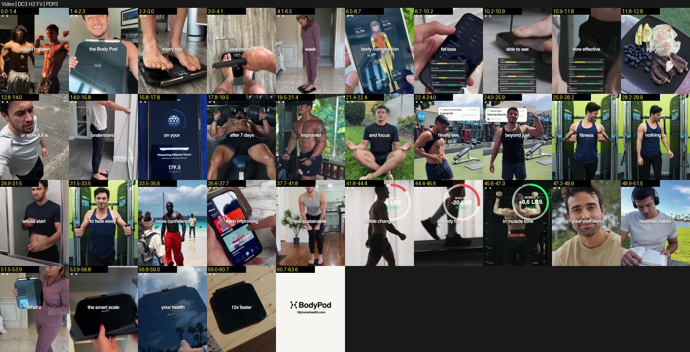

# Video | DC3 H2 FV | PDP3

Master: `Video | DC3 H2 FV | PDP3` · 63.6s · 720x900

**Pacing:** 35 shots · avg 1.816s · median 1.766s · 5.35 cuts/10s · first cut 1.433s · 174.0 wpm · talk ratio 0.93 · cuts on word start 79.4% · cuts in speech gaps 58.8%
**Audio:** {'I_lufs': -19.1, 'LRA': 2.7, 'true_peak_db': -1.7} · BPM≈143.6 · music {'speech_rms_db': -24.4, 'pause_seconds': 4.1, 'pause_rms_db': -25.0, 'bed_minus_voice_db': -0.6, 'music_bed_likely': True} · cuts with SFX/transient 58.8%

**Captions:** 89 cards · 2 words/card (median) · y≈0.457 of frame height · text height≈0.0517 · colours {'red': 5, 'white': 76, 'dark/other': 5, 'yellow': 1, 'blue': 2} · cards crossing a cut: 7
Highlighted: This is what, would happen, if you use, body composition, Low, kcfocuse, plan to, your secret?
**Headlines:** you'd get (5.5–5.5s, white) | Age (7.0–7.0s, white) | bollcAge (7.0–7.0s, white) | Years (7.0–7.0s, dark/other) | RightArm (7.0–8.0s, dark/other) | 76.3% (7.0–8.0s, white) | Standard (7.0–8.0s, dark/other) | LeftArm (7.0–8.0s, dark/other)

**Hook (0–3s) spoken:** This is what would happen if you use the body pod every day for just
**Hook on-screen:** This is what / emUHX / every day / if you use / the Body Pod / would happen
**CTA (last 5s):** 12 times faster. · on-screen: 12x faster / Myhumehealth.com / XBodyPod

## Beat sheet

| # | in–out (s) | dur | transition | spoken | on-screen text |
|---|---|---|---|---|---|
| 1 | 0.00–1.43 | 1.43 |  | This is what would happen if you use | This is what [red] / would happen [red] / if you use [red] |
| 2 | 1.43–2.30 | 0.87 | cut +SFX hit | the body pod every | if you use [red] / the Body Pod / emUHX |
| 3 | 2.30–3.00 | 0.7 | cut +SFX hit | day for | the Body Pod / emUHX / every day |
| 4 | 3.00–4.10 | 1.1 | cut +SFX hit | just one month. | for just / onemonth / SUE6. / within |
| 5 | 4.10–6.53 | 2.43 | cut | Within the first week, you'd get a clear picture of | within / the first / week / you'd get (HEADLINE) / a clear picture |
| 6 | 6.53–8.70 | 2.17 | cut | your body composition, showing fat | Age (HEADLINE) / bollcAge (HEADLINE) / Years (HEADLINE) / RightArm (HEADLINE) / 76.3% (HEADLINE) / Standard (HEADLINE) |
| 7 | 8.70–10.20 | 1.5 | cut +SFX hit | loss and muscle gain. | 14:58 (HEADLINE) / 23.7 (HEADLINE) / 63.6% / BodyMuscle&Fat (HEADLINE) / fat loss / 12LBS |
| 8 | 10.20–10.90 | 0.7 | cut +SFX hit | You'll be able to see | WEIGHT / BODY WATER / MUSCLEMASS / +4LBS% / you'll be / -12LBS |
| 9 | 10.90–11.80 | 0.9 | cut | how effective your | WEIGHT / MUSCLEMASS / +4LBS% / -12LBS / BODYFAT / VISCERALFAT |
| 10 | 11.80–12.77 | 0.97 | cut | diet or workout | your diet |
| 11 | 12.77–14.00 | 1.23 | cut | is, helping | or workout is |
| 12 | 14.00–15.80 | 1.8 | cut +SFX hit | you understand exactly where to | helping you / exactlywhere |
| 13 | 15.80–17.83 | 2.03 | cut +SFX hit | focus on your health journey. After | Measurement (HEADLINE) / to focus / Measuring BodyWater / Almostdone,pleasestayonthescale / 179.5 / Weight(lbs) |
| 14 | 17.83–19.53 | 1.7 | cut +SFX hit | seven days, you'd notice | after 7 days / you'd notice |
| 15 | 19.53–21.40 | 1.87 | cut +SFX hit | improved motivation and focus, | improved / motivation |
| 16 | 21.40–22.43 | 1.03 | cut +SFX hit | as you | motivation / and focus |
| 17 | 22.43–24.03 | 1.6 | cut | can finally see progress beyond | and focus / BodyFatPercentage (HEADLINE) / 12:42AM> (HEADLINE) / Losing Fat (HEADLINE) / lolololola (HEADLINE) / 12.4% (HEADLINE) |
| 18 | 24.03–25.93 | 1.9 | cut | just weight loss. your | MuscleMas (HEADLINE) / Gaining Mu (HEADLINE) / Muscle: 85.1% (HEADLINE) / beyond just / MuscleMass (HEADLINE) / GainingMuscle (HEADLINE) |
| 19 | 25.93–28.23 | 2.3 | cut +SFX hit | confusion about fitness goals, wondering | your confusion / PRECOR (HEADLINE) / fitness / wondering why |
| 20 | 28.23–29.93 | 1.7 | cut +SFX hit | why nothing is working and | PRECOR (HEADLINE) / wondering why / PRELOR (HEADLINE) / nothing is |
| 21 | 29.93–31.47 | 1.53 | cut +SFX hit | plateau would start to fade | and plateau / would start |
| 22 | 31.47–33.50 | 2.03 | cut +SFX hit | away. After 10 days you'd | would start / PRECIR (HEADLINE) / to fade away / PRECOR (HEADLINE) / after10 days |
| 23 | 33.50–35.63 | 2.13 | cut | notice more confidence and a clearer | moreconfidence / and a clearer |
| 24 | 35.63–37.73 | 2.1 | cut | plan to keep improving as | Plans (HEADLINE) / Programs / kcfocuse [red] / plan to [red] / New&Featured [red] (HEADLINE) / WelcomeToFitTrack (HEADLINE) |
| 25 | 37.73–41.83 | 4.1 | cut | you track real sustainable progress. On the 20th day you | asyoutrack / real sustainable / progress / on the 20th day |
| 26 | 41.83–44.40 | 2.57 | cut +SFX hit | see visible changes, a decrease in | yousee / SODYFAT (HEADLINE) / 5LBS (HEADLINE) / visible changes / BODYFAT (HEADLINE) / -13LBS (HEADLINE) |
| 27 | 44.40–45.57 | 1.17 | cut +SFX hit | body fat and an increase | BODYFAT (HEADLINE) / -13LBS (HEADLINE) / a decrease / -27LBS (HEADLINE) / andan increase |
| 28 | 45.57–47.33 | 1.77 | cut +SFX hit | in muscle tone. You feel | MUSCLER (HEADLINE) / +0,6 LBS (HEADLINE) / inmuscletone / MUSCLE (HEADLINE) / +0,8 LBS (HEADLINE) / Optimal [green] (HEADLINE) |
| 29 | 47.33–49.87 | 2.53 | cut +SFX hit | more confident in your own skin. You've | MUSCLE (HEADLINE) / +0,8 LBS (HEADLINE) / Optimal [green] (HEADLINE) / you feel more / confident in / yourownskin |
| 30 | 49.87–51.47 | 1.6 | cut +SFX hit | built healthier habits. People | you've built (HEADLINE) / healthierhabits |
| 31 | 51.47–53.87 | 2.4 | cut | are asking, what's your secret? This | healthierhabits / asking (HEADLINE) / your secret? [blue] |
| 32 | 53.87–56.77 | 2.9 | cut | is the body pod, the smart scale that helps you | this is / the smart scale / that helps / XHume |
| 33 | 56.77–59.00 | 2.23 | cut | achieve your health and fitness goals 12 | you achieve / and fitness goals |
| 34 | 59.00–60.70 | 1.7 | cut | times faster. | 12x faster |
| 35 | 60.70–63.55 | 2.85 | cut +SFX hit |  | XBodyPod (HEADLINE) / Myhumehealth.com |

## Full transcript

This is what would happen if you use the body pod every day for just one month. Within the first week, you'd get a clear picture of your body composition, showing fat loss and muscle gain. You'll be able to see how effective your diet or workout is, helping you understand exactly where to focus on your health journey. After seven days, you'd notice improved motivation and focus, as you can finally see progress beyond just weight loss. your confusion about fitness goals, wondering why nothing is working and plateau would start to fade away. After 10 days you'd notice more confidence and a clearer plan to keep improving as you track real sustainable progress. On the 20th day you see visible changes, a decrease in body fat and an increase in muscle tone. You feel more confident in your own skin. You've built healthier habits. People are asking, what's your secret? This is the body pod, the smart scale that helps you achieve your health and fitness goals 12 times faster.