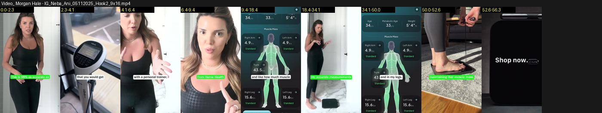

# Video_ Morgan Hale - IG_Neba_Ani_05112025_Hook2_9x16.mp4

Master: `Video_ Morgan Hale - IG_Neba_Ani_05112025_Hook2_9x16.mp4` · 56.3s · 720x1280

**Pacing:** 9 shots · avg 6.258s · median 2.967s · 1.42 cuts/10s · first cut 2.333s · 221.0 wpm · talk ratio 0.89 · cuts on word start 87.5% · cuts in speech gaps 100.0%
**Audio:** {'I_lufs': -14.6, 'LRA': 8.3, 'true_peak_db': -0.6} · BPM≈112.3 · music {'speech_rms_db': -21.3, 'pause_seconds': 4.8, 'pause_rms_db': -21.4, 'bed_minus_voice_db': -0.1, 'music_bed_likely': True} · cuts with SFX/transient 37.5%

**Captions:** 114 cards · 1.0 words/card (median) · y≈0.648 of frame height · text height≈0.0304 · colours {'green': 8, 'white': 103, 'dark/other': 2, 'red': 1} · cards crossing a cut: 0
Highlighted: This is98%asaccurateas, called the Body Pod, Standard, myaccuratemeasurements, of everything, Standard, This device would help you, maintaining that muscle mass, while losing weight
**Headlines:** InBody (3.5–3.5s, white) | Body Pod (10.0–18.0s, white) | Connected (10.0–18.0s, green) | Wantdeeperinsightsintoyour (10.0–10.0s, dark/other) | progress?Generateareportnow! (10.0–10.0s, dark/other) | Body (10.0–11.0s, dark/other) | Hume (10.0–11.0s, dark/other) | MetabolicAge (11.0–13.0s, white)

**Hook (0–3s) spoken:** This is 98 % as accurate as an in -body scan
**Hook on-screen:** This is98%asaccurateas / anin bodyscan
**CTA (last 5s):** while losing weight. · on-screen: Humehealth.com / Shop now / X Body Pod / while losing weight

## Beat sheet

| # | in–out (s) | dur | transition | spoken | on-screen text |
|---|---|---|---|---|---|
| 1 | 0.00–2.33 | 2.33 |  | This is 98 % as accurate as | This is98%asaccurateas [green] |
| 2 | 2.33–4.10 | 1.77 | cut | an in -body scan that you would get at | This is98%asaccurateas [green] / anin bodyscan / hBody / that you would get / InBody (HEADLINE) / like at a gym or |
| 3 | 4.10–6.43 | 2.33 | cut +SFX hit | a gym or with a personal trainer. I | like at a gym or / witha personaltrainer, |
| 4 | 6.43–9.40 | 2.97 | cut +SFX hit | got a new device from Kim Health called the BodyPod. | witha personaltrainer, / got a new device / called the Body Pod [green] |
| 5 | 9.40–18.40 | 9.0 | cut +SFX hit | It actually shows you each of your arms up, and I'll show you on the next slide. It's like how much less likely you have an age or metabolic age, which is kind of crazy. | called the Body Pod [green] / Body Pod (HEADLINE) / Connected [green] (HEADLINE) / Wantdeeperinsightsintoyour (HEADLINE) / progress?Generateareportnow! (HEADLINE) / Body (HEADLINE) |
| 6 | 18.40–34.07 | 15.67 | cut | I want to show you how it works. We keep it in the bathroom because I do this right after so that we can use the restroom and just get my accurate measurements of everything. Step one, pull this up, hold on, it connects to the app on your phone and it reads everything. | Body Pod (HEADLINE) / Connected [green] (HEADLINE) / Standard [green] / Right Arm / LeftArm / Body (HEADLINE) |
| 7 | 34.07–50.03 | 15.97 | cut | It shows the humanoid body graph which it'll show exactly how much muscle mass I have in each of my arms, my torso, and in my legs. So I know which legs to work on which more are not getting hit enough or my arms. This device would help you make sure that | Body Pod (HEADLINE) / Wantdeeperinsights intoyour (HEADLINE) / progress?Generateareportnow! (HEADLINE) / Body (HEADLINE) / Hume (HEADLINE) / Age |
| 8 | 50.03–52.57 | 2.53 | cut | you're maintaining that muscle mass while losing weight. | maintaining that muscle mass [green] / while losing weight [red] |
| 9 | 52.57–56.32 | 3.75 | cut |  | X Body Pod (HEADLINE) / Shop now / Humehealth.com |

## Full transcript

This is 98% as accurate as an in-body scan that you would get at a gym or with a personal trainer. I got a new device from Kim Health called the BodyPod. It actually shows you each of your arms up, and I'll show you on the next slide. It's like how much less likely you have an age or metabolic age, which is kind of crazy. I want to show you how it works. We keep it in the bathroom because I do this right after so that we can use the restroom and just get my accurate measurements of everything. Step one, pull this up, hold on, it connects to the app on your phone and it reads everything. It shows the humanoid body graph which it'll show exactly how much muscle mass I have in each of my arms, my torso, and in my legs. So I know which legs to work on which more are not getting hit enough or my arms. This device would help you make sure that you're maintaining that muscle mass while losing weight.