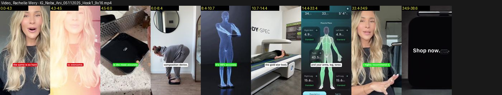

# Video_ Rachelle Wery - IG_Neba_Ani_05112025_Hook1_9x16.mp4

Master: `Video_ Rachelle Wery - IG_Neba_Ani_05112025_Hook1_9x16.mp4` · 38.6s · 720x1280

**Pacing:** 9 shots · avg 4.29s · median 2.433s · 2.07 cuts/10s · first cut 4.3s · 231.0 wpm · talk ratio 0.84 · cuts on word start 75.0% · cuts in speech gaps 75.0%
**Audio:** {'I_lufs': -14.1, 'LRA': 3.7, 'true_peak_db': -0.6} · BPM≈117.5 · music {'speech_rms_db': -17.8, 'pause_seconds': 3.7, 'pause_rms_db': -19.2, 'bed_minus_voice_db': -1.4, 'music_bed_likely': True} · cuts with SFX/transient 50.0%

**Captions:** 134 cards · 1.0 words/card (median) · y≈0.648 of frame height · text height≈0.0293 · colours {'white': 114, 'red': 5, 'green': 7, 'dark/other': 7, 'blue': 1} · cards crossing a cut: 0
Highlighted: number on, a scale stay, the same is so hard, to overcome, to overcome., The Body Pod, is the most accurate, It's98% accurate, Standard, It's so cool., like detailed insight, Hiah, Ihighly recommend it
**Headlines:** WEWILLTRAVELTOGETYOUS (11.0–11.0s, other-colour) | DY·SPEC (11.0–14.0s, white) | WEWTLLTRAVELTOGETYOUS (12.0–12.0s, white) | WEWLLTRAVELTOGETYOUS (13.0–13.0s, white) | WEWILLTRAVELTOGETYOUSO (14.0–14.0s, white) | Body Pod (15.0–33.0s, white) | Body (15.0–15.0s, dark/other) | Hume (15.0–15.0s, dark/other)

**Hook (0–3s) spoken:** Seeing that number on the scale say the same is so hard mentally for
**Hook on-screen:** Seeing that / a scale stay / mentally for them / number on / the same is so hard
**CTA (last 5s):** highly recommend it. · on-screen: Humehealth.c / Humehealth.com / Ihighly recommend it / Shop n / X Body P

## Beat sheet

| # | in–out (s) | dur | transition | spoken | on-screen text |
|---|---|---|---|---|---|
| 1 | 0.00–4.30 | 4.3 |  | Seeing that number on the scale say the same is so hard mentally for them to overcome. | Seeing that / number on [red] / a scale stay [red] / the same is so hard [red] / mentally for them / to overcome [red] |
| 2 | 4.30–4.47 | 0.17 | cut +SFX hit | The BodyPod | to overcome. [red] |
| 3 | 4.47–6.00 | 1.53 | cut +SFX hit | is the most accurate at | to overcome. [red] / The Body Pod [green] / is the most accurate [green] |
| 4 | 6.00–8.43 | 2.43 | cut | home body composition device you can get. | at home body / compositiondevice. / You can get. |
| 5 | 8.43–10.70 | 2.27 | cut | It's 98 % accurate compared to like | You can get. / It's98% accurate [green] / compared to like |
| 6 | 10.70–14.37 | 3.67 | cut +SFX hit | a DEXA scan, which is like the gold star of body composition measurement. | WEWILLTRAVELTOGETYOUS [other-colour] (HEADLINE) / DY·SPEC (HEADLINE) / aDexascan, / WEWTLLTRAVELTOGETYOUS (HEADLINE) / whichislike / WEWLLTRAVELTOGETYOUS (HEADLINE) |
| 7 | 14.37–33.40 | 19.03 | cut | So this is the app that the BodyPod connects to. It's so cool. Look at this little like humanoid body graph. The Hume app breaks down the muscle and the fat in your arms, leg, torso. I think it's so cool to have this like detailed insight. And then look at all this extra data that you get. It's insane to look and compare from like days, weeks, and months. | DY·SPEC (HEADLINE) / WEWILLTRAVELTOGETYOUSO (HEADLINE) / compositionmeasurement / Body Pod (HEADLINE) / Body (HEADLINE) / Hume (HEADLINE) |
| 8 | 33.40–34.90 | 1.5 | cut +SFX hit | I highly recommend it. | Body Pod (HEADLINE) / Standard [green] / BoneMineral / 5.5ibs / Content / Hydration&Minerals |
| 9 | 34.90–38.61 | 3.71 | cut |  | X Body P (HEADLINE) / Shop n / Humehealth.c / Humehealth.com |

## Full transcript

Seeing that number on the scale say the same is so hard mentally for them to overcome. The BodyPod is the most accurate at home body composition device you can get. It's 98% accurate compared to like a DEXA scan, which is like the gold star of body composition measurement. So this is the app that the BodyPod connects to. It's so cool. Look at this little like humanoid body graph. The Hume app breaks down the muscle and the fat in your arms, leg, torso. I think it's so cool to have this like detailed insight. And then look at all this extra data that you get. It's insane to look and compare from like days, weeks, and months. I highly recommend it.