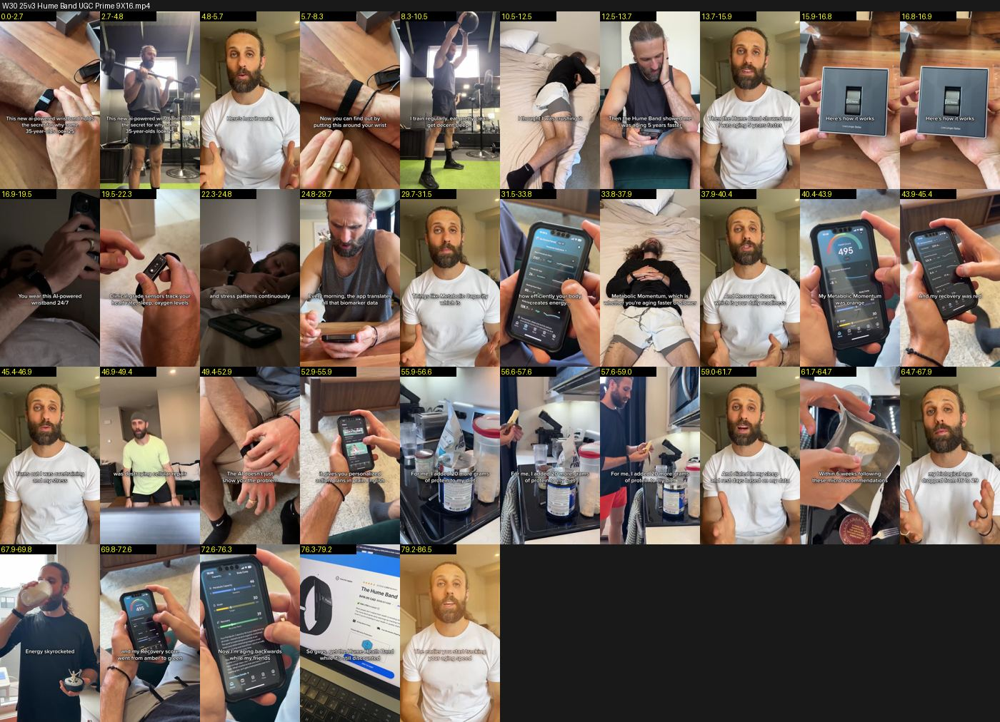

# W30 25v3 Hume Band UGC Prime 9X16.mp4

Master: `W30 25v3 Hume Band UGC Prime 9X16.mp4` · 86.5s · 720x1280

**Pacing:** 35 shots · avg 2.472s · median 2.533s · 3.93 cuts/10s · first cut 2.7s · 208.0 wpm · talk ratio 0.94 · cuts on word start 79.4% · cuts in speech gaps 88.2%
**Audio:** {'I_lufs': -14.5, 'LRA': 2.8, 'true_peak_db': -0.7} · BPM≈129.2 · music {'speech_rms_db': -18.3, 'pause_seconds': 0.9, 'pause_rms_db': -18.7, 'bed_minus_voice_db': -0.4, 'music_bed_likely': True} · cuts with SFX/transient 52.9%

**Captions:** 197 cards · 1 words/card (median) · y≈0.587 of frame height · text height≈0.0304 · colours {'white': 167, 'red': 18, 'blue': 4, 'dark/other': 8} · cards crossing a cut: 11
Highlighted: Clinical-grade sensorstrack your, heart rate, sleep,oxygen levels, Metabolle Indicators, how efficiently your body, creates energy..., how.efficiently your body, 495, And my recovery was red, But here's the game-changer, show you the problem, it gives you personalized, PURCHASESUPPORTS, Caidoadau, PURCHASEBU, and myRecovery score
**Headlines:** 10:456 (32.0–32.0s, blue) | NoDevicePaired (32.0–32.0s, blue) | CNoDevicePaired (33.0–33.0s, blue) | BasalMetabolicRate (33.0–33.0s, white) | Thutrition,sleepandactivityadvic (33.0–33.0s, white) | providedbyHumeisfor educationaland (33.0–33.0s, white) | informationalpurposesonlyandshouldnot (33.0–33.0s, white) | becongtruedasasubstitutefor (33.0–33.0s, white)

**Hook (0–3s) spoken:** This new AI -powered wristband holds the secret for why some 35
**Hook on-screen:** 35-year-oldslook25 / This new ai-powered wristband holds / the secretforwhy some
**CTA (last 5s):** required. The earlier you start tracking your aging speed, the longer you stay in your prime. · on-screen: 10:62 / 17.40 / 201.6 / 209.4bs / 23.7 / ENoDeicePaired / GoarWeigt / HSA/FSAeligible, / Saandad / Standard / The earlier you start tracking / no subscription required

## Beat sheet

| # | in–out (s) | dur | transition | spoken | on-screen text |
|---|---|---|---|---|---|
| 1 | 0.00–2.70 | 2.7 |  | This new AI -powered wristband holds the secret for why some | This new ai-powered wristband holds / the secretforwhy some / 35-year-oldslook25 |
| 2 | 2.70–4.77 | 2.07 | cut +SFX hit | 35 year old look 25. | This new ai-powered wristband holds / the secretforwhy some / 35-year-oldslook25 |
| 3 | 4.77–5.67 | 0.9 | cut | Here's how it works. | This new ai-powered wristband holds / the secretforwhy some / 35-year-oldslook25 / Here's how it works / Now you can find out by / putting this around your wrist |
| 4 | 5.67–8.33 | 2.67 | cut +SFX hit | Now you can find out by putting this around your wrist. | Now you can find out by / putting this around your wrist |
| 5 | 8.33–10.50 | 2.17 | cut +SFX hit | I train regularly, eat pretty clean, | Now you can find out by / putting this around your wrist / I train regularly, eat pretty clean, / getdecentsleep.. / getdecent sleep... |
| 6 | 10.50–12.50 | 2.0 | cut | get decent sleep. I thought I was crushing it. | I train regularly, eat pretty clean, / getdecent sleep... / I thought I was crushing it |
| 7 | 12.50–13.70 | 1.2 | cut | Then the human band showed me I was | Then the Hume Band showed me / Iwas aging5yearsfaster |
| 8 | 13.70–15.90 | 2.2 | cut +SFX hit | aging five years faster than I should be. | Then the Hume Band showed me / Iwas aging5yearsfaster / than I should be |
| 9 | 15.90–16.80 | 0.9 | cut | Here's how it works. | XHume / Here's how it works / LiveLonger.Better. |
| 10 | 16.80–16.90 | 0.1 | cut +SFX hit |  |  |
| 11 | 16.90–19.47 | 2.57 | cut | You wear this AI -powered wristband 24 -7. | You wearthis Al-powered / wristband24/7 |
| 12 | 19.47–22.27 | 2.8 | cut | Clinical grade sensors track your heart rate, sleep, | You wearthis Al-powered / wristband24/7 / Clinical-grade sensorstrack your [red] / heart rate, sleep,oxygen levels [red] |
| 13 | 22.27–24.80 | 2.53 | cut | oxygen levels and stress patterns continuously. | Clinical-grade sensorstrack your [red] / heart rate, sleep,oxygen levels [red] / and stress patterns continuously |
| 14 | 24.80–29.70 | 4.9 | cut | Every morning the app translates all that biomarker data in the easy to understand scores. | Every morning, the app translates / all thatbiomarkerdata / into easy-to-understand scores |
| 15 | 29.70–31.53 | 1.83 | cut +SFX hit | Things like metabolic capacity, which is | Things like Metabolic Capacity / whichis |
| 16 | 31.53–33.77 | 2.23 | cut +SFX hit | how efficiently your body creates energy. | 10:456 [blue] (HEADLINE) / NoDevicePaired [blue] (HEADLINE) / Metabolle Indicators [blue] / BasalMetabolic Rate / 2157ca+ / High |
| 17 | 33.77–37.90 | 4.13 | cut | Metabolic momentum, which is whether you're aging faster or slower than you should be. | Metabolic Momentum, which is / whether you're aging faster or slower |
| 18 | 37.90–40.37 | 2.47 | cut +SFX hit | And recovery score, which is your daily readiness. | And Recovery Score, / which is your daily readiness |
| 19 | 40.37–43.90 | 3.53 | cut +SFX hit | Metabolic momentum was orange, aging five years too fast. | And Recovery Score, / which is your daily readiness / 10:49 [blue] (HEADLINE) / HealthScore [blue] (HEADLINE) / 495 [blue] (HEADLINE) / LMetabolicMomentum |
| 20 | 43.90–45.40 | 1.5 | cut +SFX hit | And my recovery was red. | 10:52 [blue] (HEADLINE) / NoDevicePaired→ [blue] (HEADLINE) / wegn / 201.6 / 23.7 / 209.40m |
| 21 | 45.40–46.87 | 1.47 | cut +SFX hit | Turns out I was overtraining and | 10:52 [blue] (HEADLINE) / And my recovery was red [red] / 8.6 (HEADLINE) / 17.4om / BooyFat Mas / SubcutaneounFatMans |
| 22 | 46.87–49.40 | 2.53 | cut +SFX hit | my stress was destroying cellular repair. | Turns out I was overtraining / andmystress / was destroying cellular repair |
| 23 | 49.40–52.87 | 3.47 | cut +SFX hit | But here's the game changer. The AI doesn't just show you the problem. | was destroying cellular repair / But here's the game-changer [red] / The Al doesn't just / show you the problem [red] |
| 24 | 52.87–55.90 | 3.03 | cut | It gives you personalized action plans in plain English. | MOVEITTOLOS / it gives you personalized [red] / action plans in plain English / MOVEITTOLOSEIT / POWERBEAT21 / Powerbeic21 |
| 25 | 55.90–56.63 | 0.73 | cut | For me, I | For me,Iadded 20 more grams / of protein to my diet |
| 26 | 56.63–57.57 | 0.93 | cut +SFX hit | added 20 more | For me,Iadded 20 more grams / of protein to my diet / PRL |
| 27 | 57.57–59.03 | 1.47 | cut | grams of protein to my diet and | For me,Iadded 20 more grams / of protein to my diet / And dialed in mysleep / and rest days based on my data |
| 28 | 59.03–61.73 | 2.7 | cut +SFX hit | dialed in my sleep and rest days based on my data. | And dialed in mysleep / and rest days based on my data |
| 29 | 61.73–64.70 | 2.97 | cut | Within six weeks of following these micro recommendations, my | Within 6weeks following / these micro-recommendations / PURCHASESUPPORTS [red] / Caidoadau [red] / PURCHASEBU [red] |
| 30 | 64.70–67.90 | 3.2 | cut +SFX hit | biological age dropped from 36 to 29. | my biological age / dropped from 36to 29 |
| 31 | 67.90–69.83 | 1.93 | cut | My energy skyrocketed and | Energyskyrocketed |
| 32 | 69.83–72.63 | 2.8 | cut +SFX hit | my recovery score went from amber to green. | 495 [blue] (HEADLINE) / and myRecovery score [red] / went from amberto green [red] / 495 [blue] |
| 33 | 72.63–76.27 | 3.63 | cut +SFX hit | Now I'm aging backwards while my friends burn out without even knowing it. | BodyComp (HEADLINE) / 10:48 [blue] (HEADLINE) / Capacity (HEADLINE) / MetabolicCapacity (HEADLINE) / Baseline (HEADLINE) / 30 (HEADLINE) |
| 34 | 76.27–79.17 | 2.9 | cut | So guys, get the Hume Health Band while it's still discounted. | BodyComp (HEADLINE) / 10:48 [blue] (HEADLINE) / Capacity (HEADLINE) / MetabolicCapacity (HEADLINE) / RecoveryNeed / all strain-beneficial andnegativecombined. (HEADLINE) |
| 35 | 79.17–86.53 | 7.36 | cut | HSA, FSA eligible. No subscription required. The earlier you start tracking your aging speed, the longer you stay in your prime. | 10:52 [blue] (HEADLINE) / EgNoDevicePared [blue] (HEADLINE) / MetaboicAge (HEADLINE) / Macie Mass / RigntAem / 9.7 |

## Full transcript

This new AI-powered wristband holds the secret for why some 35 year old look 25. Here's how it works. Now you can find out by putting this around your wrist. I train regularly, eat pretty clean, get decent sleep. I thought I was crushing it. Then the human band showed me I was aging five years faster than I should be. Here's how it works. You wear this AI-powered wristband 24-7. Clinical grade sensors track your heart rate, sleep, oxygen levels and stress patterns continuously. Every morning the app translates all that biomarker data in the easy to understand scores. Things like metabolic capacity, which is how efficiently your body creates energy. Metabolic momentum, which is whether you're aging faster or slower than you should be. And recovery score, which is your daily readiness. Metabolic momentum was orange, aging five years too fast. And my recovery was red. Turns out I was overtraining and my stress was destroying cellular repair. But here's the game changer. The AI doesn't just show you the problem. It gives you personalized action plans in plain English. For me, I added 20 more grams of protein to my diet and dialed in my sleep and rest days based on my data. Within six weeks of following these micro recommendations, my biological age dropped from 36 to 29. My energy skyrocketed and my recovery score went from amber to green. Now I'm aging backwards while my friends burn out without even knowing it. So guys, get the Hume Health Band while it's still discounted. HSA, FSA eligible. No subscription required. The earlier you start tracking your aging speed, the longer you stay in your prime.