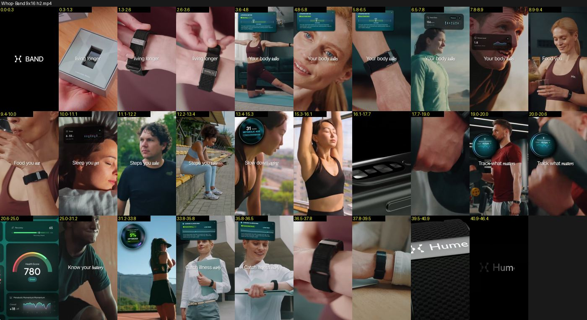

# Whop- Band 9x16 h2.mp4

Master: `Whop- Band 9x16 h2.mp4` · 46.4s · 720x1280

**Pacing:** 29 shots · avg 1.599s · median 1.2s · 6.04 cuts/10s · first cut 0.3s · 195.0 wpm · talk ratio 0.84 · cuts on word start 82.1% · cuts in speech gaps 60.7%
**Audio:** {'I_lufs': -14.1, 'LRA': 2.4, 'true_peak_db': -0.5} · BPM≈117.5 · music {'speech_rms_db': -16.4, 'pause_seconds': 3.4, 'pause_rms_db': -16.3, 'bed_minus_voice_db': 0.1, 'music_bed_likely': True} · cuts with SFX/transient 71.4%

**Captions:** 51 cards · 1 words/card (median) · y≈0.519 of frame height · text height≈0.0328 · colours {'white': 31, 'dark/other': 17, 'red': 1, 'green': 2} · cards crossing a cut: 3
Highlighted: Slow down aging, Great, Gre
**Headlines:** alth (0.5–0.5s, white) | Better (0.5–0.5s, white) | Live Longer.Befer (1.0–1.0s, white) | XHume (1.5–1.5s, white) | HeartRate (7.0–7.0s, white) | Measure (7.0–7.0s, dark/other) | 156bpm (7.0–7.0s, white) | Last:[lun10] (7.0–7.0s, dark/other)

**Hook (0–3s) spoken:** Living longer and healthier is now possible with the Hume
**Hook on-screen:** BAND / Better / Live Longer.Befer / XHume / alth / living longer
**CTA (last 5s):** future. In your hands. · on-screen: Hume / Humehealth.com / In your hands. / X Hume / X HumeHealth / hands.

## Beat sheet

| # | in–out (s) | dur | transition | spoken | on-screen text |
|---|---|---|---|---|---|
| 1 | 0.00–0.30 | 0.3 |  | Living | BAND |
| 2 | 0.30–1.30 | 1.0 | cut +SFX hit | longer and healthier | BAND / alth (HEADLINE) / Better (HEADLINE) / living longer / XHume / Live Longer.Befer (HEADLINE) |
| 3 | 1.30–2.57 | 1.27 | cut +SFX hit | is now possible with | living longer / XHume / Live Longer.Befer (HEADLINE) / XHume (HEADLINE) / XHume |
| 4 | 2.57–3.60 | 1.03 | cut +SFX hit | the Hume Band. | living longer / XHume / Your |
| 5 | 3.60–4.83 | 1.23 | cut +SFX hit | Every day, your body | Your / Your body talks |
| 6 | 4.83–5.83 | 1.0 | cut | is giving you signals, | Your body talks |
| 7 | 5.83–6.47 | 0.63 | cut +SFX hit |  | Your body talks |
| 8 | 6.47–7.77 | 1.3 | cut +SFX hit | subtle clues about your | Your body talks / HeartRate (HEADLINE) / Measure (HEADLINE) / 156bpm (HEADLINE) / Last:[lun10] (HEADLINE) |
| 9 | 7.77–8.93 | 1.17 | cut +SFX hit | future health, | Your body talks / StressLevel (HEADLINE) / 1.8 (HEADLINE) / Last:[Date_Here] |
| 10 | 8.93–9.43 | 0.5 | cut +SFX hit | the food you | Food you / Me. |
| 11 | 9.43–9.97 | 0.53 | cut +SFX hit | eat, | Food you / Me. |
| 12 | 9.97–11.13 | 1.17 | cut +SFX hit | the sleep you get, | 心Sleep (HEADLINE) / 6h55m (HEADLINE) / Last:[Jun 10] (HEADLINE) / Sleep you / Steps |
| 13 | 11.13–12.23 | 1.1 | cut +SFX hit | the steps you take, | Steps / Steps you take |
| 14 | 12.23–13.43 | 1.2 | cut | they all add up. | Steps you take |
| 15 | 13.43–15.30 | 1.87 | cut +SFX hit | You're either slowing aging or accelerating | Steps you take / 31 (HEADLINE) / YEARS (HEADLINE) / METABOLICAGE [blue] (HEADLINE) / -7 Years vs,Chronological Age [blue] (HEADLINE) / Slow down aging [red] |
| 16 | 15.30–16.10 | 0.8 | cut +SFX hit | it. | YEARS (HEADLINE) / METABOLICAGE [blue] (HEADLINE) / Slow down aging [red] / 34 (HEADLINE) |
| 17 | 16.10–17.70 | 1.6 | cut +SFX hit | The all -new Hume Band is |  |
| 18 | 17.70–18.97 | 1.27 | cut +SFX hit | the only wearable that tracks |  |
| 19 | 18.97–19.97 | 1.0 | cut | your metabolic momentum, | MetabolicMomentum (HEADLINE) / +5.2yrs [blue] (HEADLINE) / Track-what matters |
| 20 | 19.97–20.57 | 0.6 | cut +SFX hit |  | MetabolicMomentum (HEADLINE) / +5.2yrs [blue] (HEADLINE) / Track what matters |
| 21 | 20.57–25.03 | 4.47 | cut +SFX hit | a powerful new metric that shows you which way your health is truly heading. | 65 (HEADLINE) / Recovery (HEADLINE) / RecoveryNeed (HEADLINE) / HealthScore / 780 (HEADLINE) / Great [green] |
| 22 | 25.03–31.20 | 6.17 | cut +SFX hit | It also tracks your metabolic capacity, which is your body's internal battery that slows as you age. | 29% [yellow] (HEADLINE) / 100 (HEADLINE) / Know yourbattery / 75% [yellow] (HEADLINE) |
| 23 | 31.20–33.80 | 2.6 | cut +SFX hit | Feel younger. Move with energy again. | 39% [green] (HEADLINE) / OPTIMIZED (HEADLINE) |
| 24 | 33.80–35.77 | 1.97 | cut | Easily detect early signs of chronic | CHRONICILLNESSRISK (HEADLINE) / LOWRISK (HEADLINE) / You'redoingbetterthan 80%ofpeopleyourage,Your (HEADLINE) / chronicilness risk is low-keep it that way.Small daily (HEADLINE) / habits areyourstrongestshield (HEADLINE) / Catch illness early |
| 25 | 35.77–36.50 | 0.73 | cut | illness, | LOWRISK (HEADLINE) / Catch illness early / CHRONICILLNESSRISK (HEADLINE) / You'redoingbetterthan80%ofpeopleyourage.Your (HEADLINE) / chronicillness risk is low-keep it that way. Small daily (HEADLINE) / habits are yourstrongest shield (HEADLINE) |
| 26 | 36.50–37.80 | 1.3 | cut | so you never have to worry about |  |
| 27 | 37.80–39.47 | 1.67 | cut +SFX hit | it being too late anymore. |  |
| 28 | 39.47–40.87 | 1.4 | cut | Hume band. Your health. | Hume (HEADLINE) |
| 29 | 40.87–46.38 | 5.51 | cut | Your future. In your hands. | future. (HEADLINE) / X Hume (HEADLINE) / hands. / In your hands. / Hume (HEADLINE) / X HumeHealth |

## Full transcript

Living longer and healthier is now possible with the Hume Band. Every day, your body is giving you signals, subtle clues about your future health, the food you eat, the sleep you get, the steps you take, they all add up. You're either slowing aging or accelerating it. The all-new Hume Band is the only wearable that tracks your metabolic momentum, a powerful new metric that shows you which way your health is truly heading. It also tracks your metabolic capacity, which is your body's internal battery that slows as you age. Feel younger. Move with energy again. Easily detect early signs of chronic illness, so you never have to worry about it being too late anymore. Hume band. Your health. Your future. In your hands.