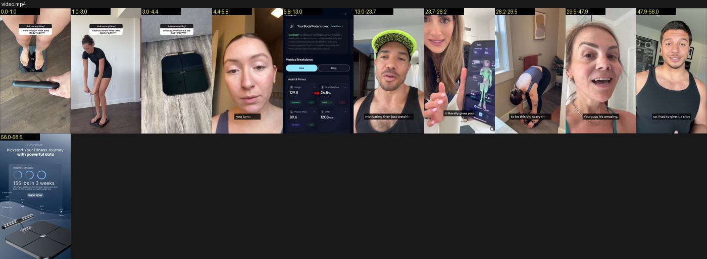

# video.mp4

Master: `video.mp4` · 58.5s · 720x1280

**Pacing:** 11 shots · avg 5.317s · median 2.455s · 1.71 cuts/10s · first cut 1.033s · 217.0 wpm · talk ratio 0.88 · cuts on word start 80.0% · cuts in speech gaps 90.0%
**Audio:** {'I_lufs': -14.6, 'LRA': 6.3, 'true_peak_db': -0.5} · BPM≈112.3 · music {'speech_rms_db': -20.3, 'pause_seconds': 4.0, 'pause_rms_db': -24.0, 'bed_minus_voice_db': -3.7, 'music_bed_likely': True} · cuts with SFX/transient 60.0%

**Captions:** 109 cards · 1 words/card (median) · y≈0.817 of frame height · text height≈0.0258 · colours {'white': 98, 'dark/other': 5, 'green': 4, 'blue': 1, 'other-colour': 1} · cards crossing a cut: 0
Highlighted: Good, Excellent, Standard, Good, Younger, Medium
**Headlines:** Askmeanything! (0.0–4.0s, white) | Iwanttoknowwhat'sthe (0.5–0.5s, white) | Iwanttoknowwhat'sthe (3.0–4.0s, white) | BodyPod???? (3.0–3.0s, white) | Insights (9.0–9.0s, white) | YourBodyWaterlsLow (9.0–9.0s, white) | Congrats!Yourbodyfathasdropped2%inthepast4 (9.0–9.0s, dark/other) | weeksthiscanbeattnibutedtoimprovedactivityand (9.0–9.0s, dark/other)

**Hook (0–3s) spoken:** The body pod. It's insane. It's so good. Let
**Hook on-screen:** Askmeanything! / Iwanttoknowwhat'sthe
**CTA (last 5s):** So get it and try it because it's awesome. · on-screen: %BodyFat (%) / 155Ibsin3weeks / KickstartYourFitness Journey / KickstartYourFitnessJo / SHOPNOW / Weight Loss Progress / XHumeHealth / and try / cause it'sawesome / withpowerfuldata

## Beat sheet

| # | in–out (s) | dur | transition | spoken | on-screen text |
|---|---|---|---|---|---|
| 1 | 0.00–1.03 | 1.03 |  | The body pod. | Askmeanything! (HEADLINE) / Iwanttoknowwhat'sthe (HEADLINE) |
| 2 | 1.03–3.03 | 2.0 | cut +SFX hit | It's insane. It's so good. Let | Askmeanything! (HEADLINE) / Iwanttoknowwhat'sthe (HEADLINE) / BodyPod???? (HEADLINE) |
| 3 | 3.03–4.37 | 1.33 | cut +SFX hit | me tell you about it. | Askmeanything! (HEADLINE) / Iwanttoknowwhat'sthe (HEADLINE) / BodyPod???? (HEADLINE) / XHume |
| 4 | 4.37–5.77 | 1.4 | cut +SFX hit | Okay so anytime you jump on it, | Askmeanything! (HEADLINE) / Iwanttoknowwhat'sthe (HEADLINE) / XHume / Ok so anytime / you jump / you jump on it, |
| 5 | 5.77–12.97 | 7.2 | cut | it sends an electric current through your entire body. It shows your body fat, how much body water you have, your bone mass, protein rate. | you jump on it, / itsendsanelectriccurrent / through yo / through your entire body. / Insights (HEADLINE) / YourBodyWaterlsLow (HEADLINE) |
| 6 | 12.97–23.73 | 10.77 | cut +SFX hit | I've literally seen my muscle mass increase and my fat percentage drop and that's much more motivating than just watching the sale. The app is easy to use and it's been very helpful in keeping me motivated. | I've literally se / my musclemass increase / and / and my fat % drop / and that's much more / motivating than just watching |
| 7 | 23.73–26.17 | 2.43 | cut | It literally gives you an entire map of your body. | It literallygivesyou / 11:26 (HEADLINE) / Height (HEADLINE) / 5'4" (HEADLINE) / 4.9bs / TunikMuncleMuns |
| 8 | 26.17–29.53 | 3.37 | cut +SFX hit | Weighing myself doesn't have to be this big scary thing. And with BodyPod, I | Weighing / Weighing myself doesn't have / to be this big scary thing, / With Body pod, |
| 9 | 29.53–47.93 | 18.4 | cut | can focus on if I am healthy or am I not. It's very comparable to those in -body machines, those super expensive machines that you see at gyms. You guys, it's amazing. And it's 98 % as accurate as the in -body scans, which you can only get done at a gym. | I can focus on if / IamhealthyoramInot / It'sverycomparable / to those in body machines / thosesuperexpensivemachines / that you see at gyms |
| 10 | 47.93–56.03 | 8.1 | cut +SFX hit | I've seen so many fitness coaches using this. So I had to give it a shot. Love it. So get it and try it because it's awesome. | I'veseensomanyfitness / I'veseensomanyfitnesscoaches / soI had to give it a sh / so I had to give it a shot / I love it / and try |
| 11 | 56.03–58.49 | 2.45 | cut |  | KickstartYourFitnessJo (HEADLINE) / Weight Loss Progress (HEADLINE) / 155Ibsin3weeks / %BodyFat (%) / XHumeHealth (HEADLINE) / KickstartYourFitness Journey (HEADLINE) |

## Full transcript

The body pod. It's insane. It's so good. Let me tell you about it. Okay so anytime you jump on it, it sends an electric current through your entire body. It shows your body fat, how much body water you have, your bone mass, protein rate. I've literally seen my muscle mass increase and my fat percentage drop and that's much more motivating than just watching the sale. The app is easy to use and it's been very helpful in keeping me motivated. It literally gives you an entire map of your body. Weighing myself doesn't have to be this big scary thing. And with BodyPod, I can focus on if I am healthy or am I not. It's very comparable to those in-body machines, those super expensive machines that you see at gyms. You guys, it's amazing. And it's 98% as accurate as the in-body scans, which you can only get done at a gym. I've seen so many fitness coaches using this. So I had to give it a shot. Love it. So get it and try it because it's awesome.