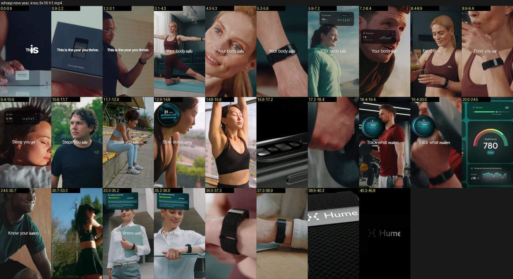

# whoop new year, kreo, 9x16 h1.mp4

Master: `whoop new year, kreo, 9x16 h1.mp4` · 45.8s · 720x1280

**Pacing:** 28 shots · avg 1.637s · median 1.216s · 5.89 cuts/10s · first cut 0.933s · 200.0 wpm · talk ratio 0.82 · cuts on word start 77.8% · cuts in speech gaps 63.0%
**Audio:** {'I_lufs': -14.1, 'LRA': 2.7, 'true_peak_db': -0.8} · BPM≈123.0 · music {'speech_rms_db': -17.1, 'pause_seconds': 3.3, 'pause_rms_db': -19.5, 'bed_minus_voice_db': -2.4, 'music_bed_likely': True} · cuts with SFX/transient 66.7%

**Captions:** 60 cards · 1.0 words/card (median) · y≈0.568 of frame height · text height≈0.0293 · colours {'white': 32, 'dark/other': 25, 'red': 1, 'green': 2} · cards crossing a cut: 4
Highlighted: Sleep you get, Great, Good
**Headlines:** is (0.0–0.0s, white) | HeartRate (6.0–6.0s, white) | Measure (6.0–6.0s, dark/other) | 156bpm (6.0–6.0s, white) | Last:[Jun10] (6.0–6.0s, dark/other) | 心Sleep (10.0–10.0s, white) | 6h55m (10.0–10.0s, white) | Last: [Jun 10] (10.0–10.0s, dark/other)

**Hook (0–3s) spoken:** This is the year you don't just survive, you thrive.
**Hook on-screen:** HumeHealth / LiveLonger.Better. / LiveLonger.Botter. / Th / This is the year you thrive. / This is theyear / is
**CTA (last 5s):** future. In your hands. · on-screen: Hume / Humehealth.com / Ir your hands. / X Hume / X HumeHealth / Your future.

## Beat sheet

| # | in–out (s) | dur | transition | spoken | on-screen text |
|---|---|---|---|---|---|
| 1 | 0.00–0.93 | 0.93 |  | This is the year you | is (HEADLINE) / Th / HumeHealth / This is theyear |
| 2 | 0.93–2.20 | 1.27 | cut | don't just survive, | This is theyear / This is the year you thrive. / LiveLonger.Botter. / LiveLonger.Better. |
| 3 | 2.20–3.07 | 0.87 | cut +SFX hit | you thrive. | This is the year you thrive. / Your |
| 4 | 3.07–4.30 | 1.23 | cut +SFX hit | Every day, your body | Your / Your body talks |
| 5 | 4.30–5.30 | 1.0 | cut | is giving you signals, | Your body talks |
| 6 | 5.30–5.93 | 0.63 | cut +SFX hit |  | Your body talks |
| 7 | 5.93–7.23 | 1.3 | cut | subtle clues about your | Your body talks / HeartRate (HEADLINE) / Measure (HEADLINE) / 156bpm (HEADLINE) / Last:[Jun10] (HEADLINE) |
| 8 | 7.23–8.40 | 1.17 | cut | future health, | Your body talks / 1.8 |
| 9 | 8.40–8.90 | 0.5 | cut +SFX hit | the food you | Your body talks / 1.8 |
| 10 | 8.90–9.43 | 0.53 | cut +SFX hit | eat, | Food you eat |
| 11 | 9.43–10.60 | 1.17 | cut +SFX hit | the sleep you get, | Food you eat / 心Sleep (HEADLINE) / 6h55m (HEADLINE) / Last: [Jun 10] (HEADLINE) / Sleep you get [red] |
| 12 | 10.60–11.70 | 1.1 | cut +SFX hit | the steps you take, | Steps you take |
| 13 | 11.70–12.90 | 1.2 | cut | they all add up. | Steps you take |
| 14 | 12.90–14.77 | 1.87 | cut +SFX hit | You're either slowing aging or accelerating | YEARS (HEADLINE) / METABOLICAGE [blue] (HEADLINE) / 7Vearsvs.ChronologicalAge [blue] (HEADLINE) / Slow down / 33 (HEADLINE) / Slow down aging |
| 15 | 14.77–15.57 | 0.8 | cut +SFX hit | it. |  |
| 16 | 15.57–17.17 | 1.6 | cut +SFX hit | The all new Hume Band is |  |
| 17 | 17.17–18.43 | 1.27 | cut +SFX hit | the only wearable that tracks | Track what |
| 18 | 18.43–19.43 | 1.0 | cut +SFX hit | your metabolic momentum, | Track what / +5.2yrs [blue] (HEADLINE) / Trackwhat matters |
| 19 | 19.43–20.03 | 0.6 | cut +SFX hit |  | +5.2yrs [blue] (HEADLINE) / Trackwhat matters / 130 (HEADLINE) / Overall (HEADLINE) / +18 (HEADLINE) / 65 (HEADLINE) |
| 20 | 20.03–24.50 | 4.47 | cut | a powerful new metric that shows you which way your health is truly heading. | 130 (HEADLINE) / Overall (HEADLINE) / +18 (HEADLINE) / 65 (HEADLINE) / PRecovery (HEADLINE) / 85 |
| 21 | 24.50–30.67 | 6.17 | cut +SFX hit | It also tracks your metabolic capacity, which is your body's internal battery that slows as you age. | 100 (HEADLINE) / Know your / 63% [yellow] (HEADLINE) / You havea optimal energyreserves,readytofuel (HEADLINE) / Know your battery / 82% [yellow] (HEADLINE) |
| 22 | 30.67–33.27 | 2.6 | cut +SFX hit | Feel younger. Move with energy again. | METABOLCCAPACITY (HEADLINE) / Energy Level (HEADLINE) / 6% [green] (HEADLINE) / OPTIMIZED (HEADLINE) / 65% [green] (HEADLINE) |
| 23 | 33.27–35.23 | 1.97 | cut | Easily detect early signs of chronic | OPTIMIZED (HEADLINE) / 65% [green] (HEADLINE) / LOWRISK (HEADLINE) / You'redoingbetterthan 80%ofpeople yourage.Your (HEADLINE) / chronic illness risk is low-keep it.that way.Smalldally (HEADLINE) / Catch illness early |
| 24 | 35.23–35.97 | 0.73 | cut | illness, | LOWRISK (HEADLINE) / Catch illness early / CHRONICILLNESSRISK (HEADLINE) / You'redoingbetterthan80%ofpeopieyourage.Your (HEADLINE) / chronic illiness risk islow-keep it that way.Small daily (HEADLINE) / habits are yourstrongest shield (HEADLINE) |
| 25 | 35.97–37.27 | 1.3 | cut +SFX hit | so you never have to worry about |  |
| 26 | 37.27–38.93 | 1.67 | cut +SFX hit | it being too late anymore. |  |
| 27 | 38.93–40.33 | 1.4 | cut +SFX hit | Hume band. Your health. | Hume (HEADLINE) / Your health. |
| 28 | 40.33–45.84 | 5.51 | cut | Your future. In your hands. | Hume (HEADLINE) / Your health. / Your future. / X Hume (HEADLINE) / Ir your hands. / Hume (HEADLINE) |

## Full transcript

This is the year you don't just survive, you thrive. Every day, your body is giving you signals, subtle clues about your future health, the food you eat, the sleep you get, the steps you take, they all add up. You're either slowing aging or accelerating it. The all new Hume Band is the only wearable that tracks your metabolic momentum, a powerful new metric that shows you which way your health is truly heading. It also tracks your metabolic capacity, which is your body's internal battery that slows as you age. Feel younger. Move with energy again. Easily detect early signs of chronic illness, so you never have to worry about it being too late anymore. Hume band. Your health. Your future. In your hands.